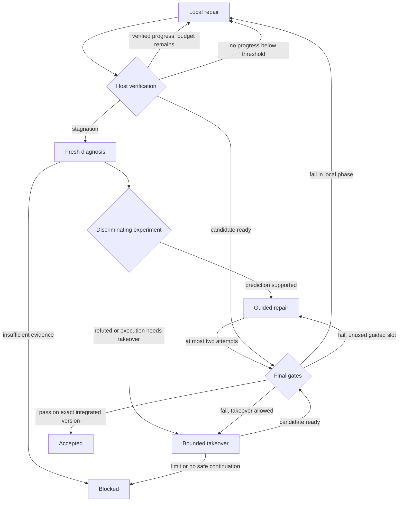

# Loop engineering: диагностическая эскалация между GPT-агентами

**Статус: PROPOSED / design-only. Дата исследования: 2026-11-13.**

Предлагаемая политика ANSA: GPT-6.1 Sol выполняет задачу; после трёх завершённых попыток без проверенного прогресса отдельная свежая сессия GPT-6 Astra исследует причину, предлагает различающий эксперимент и ограниченный план. Исполнитель проверяет гипотезу и продолжает работу. Переходами, разрешениями, счётчиками и завершением управляет код ANSA.

Этот документ специфицирует будущую функцию. Controller, контракты пакетов, события, policy JSON и псевдокод ниже **ещё не являются API или конфигурацией работающего ANSA**. Пара моделей и порог три — гипотеза для eval, не доказанная оптимальная настройка.

## D0. Исходное состояние и место решения

Проверенный repository baseline: [`main@8f37af0`][A-main]. В нём Rust M4 принят, production/default остаётся C++20; следующий migration milestone — M5. Результаты native M4 принадлежат прежнему [отчёту](migration/M4.md), эта работа их не воспроизводила. Текущие ограничения находятся в [PROJECT_STATE](PROJECT_STATE.md), [архитектуре](architecture.md) и [migration plan](RUST_MIGRATION_PLAN.md).

[Draft PR #3][A-orchestration-pr] описывает отдельную native orchestration feature. Используется его [ADR 0002 на фиксированном commit][A-orchestration-adr]: собственные ANSA sessions, direct SIWC, один task owner, один active model child, durable child receipts, worktrees и independent acceptance. Его исторические сведения о M0 не переносятся в текущий baseline. Новый документ можно ревьюить от актуального `main`, пока PR #3 остаётся открытым; отсутствующий в `main` ADR связан абсолютной pinned ссылкой.

Loop engineering расширяет будущую **политику восстановления** Orchestrate. Default implementation sequencing остаётся после verified M10 GO и соответствующих O1–O4 gates. M0–M10 не расширяются. Наличие M4 journal primitives не означает наличие Rust AgentRuntime, task controller или child-session bridge.

Пакет решения:

- Этот документ: evidence, система, состояния, пример, eval и roadmap.
- [ADR 0003](adr/0003-gpt-diagnostic-escalation.md): решение и условия пересмотра.
- [Prompts](LOOP_ENGINEERING_PROMPTS.md): worker, advisor, continuation и отдельный offline implementation handoff.

## D1. Задача и исследовательское основание

Обычный repair loop часто тратит очередную попытку на ту же неверную причинную модель. Передача проблемы диагносту может окупиться, если он найдёт ошибочное предположение и предложит проверку, после которой следующий patch имеет больше шансов пройти acceptance. Новая сессия также может помочь сама по себе; этот эффект нужно отделить от силы другой модели.

### Что дают первоисточники

| Источник | Поддерживаемая идея | Ограничение вывода |
|---|---|---|
| Olausson et al., ICLR 2024, *Is Self-Repair a Silver Bullet for Code Generation?* [R1] | Разделение feedback generator и repair model; более сильный критик улучшал исследованные конфигурации self-repair. | HumanEval/APPS и более старые модели; не проверка Sol/Astra, больших репозиториев или порога три. |
| Shinn et al., NeurIPS 2023, *Reflexion* [R2] | Внешний сигнал, короткая рефлексия и память о неудачах могут направлять следующую попытку. | Обновляется контекст, не веса; собственные тесты и самооценки могут ошибаться. |
| Tyen et al., Findings ACL 2024 [R3] | Локализация ошибки и исправление — разные способности; корректное указание места ошибки помогает исправителю. | Reasoning-задачи; правильность локализации произвольным advisor не гарантируется. |
| Huang et al., ICLR 2024 [R4] | Самопересмотр без новой внешней информации не обеспечивает устойчивое улучшение; нужен fair compute baseline. | Не запрет современным моделям исправлять код с тестами и tools. |
| Zhou et al., ICML 2024, *LATS* [R5] | Полезно исследовать другую траекторию и возвращаться к сохранённому состоянию. | Дополнительный поиск стоит ресурсов; не доказательство экономии конкретного escalation profile. |

**Наш вывод:** диагностическая эскалация заслуживает пилота. Контролируемых данных, доказывающих пользу именно «три неудачи Sol → Astra → Sol» в ANSA, в этом исследовании не получено. Таблица benchmark-score отдельной модели такого доказательства не заменяет. Термин loop engineering используется как название проектируемой политики, без заявления об изобретении нового класса методов.

### Проверяемая гипотеза

На одинаковом зафиксированном тупике сильный диагност увеличивает вероятность принятого решения в оставшемся бюджете по сравнению с продолжением worker, свежим worker и отдельным диагностом той же модели. Весь pipeline должен также сравниваться с сильной моделью с самого начала: первые три провала уже израсходовали ресурсы.

## D2. Архитектура и роли

| Компонент | Ответственность | Что не входит в полномочия |
|---|---|---|
| `LoopController` — предлагаемый Rust domain module | Сериализованный task reducer, policy, phase, budgets, child lifecycle и acceptance | Самостоятельный второй generate/tools/continue loop |
| Worker — native `basic` child | Исследовать, предложить гипотезу, изменить owned worktree, выполнить разрешённые проверки | Менять frozen criteria, policy, root counters или credentials |
| `VerificationRunner` — host code | Выполнить разрешённый manifest, сохранить actual outcomes, сравнить кандидатов | Принимать текст модели за результат команды |
| Diagnostic advisor — fresh native `plan` child | Читать snapshot/evidence, найти неверное предположение, предложить эксперимент | Писать production patch, запускать произвольный shell, принимать задачу |
| Final reviewer — отдельный fresh child Orchestrate | Проверить конечный diff по исходной задаче и evidence | Считать прежний diagnostic advice финальным review |

Сессии композируют тот же будущий Rust AgentRuntime и собственный SIWC adapter. У каждого child отдельные session journal, context epoch и immutable ToolSnapshot. Auth subsystem общая; сохраняются существующие operation-scoped leases. Вызов advisor не выполняется как вложенный model call под удерживаемым worker tool/auth lease. Root выдаёт dispatch permit до auth admission, не ждёт child под auth lock.

В MVP последовательно работает **один model child и максимум один writer**. Advisory role не получает delegation tool. Смена роли создаёт новую сессию; новый модельный binding не подставляется в continuation прежней сессии. Codex остаётся внешним инструментом разработки; SDK, app-server и внешний coding CLI не являются execution backend. Это сохраняет принятое native-only решение [A-orchestration-adr].

### GPT-пример

| Роль | Предлагаемый model ID | Начальный effort | Зачем |
|---|---|---|---|
| Worker | `gpt-6.1-sol` | `medium` | Основные ограниченные repair attempts |
| Diagnostic advisor | `gpt-6-astra` | `high` | Отдельное исследование причин застоя |
| Optional takeover | `gpt-6-astra` | `high` | До двух write attempts, если profile допускает takeover |
| Контрольный advisor в eval | `gpt-6.1-sol` | `medium` | Отделить отдельную роль и свежий контекст от силы модели |

ID и указанные effort опубликованы в model cards [O1][O2]. Их наличие не гарантирует доступ конкретного SIWC аккаунта или выигрыш данной пары. Alias/model revision, requested/returned model, effort, account-binding reference и capability outcome фиксируются для каждого запуска. `ultra` в этот пример не включён.

### Direct SIWC boundary

Собственный adapter использует разрешённый direct Responses route. Inference docs описывают публичный endpoint, account-scoped model discovery и terminal success [O3]. На admission проверяются активный профиль, grant, model slug и параметры; отсутствие `chatgpt.tokens.use.direct`, недоступная модель и quota error дают именованный blocker [O5]. Каталог — предварительное свидетельство, фактический ответ всё ещё может быть отклонён.

Для HTTP SIWC нужны `store:false`, `stream:true` и необходимый контекст в `input`. Этот маршрут не принимает `multi_agent`, `max_output_tokens`, `max_tool_calls`, `background`, `conversation` и HTTP `previous_response_id`; инструкции передаются поддерживаемым способом [O4]. Поэтому counter, advisor protocol и continuation orchestration принадлежат ANSA. Псевдопараметры policy ниже не отправляются как поля Responses.

Schema-valid текст остаётся предложением. Не предполагать поддержку structured output без проверки конкретного маршрута. Для первого адаптера достаточно bounded text/JSON и строгого локального validator; максимум одна corrective generation внутри той же diagnosis и общего request budget. Partial SSE/preview не является готовым отчётом: требуется полный native admission и durable child result.

## D3. Что считается loop и прогрессом

### Единица учёта

**Repair attempt** — одна host-assigned `AttemptId`: зафиксированная исходная версия → гипотеза и ограниченный patch → frozen candidate → результат host verification. Первый candidate тоже attempt. Baseline verification до редактирования не является attempt. Несколько чтений, HTTP rounds, test commands и Resume внутри одного attempt не превращаются в несколько repair attempts.

Root резервирует слот attempt **до** запуска writer. Слот считается израсходованным при запуске и не возвращается после crash, cancel или inconclusive verification. Счётчик no-progress изменяется лишь после классифицированного результата. Повторная доставка того же receipt не расходует слот повторно. `RequestId` сохраняет значение identity accepted Submit/turn в пределах SessionId; это не AttemptId и не ID каждого HTTP exchange.

### Детерминированное определение прогресса

Перед работой host замораживает `AcceptanceManifest`: обязательные goal checks и protected regression checks с устойчивыми ID, commands, expected inventory, условиями skip, значимым environment и policy изменения тестов. Existing tests нельзя удалять или ослаблять ради PASS. Новые regression tests разрешены в scope; замена acceptance manifest требует отдельного явного изменения task contract и делает прошлые сравнения несопоставимыми.

Для MVP прогресс означает строгий рост множества подтверждённых passed criteria относительно **лучшего принятого checkpoint**, при сохранении всех уже passed criteria, protected checks и hard constraints. Меньше failed tests при потере ранее зелёной проверки — не прогресс. Unknown/skipped/missing required check не считается passed. Для недискретной задачи нужен заранее определённый объективный evaluator; если его нет, автоматический reset streak отключён.

Хранится high-water checkpoint. Возврат A→B→A не сбрасывает streak повторным открытием уже достигнутого состояния. Новый diff, другая гипотеза, меньший лог, уверенность модели и диагностическая информация отдельно сохраняются, но не являются verified progress. Даже полезный прогресс не возвращает потраченные attempts, calls или время.

| Наблюдение host | No-progress streak | Остальные действия |
|---|---|---|
| Полный сопоставимый verification, критерии не улучшены | +1 | Сохранить failure fingerprint и facts |
| Product regression при сопоставимой проверке | +1 | Candidate не становится лучшим checkpoint |
| Строгое улучшение по frozen evaluator | 0 | Продвинуть high-water checkpoint; общий бюджет прежний |
| Mechanical checks кандидата прошли | Пока без изменения | Перейти к independent/final acceptance того же attempt |
| Infra failure либо inconclusive | Без изменения | Отдельный retry budget; текущий attempt slot уже потрачен |
| Повторный receipt того же verification | Без изменения | Идемпотентный import |
| Contract violation или неизвестный effect | Без изменения | Остановить dispatch; `BlockedPolicy` или reconciliation |
| Только новый текст/контекст/advice | Без изменения | Сохранить observation, не улучшение |

Classifier использует observed exit/status, runner diagnostics и manifest, а не заверение worker. Assertion failure и воспроизводимый product crash — product failure. Timeout продуктового теста с фиксированным deadline может быть product failure; недоступный runner, auth/429/503 — infrastructure. Если причину отделить нельзя, результат inconclusive, а не произвольно выбранный FAIL/PASS. Infra retries не позволяют бесконечно удерживать живой run. Blocking review finding должен ссылаться на нарушение исходного contract и evidence; host проверяет binding и применимость finding. Подтверждённый blocking finding запрещает progress/acceptance, а неподтверждённый существенный риск оставляет результат inconclusive до bounded проверки. Необязательное пожелание reviewer не меняет manifest.

### Триггеры

Основной триггер — `no_progress_streak >= 3` в local phase. Optional early trigger — повторная пара `(candidate_digest, failure_fingerprint)` или подтверждённый цикл между двумя уже проверенными кандидатами, при отсутствии нового high-water checkpoint. Fingerprint включает check ID, failure class и нормализованный значимый stack/error, но хранит ссылки на raw logs. Нормализация имеет версию; одно совпадение текста ошибки само по себе не доказывает общий root cause.

Scope/permission breach и unknown effects не отправляются на обычную diagnosis, обходящую recovery. Они блокируют execution. Порог три — стартовый параметр eval, а не модельная эвристика, скрытая в prompt.

## D4. Ограниченная машина состояний



Диаграмма показывает смысл переходов; таблица guards ниже определяет допустимость. Во всех состояниях Cancel/deadline/budget закрывают новые permits. Любой возврат к repair требует свободного общего и фазового слота. Неиспользованная diagnosis запускается из final failure через тот же classifier/threshold; уже использованная не создаётся снова. Final acceptance failure учитывается один раз в итоговой оценке соответствующего candidate/attempt; механический PASS сам по себе ещё не закрывает attempt как успешный.

| Phase | Разрешённое продолжение |
|---|---|
| `Local` | Следующий attempt при наличии budget; на stagnation — единственная diagnosis. Final-review finding даёт no-progress и остаётся в этой фазе до trigger. |
| `DiagnosisPending / Diagnosing` | Один `EscalationId` и fresh plan child; повтор import/ACK не создаёт второго advisor. |
| `Experiment` | Один разрешённый discriminating experiment на snapshot. Supported → Guided; refuted → bounded Takeover либо Blocked. Inconclusive → один infra retry либо Blocked. |
| `Guided` | Максимум два repair slots суммарно после diagnosis, включая attempts с улучшением. Неиспользованный слот доступен для final-review finding. Затем Takeover/Blocked. |
| `Takeover` | Новый basic child сильной модели; максимум два slots, если profile разрешает и хватает общего budget. Повторная diagnosis отсутствует. |
| `FinalVerification` | Frozen candidate, independent review, serial integration и повторная проверка integrated SHA. Finding маршрутизируется по сохранённой исходной phase, не создаёт бесплатный attempt. |
| `Accepted / Blocked / Cancelled` | Новых dispatch нет. Late known outcomes могут только уточнить evidence/usage и потребность в reconciliation. |

Advisor может предложить replan, но не меняет цель и права. В MVP replan означает другой диагностический план в прежнем scope и бюджете; потребность изменить business requirements или разрешённые paths даёт `BlockedRequirements`/`BlockedScope`. Параллельный fork и reviewer-of-reviewer не входят в MVP.

### Пример policy, не поддерживаемый сегодня config

```json
{
  "schema": "ansa.loop_policy.proposed.v1",
  "profile": "gpt_diagnostic_pilot",
  "enabled_by_default": false,
  "worker": {"model": "gpt-6.1-sol", "effort": "medium"},
  "advisor": {"model": "gpt-6-astra", "effort": "high"},
  "stagnation_attempts": 3,
  "early_cycle_trigger": false,
  "max_total_attempts": 7,
  "max_diagnoses": 1,
  "max_diagnostic_experiments": 1,
  "max_guided_attempts": 2,
  "takeover": {"enabled": true, "model": "gpt-6-astra", "effort": "high", "max_attempts": 2},
  "max_active_model_children": 1,
  "max_provider_dispatches": 32,
  "max_tool_dispatches": 96,
  "max_resume_commands": 8,
  "max_verification_runs": 12,
  "max_infra_retries_per_operation": 1,
  "max_infra_retries_total": 4,
  "deadline_seconds": 1800,
  "max_advisor_packet_bytes": 131072,
  "max_advisor_report_bytes": 16384,
  "max_report_repairs": 1,
  "implicit_model_or_billing_fallback": false
}
```

Числа — стартовый bounded pilot profile для одного coding task, не измеренные оптимумы. Фазовые caps не резервируют дополнительные попытки поверх семи: если local phase уже потратила больше трёх slots, поздним фазам остаётся меньше. В task graph лимиты этого task дополнительно ограничены общими монотонными лимитами root run; новый task или child не копирует себе root allowance. Все model requests, compact, corrective generation, transport retries, reviewer и takeover входят в root ledger. Каждый фактический provider dispatch расходует permit, включая повтор того же logical request; исчерпание любого hard dispatch cap прекращает новые вызовы.

До новой работы оставляется reserve для required final gates; иначе остановка с partial candidate. SIWC не даёт используемого здесь provider output-token cap [O4]. Byte caps, cancellation и request count ограничивают локальные ресурсы и будущий dispatch, но не обещают точный верхний предел оплаченного in-flight output. Unknown usage остаётся unknown с консервативным резервом, не нулём. Monotonic budget state переживает Resume, новую session и process restart; deadline не начинается заново при запуске процесса. Если время после restart нельзя достоверно восстановить, run приостанавливается.

Подписка не создаёт отдельный allowance для advisor; usage приложения входит в существующие лимиты [O6]. В этом дизайне нет paid API alternate, а API price не выдаётся за фактическую стоимость subscription-run. Для pilot измеряются реальные доступные usage/credits, requests, wall time и quota rejection; недоступные показатели явно помечаются unknown.

## D5. Контракты evidence и advice

Все нижеуказанные типы — проектируемые domain records отдельного orchestration namespace. Они не добавляются в strict session v1. Model text не получает constructor для authoritative records.

### Snapshot и пакет advisor

Перед diagnosis host закрывает writer permits, завершает/reconciles child и подтверждает cleanup. Затем создаёт immutable candidate inventory. Только commit SHA недостаточен: учитываются actual tracked/untracked relevant bytes, file modes, разрешённые generated inputs, submodule identities при наличии, manifest и environment. Неполный inventory или неизвестный процесс блокируют freeze. Host-created candidate commit в owned branch может быть частью этого snapshot; пользовательская ветка не переписывается.

| Поле `DiagnosticPacket` | Контракт |
|---|---|
| Identity | `RunId`, `TaskId`, `EscalationId`, origin owner epoch, packet schema/version и digest |
| Task | Исходная цель, immutable task/acceptance/policy digest, allowed paths, forbidden effects |
| Snapshot | Base/candidate Git identities, content inventory digest, worktree identity, environment digest, dirty diff/inventory refs |
| Verification | Frozen manifest digest, ordered receipts, actual argv/cwd/toolchain/seed, exits, test ID inventory, required skips, raw log hashes |
| Attempts | Attempt IDs, source/candidate refs, гипотеза, наблюдение, host classification, high-water checkpoint |
| Refuted hypotheses | Evidence-linked опровержения на соответствующих версиях; не вечные универсальные правила |
| Budget | Remaining root/phase permits, absolute deadline и telemetry uncertainty |
| Allowed interaction | Read-only source/evidence access и контракт предлагаемого experiment; нет writer grant |

Host строит пакет из canonical receipts и actual files. Worker summary помечается как интерпретация. Для уменьшения anchoring сначала идут цель, код и ошибки, затем прежние объяснения. В summary помещается ограниченный объём; исходные свидетельства доступны через scoped reads, а не обрезаются так, чтобы исчезла значимая ошибка. Если размер не укладывается, host явно отмечает omitted sections и выдаёт indexed evidence; отсутствующие mandatory fields дают blocker.

Во время diagnosis target snapshot неизменен. Advice связывается с `EscalationId`, packet digest, source digest, manifest, policy и environment. Worker patch после консультации естественно создаёт новый candidate; source его attempt должен совпасть с advice target. Для следующего guided attempt host создаёт явный `GuidanceCarriedForward` record со ссылкой на предыдущий advice, новое evidence и новую source identity. Сохраняются прежние scope/manifest, проверяются указанные preconditions и отсутствие фактов, опровергающих прогноз. Если их актуальность подтвердить нельзя, guided dispatch запрещён. Record не объявляет первоначальное наблюдение автоматически истинным на новой версии. Несовпадение перед первым применением — stale advice, без dispatch.

### Отчёт advisor

Обязательны:

1. Проверенные evidence refs и то, чего установить не удалось.
2. Одна основная причина и до двух альтернатив; отдельно факты и предположения.
3. Ошибочное или неподтверждённое предположение исполнителя.
4. Минимальный эксперимент, различающий причины; ожидаемые наблюдения для подтверждения и опровержения.
5. Ограниченный следующий patch plan, сохраняемые инварианты, required verification.
6. Рекомендация `guided_repair`, `takeover`, `blocked_requirements` либо `insufficient_evidence`.

`ExperimentSpec` содержит цель, snapshot, точный разрешаемый argv/cwd/env allowlist, timeout, ожидаемые outputs и effect classification. Host валидирует scope и native tool policy; текст команды не исполняется автоматически. Произвольный shell нельзя объявить read-only одним полем JSON. Для probe с instrumentation выделяется throwaway experiment workspace с полной effect accounting; production candidate остаётся frozen. Любое изменение принятого candidate требует repair slot и новой проверки.

До dispatch фиксируется `ExperimentEvaluatorSpec`: версия host evaluator, входные поля фактического runner output, predicates для supported/refuted и правила missing/invalid evidence. Advisor может предложить predicates, но host допускает только поддерживаемые типизированные сравнения/проверки, а не произвольный model-generated evaluator code. В retry-примере supported требует одинаковый operation ID, разные pre-serialization keys и совпадение каждого pre-key с соответствующим wire-key; refuted — одинаковые pre-keys при полном валидном trace. Оба predicates истинны, ни один не определён или trace неполон — inconclusive. Свободный текст «гипотеза подтверждена» не меняет outcome. Если проверяемый evaluator невозможно задать, automatic guided dispatch не допускается.

Отчёт ограничен размером; unknown fields/IDs, несуществующие evidence refs, invalid schema и незавершённый response не допускаются. Один форматирующий retry не становится новой бесплатной diagnosis. Если проверка опровергла прогноз, executor не исполняет прежний план как подтверждённый. Сохраняется refutation; дальше разрешён только bounded takeover или blocker. Более сильная модель может ошибаться и может честно вернуть insufficient evidence.

### Минимальные domain events

| Event | Durable смысл |
|---|---|
| `AttemptReserved` | Новый slot, immutable task/source/policy binding и фазовый бюджет до writer dispatch |
| `VerificationObserved` | Промежуточный durable receipt; сам по себе не закрывает attempt и не меняет streak |
| `AttemptEvaluated` | Итог всех требуемых gates этого attempt, classification и однократный reducer update streak/checkpoint/phase |
| `EscalationReserved` | Один diagnostic slot и единственный `EscalationId` для застоя |
| `DiagnosticPacketFrozen` | Зафиксированная версия source/evidence и разрешения advisor |
| `AdviceRecorded` | Полный валидированный результат, provenance и binding; ещё не разрешение на patch |
| `ExperimentRecorded` | Actual outcome, predicted observation match/refutation/inconclusive |
| `GuidanceCarriedForward` | Обновлённая source identity и evidence для оставшегося guided slot |
| `BudgetReserved / UsageReconciled` | Монотонный dispatch ledger и known/unknown consumption |
| `RunAccepted / RunBlocked / RunCancelled` | Terminal control decision с exact final evidence или причиной остановки |

Это не новая копия child history. Root хранит decisions и verified imports; session journal остаётся authority для model/tool history. Raw logs и snapshots — immutable evidence objects, индексы/Markdown/CLI — projections. Digest связывает данные, но не делает их защищёнными от hostile same-UID writer; worktree и ToolSnapshot не являются OS sandbox.

## D6. Durable ordering, recovery и stop

Один root owner держит repository lock и сериализует decisions. Для нового child сохраняются proposed lifecycle rules PR #3: durable child initialization/binding → root submit intent → native Submit → durable receipt → root import [A-orchestration-adr]. `PostStatus::accepted` — queue admission. Native RequestId связывается с root только после durable receipt; root не переписывает первоначальный prompt для добавления поздно полученного ID.

`VerificationObserved` сохраняет отдельные receipts. Mechanical failure с сопоставимым результатом позволяет классифицировать attempt. Mechanical PASS переводит тот же attempt в candidate review/integration/final verification; его успех или failure ещё не публикуются. `AttemptEvaluated` — один итоговый journal record со всеми необходимыми evidence identities. После его fsync reducer атомарно для своей state projection вычисляет streak, best checkpoint, next phase и устойчивую identity следующего pending action, используя `phase_before`. Replay делает это снова из истории, не поверх уже применённого состояния. Между root и child journals общей транзакции нет. Записанный child outcome не теряется, если root import не успел.

Import receipt и completed evaluation имеют разные dedup guards. Совпадающий receipt не append-ится повторно, но **не прекращает** pending evaluation/dispatch reconciliation. Digest conflict блокирует run. После restart root обязан пройти сохранённые pending transitions даже без нового receipt: завершить evaluation после `VerificationObserved`, а после `AttemptEvaluated` восстановить ещё не записанный next-action intent. Idempotent reservation использует durable action identity; повтор не создаёт новый slot, EscalationId или Submit. Текущая phase не заменяет сохранённую `phase_before` при вычислении ещё не завершённого перехода.

После третьего failure сначала фиксируется следующий phase, затем `EscalationReserved` и child submit intent. Crash до dispatch восстанавливает тот же incident; crash после acceptance не запускает второго advisor вслепую. Recovery открывает original store (`OpenExisting` в proposed bridge), сверяет exact command payload и durable receipt. Missing/corrupt store блокирует работу; новый пустой journal не заменяет потерянную dedup history.

Provider response без локальных tool effects можно повторить только после reconciliation, завершения прежнего transport и нового budget permit. Это не exactly-once inference billing. Для unknown tool/process effect запрещены replay, новая write attempt и takeover до выяснения результата. Отмена/падение сохраняют late known outcomes исходной identity; старый callback не выдаёт permits новой phase. Отсутствие reliable cleanup приводит к quarantine/blocker, а не к переходу на другую модель.

Storage failure до authoritative append оставляет decision неподтверждённым и закрывает dispatch. Stop/deadline/budget проверяются на сериализованной границе **каждого** model/tool/process dispatch, включая внутренние native rounds. Отмена future или timeout ожидания сами по себе не подтверждают cleanup. Root сохраняет ownership/jobs до native join/reconciliation. Auth logout/revocation закрывает связанные permits по существующему auth contract.

### Псевдокод решения, не Rust API

```text
on_verified_receipt(receipt):
    assert source, manifest, environment and durable child binding match
    if imported_with_different_digest(receipt):
        return durably_block_conflict
    if not already_imported(receipt.identity):
        append_and_fsync(VerificationObserved(validate(receipt)))
    drive_pending_transition(receipt.attempt_id)

on_root_recovered():
    reconcile_original_children_and_effects_with_dispatch_closed()
    for attempt in durable_pending_attempts():
        drive_pending_transition(attempt.id)

drive_pending_transition(attempt_id):
    state = replay_current_durable_state(attempt_id)
    if state.stop_latched or state.has_unknown_effect:
        return reconcile_without_dispatch
    if not state.evaluation_finalized:
        if state.needs_infra_retry:
            return reserve_idempotent_retry_or_block(state.pending_action_id)
        if state.needs_final_gates:
            return reserve_idempotent_final_gates_or_block(state.pending_action_id)
        if not state.has_complete_required_observations:
            return await_or_reconcile_original_pending_operation
        observation = classify_complete_attempt(state.verified_receipts)
        append_and_fsync(AttemptEvaluated(state.phase_before, observation))
        state = replay_current_durable_state(attempt_id)
    return reconcile_or_reserve_pending_action_once(state.pending_action_id)
```

Тип pending action определяет таблица D4: final acceptance, diagnosis, next phase attempt, bounded retry или block. Новая action identity выводится из durable transition identity; она не генерируется заново при каждом replay. Функции `reserve_*` не вызывают модель сразу: они проверяют policy, root/phase caps, cleanup, source, account и retained final-gate reserve, fsync-ят intent, затем получают native dispatch. Final model review и serial integration могут добавить findings; окончательный результат attempt публикуется один раз после необходимых candidate gates. Integration conflict считается итоговым failure, а его repair требует нового slot. Review target — exact tuple base commit, candidate commit/content digest, manifest, policy и environment. Любое изменение tuple после integration инвалидирует review; нужен fresh review нового target, без эвристики «смысл вроде не поменялся». Acceptance final-SHA не выводится из псевдокода автоматически.

## D7. Сквозной GPT-пример

**Синтетический сценарий для проектирования, не воспроизведённый дефект ANSA и не live model run.** В условном HTTP client надо сохранить `Idempotency-Key` при повторе запроса после 503. Acceptance: один ключ на logical operation, один успешный эффект, bounded retry и сохранение cancel/timeout. Имена tests ниже условные, команды текущего ANSA ими не подменяются.

| Шаг | Действие | Наблюдение host |
|---|---|---|
| Baseline | Зафиксированы `retry_keeps_key`, `single_effect`, `cancel_stops_dispatch`, `timeout_is_bounded` | Первые два FAIL; cancel/timeout PASS. Manifest и environment frozen. |
| Attempt 1, Sol | Меняет backoff, предполагая слишком ранний retry | Те же два FAIL, остальные PASS; streak 1. |
| Attempt 2, Sol | Увеличивает retry limit | Та же ошибка; streak 2. |
| Attempt 3, Sol | Меняет условие transient-error | Та же ошибка; streak 3. Три patch hashes сами по себе не прогресс. |
| Diagnosis, fresh Astra | Читает actual diff, request trace и три результата | Предполагает генерацию нового idempotency key внутри каждого transport attempt. Альтернатива — header теряется при сериализации. |
| Experiment | Host запускает разрешённый synthetic transport probe в отдельном workspace | Ключи до сериализации отличаются: `k1`, `k2`; на wire совпадают со своими исходными значениями. Подтверждена первая гипотеза, вторая опровергнута. |
| Guided attempt 4, fresh Sol | Получает advice + probe evidence; переносит key ownership на logical operation | Все четыре criteria PASS, без weakening. Новый exact candidate. |
| Final gates | Fresh review, integration и verification на final SHA | Только здесь Accepted; diagnosis сама ничего не приняла. |

Вместо передачи полного transcript host передаёт scoped `DiagnosticPacket` и доступ к raw evidence. В исходном worker journal сохраняется encrypted reasoning как native data; оно не превращается в текст для другого child. После advisory handoff Sol продолжает **роль исполнителя в новой сессии** с task/evidence/advice, а не с подменённой моделью или переписанным префиксом прежней continuation.

Если probe показывает одинаковые ключи до сериализации, первый диагноз опровергнут. Если guided attempts 4 и 5 не проходят, profile может выделить Astra takeover attempts 6–7. Новый Astra basic child получает обычные write permissions и свежую исходную версию; plan advisor не повышает собственные права. После седьмого slot или любого исчерпанного общего cap — Blocked с patch, logs, disproved hypotheses и причиной. Новый expert не сбрасывает счётчик.

Если ранее был verified progress и local phase успела потратить больше трёх slots, полного набора 4–7 уже нет. Takeover получает только фактический остаток. Quota/auth failure, missing runner и unknown effects никогда не превращаются в ещё три «ошибки кода».

### Carbon CLI

Новая полноэкранная панель не требуется. В существующем диалоге показываются phase, attempts used/limit, streak, текущая модель/effort, причина escalation, verified checkpoint и остаток доступных counters. Например: `Diagnosing · 3/7 attempts · Sol → Astra · repeated retry_keeps_key`. Раскрываемая запись показывает факты, прогноз advisor и outcome эксперимента. Raw model text не может рисовать доверенный PASS; terminal control characters экранируются. Предлагаемые labels не являются уже доступными slash-командами.

## D8. Как измерить пользу

### A. Conditional rescue на одинаковых тупиках

Сохранить набор stuck snapshots с frozen source, criteria, environment и failure history. Один snapshot — один парный эксперимент; arms получают одинаковые факты и оставшийся task scope. Held-out evaluation не используется для редактирования решения. Начальные prompts и tool permissions выравниваются.

| Arm | Вмешательство | Что отделяет |
|---|---|---|
| A | Sol продолжает текущий reasoning/effort | Дополнительные обычные попытки |
| B | Sol с более высоким effort в новой session на том же пакете, что C | Прибавку effort относительно C без mutation immutable binding |
| C | Sol worker начинает со свежим пакетом | Пользу сброса контекста |
| D | Отдельный свежий Sol advisor → Sol worker | Диагностическую роль |
| E | Отдельный свежий Astra/high advisor → Sol worker | Эффект model+effort profile относительно Sol/medium advisor из D |
| F | Astra сразу принимает задачу на stuck snapshot | Advice против takeover |

Политики сравниваются при заранее одинаковых observable budgets и отдельно при одинаковом deadline. B и C получают одинаковые fresh input/tools; сравнение B−C изолирует effort, тогда как B−A одновременно меняет контекст. E−D оценивает практический profile, одновременно меняющий модель и effort; оно не доказывает отдельный эффект модели. Для этого нужен дополнительный D-high с Sol/high advisor, с теми же input/tools и остальными ограничениями, что E; одинаковое имя effort всё равно не означает одинаковый compute разных моделей. Native exact binding исходной session не редактируется ради eval. Token totals разных моделей не эквивалентны деньгам или subscription credits. Если нужная telemetry отсутствует, результат не объявляется equal-cost: публикуются token/request/time и uncertainty. Изменение prompt, permissions или тестов между arms — отдельная переменная, не скрытая оптимизация одного arm.

### B. Полный pipeline от исходной задачи

Сравнить single Sol, single Astra и selective escalation от одного base SHA. Учитывать первые неудачи, context transfer, advisor/tool reads, experiment, validation, final review, takeover и все неуспешные runs. Иначе rescue может выглядеть выгодным, хотя сильная модель с начала дешевле или быстрее.

Порог 1/3/5 и optional early-cycle rule сравниваются на development set; затем выбранная policy фиксируется до held-out evaluation. Нельзя подбирать threshold на тех же задачах, на которых заявляется итоговый выигрыш. Порядок arms рандомизируется, worktrees/sessions независимы, версии окружения и доступные model revisions записаны; решения между arms не передаются.

### Метрики и критерий решения

- Accepted task rate и conditional recovery rate в остаточном бюджете.
- Regression rate и false acceptance по внешнему final evaluator.
- Total observable usage/credits на все задачи и на принятое решение, доля unknown usage.
- Wall time p50/p95, quota/infra blocked rate и manual interventions.
- Доля advice с подтверждённым прогнозом, refuted advice и вредных изменений после advice.
- Частота escalation и её причина; сколько tasks решили A–D без более сильной модели.

Начать с 20–30 разных задач/сохранённых тупиков для feasibility screening; повторные прогоны и uncertainty необходимы, это не достаточное статистическое доказательство. Размер следующего eval выбирается по наблюдаемой дисперсии и нужному effect size. Report показывает paired differences и доверительные интервалы, а не только лучший seed. Допустимый tradeoff качества/времени/usage фиксируется до сравнения.

Нулевые confirmed double effects и false acceptance обязательны для controller gates. Quality benefit не предполагается: если E не лучше D/F на выбранном tradeoff, advisor routing остаётся выключенным или применяется только к подтверждённому классу задач. Общая coding leaderboard не заменяет этого eval.

## D9. Implementation roadmap и acceptance

Это отдельные будущие feature milestones после действующего migration sequencing. В этом PR выполняется только LE0; ни один runtime gate не закрывается документацией.

| Этап | Dependency и scope | Условие закрытия |
|---|---|---|
| LE0 — design | Текущий docs PR | Контракты, GPT example, sources и independent design review |
| LE1 — offline policy | Post-M10 и O1 foundation | Pure reducer/ledger, scripted receipts, fake child port; idempotent counters, bounded phases и crash/stop tests |
| LE2 — native composition | O2 | Тот же AgentRuntime, actual durable child bridge, synthetic SIWC, fresh contexts, native cancel/recovery и usage permits |
| LE3 — evidence and gates | O3 | Frozen inventory, actual host runner, advisor validator, discriminating experiment, independent final review и integration на final SHA |
| LE4 — native pilot/eval | O4 и разрешённый live scope | Account capabilities, реальные usage/latency, paired rescue + whole-pipeline; отдельное решение о включении |

Реализация LE1 не должна тянуть новую framework, DB или отдельный crate без конкретной нужды. Formatted prompts не заменяют reducer guards. Basic/plan regression suites сохраняются. Rollback отключает dispatch новой feature и сохраняет самые свежие root/child journals и evidence; нельзя откатывать credential store или canonical history к состоянию до effects.

### Обязательные acceptance cases

| Case | Ожидаемый результат |
|---|---|
| Три разных patch, один и тот же дефект | Ровно одна diagnosis после третьего classified no-progress attempt |
| Worker пишет «решено», required check падает | Нет Accepted и reset streak |
| Target test PASS, protected test FAIL | Regression; high-water checkpoint не продвинут |
| Удалён тест, пропущен suite, exit 0 при нуле tests | Required inventory gate FAIL; ноль false acceptance |
| A→B→A возвращает старый максимум | Нет ложного verified progress |
| 429/auth/missing runner | Streak прежний; bounded infra handling, usage учтён |
| Replay verification receipt / crash после fsync | Счётчики применены один раз, один EscalationId |
| Crash после observation, после evaluation, до next intent | Replay с дубликатом и без нового receipt завершает одну evaluation и один pending action |
| Crash до/после advisor Submit ACK | Reconcile original child; нет слепого второго submit в новый store |
| Dirty/untracked byte или manifest/environment изменён | Старый verdict не допускает patch/acceptance без новой binding |
| Неверный evidence ref, partial SSE, schema retry exhausted | Advice не допускается; budget не сброшен |
| Experiment опровергает прогноз | Guided plan не исполняется как подтверждённый; takeover/blocked |
| Prose говорит supported или exit 0 при missing/ambiguous trace | Только frozen host evaluator определяет outcome; incomplete/conflicting predicates не дают guided permit |
| Guided/takeover phase исчерпана даже при частичном progress | Не выдаётся новый phase budget |
| Cancel/deadline одновременно с late advice | Advice/effect evidence сохраняются; ноль новых dispatch |
| Unknown process effect или cleanup | Blocked/quarantine; новый writer не запускается |
| Store missing/corrupt, root/child receipt conflict | Fail closed; никакого CreateNew recovery fallback |
| Usage неизвестен после timeout/restart | Не становится нулём; резерв не возвращён без evidence |
| Sol/Astra либо effort недоступны аккаунту | Именованный blocker, без model/account/billing подмены |
| Интеграция изменила candidate или base при прежнем patch diff | Новый exact-target review и final verification; прежний PASS недостаточен |
| Patch готов, budget final gates отсутствует | Partial/blocked, не Accepted |
| Restart после terminal run | Reconcile late evidence, ни одного автоматического нового loop |

### Что остаётся UNKNOWN

Точный Rust bridge/receipt API, реализации usage permits и root journal, completeness snapshot/environment, ограничения native X13s cleanup, качество evaluator и classifier, доступность модели/effort для аккаунта, достаточно ли 32 requests и 1800 секунд, диагностическая польза Astra и реальная экономика subscription usage. Эти вопросы закрываются LE1–LE4. Отчёт о design review не должен маркировать их TESTED.

## Источники

Официальные страницы проверены 2026-11-13. Repository facts привязаны к commit; рекомендации и численные caps — решения этого proposal. Primary papers описывают свои экспериментальные условия, не обещания ANSA.

[A-main]: https://github.com/junknewera/ansa/tree/8f37af075fed5918afc1fafd9d7167271e8c8d26
[A-orchestration-pr]: https://github.com/junknewera/ansa/pull/3
[A-orchestration-adr]: https://github.com/junknewera/ansa/blob/cac4f12c8063f54c032bbd532f59e047a59891f2/docs/adr/0002-self-hosted-orchestration.md
[O1]: https://developers.openai.com/api/docs/models/gpt-6.1-sol
[O2]: https://developers.openai.com/api/docs/models/gpt-6-astra
[O3]: https://developers.openai.com/siwc/token-sharing-open-source/models-and-inference
[O4]: https://developers.openai.com/siwc/token-sharing-open-source/preview-limitations
[O5]: https://developers.openai.com/siwc/token-sharing-open-source/errors-and-recovery
[O6]: https://learn.chatgpt.com/docs/sign-in-with-chatgpt
[R1]: https://proceedings.iclr.cc/paper_files/paper/2024/file/9ddc141bdbf9d1db510cefff56c586ad-Paper-Conference.pdf
[R2]: https://arxiv.org/abs/2303.11366
[R3]: https://aclanthology.org/2024.findings-acl.826/
[R4]: https://arxiv.org/abs/2310.01798
[R5]: https://proceedings.mlr.press/v235/zhou24r.html
