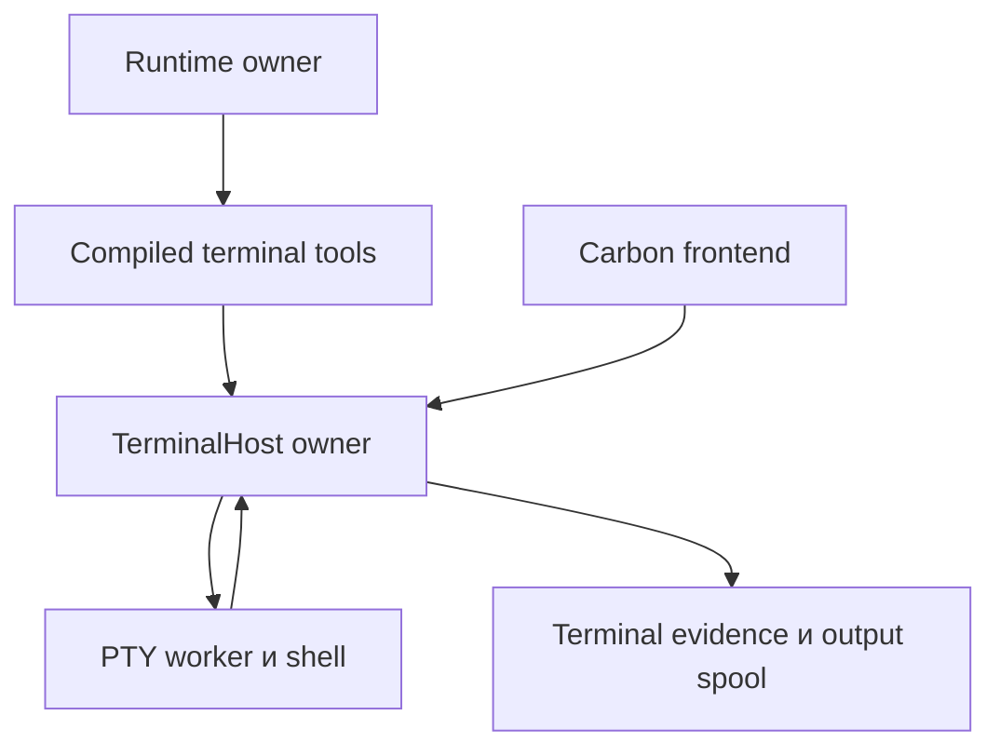

# Постоянные native терминалы: system design

Статус: **PROPOSED, docs-only**. Дата: 2026-11-15.
Runtime baseline: [`main@a6f2031`][ansa-main] после startup fix #16.
Rust остаётся Nix default, M9 имеет GO, C++ fallback сохранён; M10 отдельно не закрыт.
Этот документ задаёт будущие контракты и gates, а не сообщает об их реализации.

## 1. Задача и решение

Добавить собственные постоянные терминалы ANSA: shell с PTY, сохранением cwd,
environment, REPL и jobs между обращениями, просмотром экрана, detach/reconnect
и передачей клавиатуры между агентом и пользователем. Пользователь видит тот же
терминал, с которым работает агент. Терминал принадлежит явной рабочей задаче;
создавать новый терминал для каждого tool call не требуется.

Решение: отдельный native `TerminalHost` и compiled terminal tools рядом с
`run_command`. `run_command` сохраняет argv-direct, noninteractive, stdout/stderr,
exit status и существующий cleanup. Внешний tmux, чужой agent runtime, новый
provider или изменение SIWC/auth не становятся зависимостью.

Три возможности различаются: состояние живого shell, интерактивный TTY и жизнь
процессов после отключения frontend. Первая не требует третьей; detach допускается
только после отдельной проверки host lifecycle. Reconnect находит исходный живой
shell. Восстановление памяти Python, jobs или shell после его смерти не обещается.

### Сценарии первой версии

- Агент входит в каталог, активирует окружение и продолжает работу в том же shell.
- Агент ведёт интерактивный REPL или инструмент с TTY; пользователь подключается,
  принимает ввод, исправляет состояние и явно возвращает терминал агенту.
- Долгая команда остаётся видна после detach; повторное подключение получает
  текущий экран, состояние ownership и доступную историю вывода.
- Одна задача может держать ограниченное число именованных терминалов, например
  shell и dev server. Каждый процесс учитывается в её lifetime и ресурсах.

В первой версии не нужны layouts/splits tmux, remote execution, Windows/macOS,
подключение к произвольному пользовательскому терминалу, checkpoint памяти
процессов или автозапуск сохранённых команд после reboot. Целевая проверенная
платформа проекта остаётся Linux/aarch64 на X13s; x86_64 требует своей проверки.

## 2. Что есть сейчас и что подтверждает внешний пример

В baseline `run_command` описан как noninteractive `argv/cwd/timeout_ms` tool.
ProcessRunner делает `Command::new`, `stdin=null`, `stdout/stderr=piped`;
PTY отсутствует, живое состояние shell между вызовами не сохраняется. Shell можно
явно запустить через argv. EOF его control pipe означает Cancel,
а primary exit, timeout и Cancel запускают cleanup потомков. Worker сохраняет
request/started/result evidence и не повторяет consumed invocation без результата.
Это полезные гарантии короткой команды, которые нельзя убрать ради persistence.
Источники: [descriptor][ansa-tools], [runner][ansa-runner], [wrapper][ansa-command].

В `earendil-works/pi` уже есть близкий пример: experimental `apps/p2` предоставляет
tmux-like terminal operations, отдельный host и native Rust PTY daemon. Host живёт
отдельно от server/session workers, хранит текущий screen и ограниченный output;
его reconnect не означает переживание смерти самого host или reboot. Обычный
`coding-agent` bash tool остаётся отдельным механизмом. P2 прямо обозначен как
unsupported prototype. Поэтому наличие native terminal не является уникальным
отличием ANSA и само по себе не доказывает качество агента.
Источники: [P2 status][pi-status], [tool][pi-tool], [host][pi-host],
[native PTY][pi-pty], [обычный bash][pi-bash].

Из примера берутся разделение lifetime и понятные операции. Собственные admission,
durability, recovery, ownership и ограничения ANSA определяют реализацию здесь.
OS-семантика PTY, session и foreground process group описана в
[pty(7)][linux-pty] и [credentials(7)][linux-credentials]; обработка клавиш
и signal characters — в [termios(3)][linux-termios].

## 3. Компоненты и источники истины

Это logical boundaries, а не обязательные отдельные crates. Один serialized owner
ведёт каждое mutable control state; blocking I/O, fsync, PTY и join выполняются
bounded workers. Output flood не занимает cancel lane и не блокирует control.

| Компонент | Авторитет и ответственность |
|---|---|
| Runtime owner и canonical session journal | Принятый Submit, native RequestId, exact model context, validated batch, tool intent/outcome. Terminal result входит через обычный compiled tool/recovery contract. |
| TerminalHost owner | Lifecycle терминалов, input leases, admission операций, deadlines, учёт клиентов и процессов; не принимает решения за model loop. |
| Versioned terminal evidence namespace | Durable terminal identity, owner binding, epochs, operation intent/receipt и ссылки на вывод. Это evidence отдельного ресурса, а не второй журнал диалога или источник model history. |
| PTY worker | Владение PTY и OS-процессами, foreground group, signals, cleanup и проверяемое свидетельство исхода. |
| Frontend, screen и индексы | Производные представления. Screen, cursor и socket response не заменяют durable receipt. |

В базовом варианте host обслуживает одну native agent session и её terminal scopes.
Две сессии не получают общий stdin автоматически. Межсессионный workspace registry
выполняет admission только ANSA writers; это advisory coordination, не изоляция
от произвольных процессов того же пользователя.

Host запускается отдельным свежим helper process и держит private directory/socket
вне изменяемого worktree. Проверяются directory ownership/permissions, peer identity,
exclusive host lock и protocol version. Socket EOF разрывает attachment, но сам по
себе не означает смерть shell. Нельзя незаметно сменить private store при reconnect.

### Идентичности

- `TerminalId` неизменен для конкретного созданного терминала; имя служит подписью.
- `HostIncarnation` и terminal/worker incarnation отделяют текущую authority от
  прежней. PID без boot/process identity недостаточен из-за reuse.
- `TerminalScopeId` связывает agent session, task, workspace и budget ledger.
  В basic это локальный scope, способный жить между turns; Git не обязателен.
  При Orchestrate используются его root/task/attempt/worktree identities.
- `TerminalOperationId` назначает runtime для каждой mutating операции, включая
  create/resize/interrupt/close и handoff; `InputOperationId` — его разновидность.
  Для create resource identity резервируется до запуска. Kind/target и model
  payload неизменны для одного ID. Human control получает отдельный тип ID.
  Native `RequestId` остаётся ID принятого Submit и не переопределяется.
- `WriterEpoch`, ожидаемые incarnation и request/operation ID проверяются до
  отправки bytes. Для model input сверяется exact payload digest; human-input
  dedup не сохраняет bytes или перебираемые hashes отдельных клавиш.
  Stream sequence не является journal offset.

Создание и reconnect — разные операции. `create` возвращает новый ID только после
durable intent и проверенного запуска. Reconnect проверяет исходный store/host и
возвращает существующий ID. Отсутствующий или умерший host даёт lost/unknown,
а не новый shell под старым именем. Создание после такого отказа — новая операция.

## 4. Два вида владения

**Input owner** — единственный агент или пользователь, имеющий lease на stdin.
Читателей может быть несколько. Lease сам по себе не разрешает менять чужой
workspace, обходить mode/tool policy или продолжать отменённую задачу.

**Task/workspace owner** отвечает за shell и всех его foreground/background
потомков. Detach, возврат prompt, exit одной команды и передача клавиатуры не
освобождают этот ownership. Пока процессы могут менять файлы, второй ANSA task
не получает write admission в тот же scope. Более мелкое разделение файлов
требовало бы отдельного доказанного enforcement; первая версия его не обещает.

Терминал может жить между Submit одного session scope. Scope задаёт native owner
и явно показывает frontend; его продолжение не выводится из похожего текста
задач. Новый scope или attempt не наследует терминал молча. Перед передачей
workspace, заморозкой candidate,
независимой verification или integration первая версия закрывает task terminals
и подтверждает cleanup всех owned descendants. Prompt и terminal screen таким
подтверждением не являются. Неизвестный cleanup удерживает ownership/quarantine.
Это согласуется с [orchestration proposal #3][proposal-o].

### Передача ввода человеку и обратно

1. Host закрывает старый input permit; runtime прекращает подготовленный agent
   dispatch в этот terminal scope и отменяет generation со старым контекстом.
2. Неотправленные writes удаляются из очереди. Уже начатые получают known receipt
   либо `input_delivery_unknown`; неизвестность не скрывается передачей lease.
3. Новый writer epoch сохраняется durable. UI получает актуальные identity,
   screen/cursor, pending outcomes и ownership, затем активирует human input.
4. Возврат агенту требует явного handback и нового epoch. Пользователь разрешает
   конкретный model-visible screen snapshot и последующий output; старые
   сгенерированные keystrokes не replay-ятся. Runtime заново строит context и
   проверяет mode, stop, deadlines и budgets.

Handback snapshot получает durable receipt и поступает через явный native
continuation/Submit contract. Сохранённые provider-native items, call/result IDs
и exact epochs не переписываются. Pending tool operations сначала сверяются и
фиксируются в исходном session journal; unknown outcome удерживает pause и запрещает generation
продолжения, а не заменяется выдуманным успешным tool result.

Unknown input закрывает mutating admission для обоих владельцев до reconciliation;
просмотр и emergency stop/close доступны. Known cleanup после close доказывает
quiescence процессов, но не снимает неизвестность уже возможных файловых/внешних
эффектов. Task/workspace quarantine и запрет автоматического retry/new attempt
остаются до effect reconciliation; новый TerminalId их не обходит. Человек не
становится неявным механизмом обхода unknown-state gate. Модель не может выдать
себе human lease.

Human stdin не сериализуется как model tool call и не попадает автоматически в
session journal, transcript или prompt; durable metadata хранит ID/epoch, длину
и receipt, но не raw keystrokes или их hashes. Повтор human input с уже встреченным
ID всегда отвергается; запрос receipt — отдельная read-only операция без payload.
Это не мешает dedup model tools, где payload уже находится в exact tool intent.

Human ownership меняет и visibility epoch: старые queued/in-flight reads/results
fence-ятся до доставки модели. Private human-period ranges не становятся доступными
после handback через read, capture, scrollback или прямой artifact reference.
Первый MVP разрешает только явно одобренный целый текущий screen и output после
новой границы; private history остаётся закрытой. Capture обязан соблюдать эту
проекцию, включая старые cells/scrollback. Если такую проекцию нельзя построить,
handback блокируется до close и нового terminal; выборочная автоматическая очистка
секретов не имитируется. Read ACL и visibility epoch проверяются при доставке,
не только при постановке запроса в очередь.

Echo и программы могут вывести секреты в terminal output, в том числе повторно
после handback; полная redaction не обещается. Сохраняемый human-period output
остаётся private evidence. Пользователь видит, какой screen передаёт модели;
сам факт возврата клавиатуры не разрешает чтение всей прежней истории.
Visibility policy действует на штатные tools/UI/artifact API. Она не изолирует
private store от произвольного shell того же UID: такой sandbox в проекте не
заявлен. Эту границу нужно показывать при выборе human handback workflow.

## 5. Операции и наблюдаемые результаты

Имена ниже обозначают proposed API, не существующие CLI-команды или final schema.
Все model operations используют compiled registry, immutable tool snapshot/revision
и существующий full-response/full-batch admission. Невалидный batch вызывает ноль
executors. Host повторно проверяет identity/epoch/ownership непосредственно перед
эффектом; ранняя успешная валидация не даёт вечного разрешения.

Каждая mutating операция проходит общий intent/receipt/dedup contract. Потерянный
ACK create, resize, interrupt или close ведёт к query прежнего operation ID,
а не к новому ID и повторному эффекту. Особенно недопустим повторный interrupt
уже другой foreground job. Unknown create сохраняет reserved TerminalId и
ownership до reconciliation, не разрешая скрыто создать второй shell.

| Операция | Основной контракт |
|---|---|
| `terminal.create` | Явные scope, cwd, argv shell/program, dimensions и lifetime policy; durable intent, launch receipt, новый TerminalId. |
| `terminal.list` | Метаданные доступных owned terminals: lifecycle, input owner, deadlines, pending/unknown operations. Без скрытого создания/подключения. |
| `terminal.operation` | Read-only query receipt/status исходного operation ID в разрешённом evidence scope; не выполняет операцию повторно и не возвращает private input. |
| `terminal.input` | Bounded bytes или однозначно кодируемые keys, operation ID, ожидаемые epoch/incarnation. Возвращает receipt доставки, не exit code shell-команды. |
| `terminal.read` | Ограниченное чтение после cursor, range и retention metadata; explicit gap/truncation, при необходимости ссылка на screen. |
| `terminal.capture` | Нормализованный текущий screen с dimensions, cursor, sequence и признаком alternate screen; не полный transcript. |
| `terminal.resize` | Mutating control с input/control lease; может повлиять на программу и послать SIGWINCH. |
| `terminal.interrupt` | Прерывание текущей foreground group; receipt сигнала не означает завершения или cleanup background jobs. |
| `terminal.close` | Запрет новых writes, bounded graceful stop, escalation и join всех owned процессов; known closed либо cleanup unknown. |

Frontend предоставляет attach/detach, takeover/handback и emergency stop через
versioned control protocol. Это не разрешение модели управлять пользовательской
клавиатурой. Plan не получает create/input/resize/interrupt/close; чтение разрешено
только в явно предоставленном evidence scope, без перехвата чужого live terminal.
Переход basic→plan требует known cleanup терминалов этого scope: оставшийся
background writer несовместим с admission read-only работы. До cleanup switch
остаётся blocked с перечнем owned resources; human-owned terminal не убивается
неявно нажатием Tab. Эта проверка предшествует принятию plan turn.

Первый MVP не обещает `terminal.exec` с доверенным exit status для произвольного
текста в shell. Quiet interval, regex, появление prompt или напечатанное `exit 0`
— наблюдения, а не доказательство окончания. `read` timeout сообщает, что наблюдение
не завершилось за интервал; процесс может продолжаться. Если позже понадобится
managed-command framing, его completion channel и spoofing model проходят отдельный
gate. Маркер в недоверенном stdout сам по себе не становится таким каналом.

### Ввод: intent, доставка и эффект

Перед возможной записью в PTY нужны durable operation intent и owner/epoch.
Для model input exact payload/digest уже принадлежат обычному tool intent;
human intent хранит только metadata с одноразовым ID, без plaintext/hash ввода.
ACK означает только зафиксированное число переданных bytes и состояние доставки.

| Состояние | Что разрешено после reconnect/recovery |
|---|---|
| `rejected` или доказанно `not_started` | Вернуть исходный результат; новая операция допустима после обычного admission. |
| `delivered(n)` | Вернуть тот же receipt по ID; не отправлять bytes повторно. Последующие наблюдения/ввод того же task возможны при действующем lease. |
| `partial(n)` | Сохранить известный prefix. Не дописывать остаток автоматически: prefix мог уже вызвать эффект. Mutating admission блокируется до явного recovery. |
| `input_delivery_unknown` | Сохранять unknown, разрешить чтение и stop, запретить resend/следующий автономный input. |

Одинаковый model operation ID с другим payload отвергается; human input ID нельзя
использовать повторно вообще. Потерянный socket ACK ведёт к query исходного ID,
а не к новому ID и повторному Enter. Crash между OS write и durable
receipt принципиально может оставить неизвестность; exactly-once execution shell
не обещается. Доставленная строка также не доказывает её результат во внешнем мире.

Storage failure немедленно закрывает input latch. Известный outcome остаётся
видимым как known-but-not-durable; ошибка fsync не превращает его в разрешение
повторить действие. Runtime импортирует подтверждённый terminal receipt в исходный
session store до следующего executor. Разрыв между двумя stores устраняется сверкой
identity, без повторного side effect и без восстановления из старой копии журнала.
Missing/corrupt/conflicting original terminal evidence не доказывает `not_started`.
Pending session intent с durable terminal receipt закрывается импортом outcome;
уже durable session outcome не откатывается при последующей утрате terminal
evidence. Несогласованные identity/records блокируют новые writes в scope до
reconciliation, сохраняя известные факты и explicit unknown для остального.

## 6. Lifecycle, Cancel и отказ

Перед create фиксируются максимальная lifetime, idle policy, размеры/квоты и
поведение при disconnect. Первый безопасный slice может быть attached-only;
survive-disconnect включается лишь после NT3. Для persistent policy host сам
исполняет deadlines даже при отсутствии frontend/runtime клиентов.

| Событие | Поведение |
|---|---|
| Detach или client EOF | Attachment и input lease отзываются, новые bytes запрещены. При persistent policy host/shell и workspace ownership остаются до явного close/deadline. |
| `Ctrl+C` внутри явного attach | Передать keyboard byte в slave PTY: его ISIG/VINTR определяет, будет ли это сигналом или вводом raw-mode приложения. Не вызывать одновременно outer runtime Cancel. Explicit interrupt/stop доступны отдельным control action. |
| Runtime `/cancel`, адресный Cancel turn/task | Немедленно fence agent input и остановить будущий dispatch через приоритетную lane. По умолчанию закрыть agent-owned terminals текущего task scope с bounded cleanup; уже переданный человеку ресурс явно показывается как human-owned и сохраняет workspace ownership. |
| `close` или lifetime expiry | Остановить input, завершить foreground/background descendants, дождаться evidence; при неподтверждённом cleanup сохранить unknown и ownership. |
| CLI/runtime crash при живом host | Отозвать lease умершего клиента, применить исходную disconnect policy; reconnect не выдаёт lease до fresh snapshot/admission. |
| Host/PTY worker crash | Не считать процессы автоматически уничтоженными. Reconcile исходный store и native process identity; сомнение даёт lost/cleanup unknown. |
| Shell exit | Сохранить exit shell и отдельно результат cleanup всех descendants; shell exit сам по себе не равен закрытому scope. |
| Reboot или утрата исходного process/store | Пометить ресурс потерянным/неизвестным; новый shell только через новый create, без replay keystrokes. |

Cancel не откатывает совершённые эффекты. Late known receipt сохраняется даже после
отмены, но не возобновляет turn. Истечение lease запрещает ввод, не доказывая
quiescence. Отключение клиента, idle host exit и expiry не сбрасывают budget ledger
и не удаляют unknown evidence. Host штатно завершается лишь после закрытия owned
ресурсов и durable outcomes; unclean host exit требует reconciliation.

Client→host EOF и host→worker loss различаются. PTY worker не получает разрешения
бесконтрольно пережить своего host: потеря control owner инициирует bounded cleanup;
deadline/stop guard работает и внутри worker. Подтверждённый результат сохраняется
в исходный evidence store. Если погиб сам worker или cleanup нельзя подтвердить,
host/recovery сохраняет unknown, а не обещает kernel-level уничтожение потомков.

Терминал, принятый человеком, остаётся видимым owned resource; продолжение его jobs
не записывается как успешно отменённая agent work. Для полного прекращения task
используется explicit close всех его terminals, включая переданные человеку.
Перед frozen verification/integration это обязательное условие, независимо от
того, кто последним держал клавиатуру.

## 7. Native PTY, экран и Carbon

PTY launch требует master/slave, отдельной OS session, controlling terminal и
корректной foreground process group. Нельзя механически добавить `setsid` к
существующему пути, который уже использует `setpgid`. Нужен узкий fresh helper
в `ansa-linux`: подготовленные argv/FD, reset signal state, CLOEXEC и закрытие
лишних дескрипторов, privilege restrictions и проверяемый join lifecycle.
Существующие [supervisor][ansa-supervisor] и [managed spawn][ansa-managed] задают
отправную точку, а не готовый PTY contract.

Сначала safe std/rustix; собственный unsafe запрещён в `ansa`. Необходимый unsafe
в `ansa-linux` требует safety argument, independent review и native fault tests.
Нет allocator/locks/произвольных callbacks в unsafe fork child. Root/uid mismatch,
capabilities и `no_new_privs` сохраняют текущие ограничения. PTY не разрешает sudo
или privilege escalation и не делает shell файловой песочницей.

Foreground interrupt использует проверенное актуальное TTY/process-group состояние.
Cleanup охватывает не только эту группу, но и остальных owned descendants.
Без cgroup/container нельзя обещать прекращение всех отделившихся процессов после
SIGKILL самого supervisor/host; такой исход остаётся unknown, как и в baseline.
Механизм containment выбирается отдельно по конкретному gap, не объявляется
проверенным самим наличием PTY.

Для TUI недостаточно хвоста строк. Нужен bounded VT parser: UTF-8 carry, cursor,
erase, alternate screen, resize и ограниченный scrollback. Screen — производная
проекция output, с явно описанным supported subset; неизвестные sequences не
исполняются на внешнем терминале. OSC/DCS/clipboard и иные side-effect controls
не проходят из tool output напрямую в Carbon. Выбор parser dependency фиксируется
после проверки совместимости, лицензии, limits и native fixtures, не в этом PR.

Обычный Carbon dialogue/input остаётся основным интерфейсом. В explicit attach
frontend временно передаёт keyboard/renderer терминальному режиму, показывает
имя/owner и доступный detach chord; detach возвращает прежний draft/dialogue.
Attach не позволяет двум renderers одновременно владеть внешним TTY. Текущий
[RawMode][ansa-termios] отключает ICANON/ECHO, но сохраняет outer ISIG и другие
transformations; его недостаточно для прозрачного keyboard passthrough.
Attach требует отдельного termios profile: raw input без outer ISIG, flow-control
и CR/NL преобразований, согласованный output mode и явная обработка detach chord.
Slave line discipline и приложение решают семантику Ctrl+C/Ctrl+Z; explicit
`terminal.interrupt` отдельно сигналит проверенную foreground group.

Termios восстанавливается при detach, ошибке, внешнем SIGTSTP/SIGCONT и выходе;
[signal handling][ansa-signals] остаётся baseline восстановления, а не готовым
attach path. Проверяется отсутствие двойного interrupt и потери draft. Конкретный
chord выбирается вместе с UX history changes, не резервируется случайно.

## 8. Вывод, storage и budgets

Output spool имеет stable artifact reference, диапазоны offsets, размер и digest;
readback возвращает TerminalId/incarnation, cursor range и explicit retained/lost
ranges. Screen snapshot не заменяет полный log. При eviction, повреждении или
недоступном artifact сообщается gap/error; повторный запуск shell-команды ради
«восстановления вывода» запрещён. Durable receipt ссылается только на уже сохранённый
диапазон; live preview отдельно помечается недолговечным.

Штатный eviction касается только unpinned live-retention ranges. Blob/range,
на который ссылается сохраняемый session journal, не удаляется по ring quota:
он удерживается по evidence lifetime, совместимому с HE4. При исчерпании квоты
ограничивается новый capture/admission, а существующие references не обнуляются.
Неожиданная утрата pinned evidence всё равно сообщается как ошибка, без rerun.

Если принят [HE4 spool/readback contract из #14][proposal-he], используется его
совместимый substrate. До этого NT scope должен дать минимальный bounded artifact
contract; не нужны две конкурирующие canonical output системы. Legacy session v1
не расширяется неизвестными event kinds: terminal store имеет свою version, а
session journal содержит обычные tool intent/outcome и ссылки. Старый runtime не
обязан исполнять новые tool revisions. Compatibility проверяет legacy read/append
на совместимых сессиях и явный отказ неподдерживаемой terminal session, не ложный
fallback. Rollback отключает новый dispatch и сохраняет самый свежий state/evidence.

Перед implementation gate фиксируются численные caps и политика при превышении:
число terminals/PTY/FD/processes, lifetime/idle timeout, input bytes/queue, output
bytes/disk/ring, screen dimensions/scrollback, VT parsing work, client backlog и
read/poll rate. Достижение hard storage/control cap закрывает input и инициирует
bounded stop; нельзя блокировать Cancel заполненным spool. Допустимый output
retention loss явен, необъявленная бесконечная запись/очередь недопустима.

Все model terminal tool calls, включая list, operation query и read/capture polling,
учитываются в обычных tool budgets. Reconnect, detach, новый writer epoch и смена turn
не обнуляют terminal lifetime/byte counters. Human writes тоже входят в terminal
resource budget, хотя не считаются model tool calls. При Orchestrate/loop engineering
сохраняются root caps, stop, diagnostic escalation и write-attempt accounting:
terminal input не становится бесплатным вторым executor. Точная интеграция с
[LE2/O2][proposal-le] нужна до включения terminal tools в эти режимы.

## 9. Порядок реализации и gates

Согласованная очередь работ сохраняется: implementation по умолчанию после
проверенного M10 и применимых acceptance gates. Это sequencing policy, а не
утверждение, что PTY технически требует удаления C++ или всего Orchestrate/LE/HE.
Basic terminal может быть самостоятельным slice; включение в orchestration
требует её identity/ownership/receipt contracts. HE4 полезен для output, остальные
learning/memory milestones не являются prerequisites PTY.

| Gate | Scope и критерий выхода | Stop/rollback |
|---|---|---|
| NT0: design | Независимый review источников и контрактов, явные boundaries и acceptance matrix. Никакой runtime readiness из docs. | Нерешённые вопросы остаются blockers соответствующего implementation slice. |
| NT1: offline contracts | Versioned protocol/store, fake PTY, durable ordering, ID dedup, lease fencing, recovery и bounded queues проходят deterministic fault fixtures. Численные caps зафиксированы. | Любой duplicate/unknown replay или bypass ownership: NO-GO, feature disabled. |
| NT2: native attached terminal | На X13s проверены PTY/job control, interactive shell/REPL, FD/signals, cleanup, workspace admission, screen/readback limits и termios; run_command regressions сохранены. | Нет гарантированного cleanup в поддержанном scenario или renderer/control starvation: NO-GO. Detached policy ещё выключена. |
| NT3: detach и human handoff | Independent host lifetime, client/host/worker crash matrix, epochs, private output handback, deadlines без клиентов и workspace admission/quiescence подтверждены. | Потеря ownership или скрытое продолжение task: NO-GO. Выключить новые create/input, остановить/reconcile живые terminals, сохранить evidence. |
| NT4: agent pilot | После отдельного разрешения live — bounded задачи, terminal tools в actual model loop, независимый oracle и frozen receipts. O/LE integration проверена, если включена в pilot. | Неизвестные эффекты, обход caps или acceptance без quiescence блокируют adoption. Rollback не откатывает journal/auth. |

NT1–NT3 не требуют модельных запросов и реальных credentials. Публикация этого
документа не запускает implementation, live pilot, M10 или deployment. В новом
коде сохраняются locked build/test, fmt/clippy и platform gates выбранного slice;
skipped native suite не считается PASS.

### Обязательная acceptance matrix для будущей реализации

| Группа | Сценарии и наблюдаемый oracle |
|---|---|
| Польза persistence | `cd`, export/source и REPL state сохраняются в одном живом shell между calls/turns; новый TerminalId имеет новое состояние. Basic работает в non-Git cwd. |
| Интерактивность | isatty, foreground/background jobs, Ctrl+C/Ctrl+Z, raw/stty -isig приложение, resize/SIGWINCH, UTF-8 split, alternate screen; нет двойного outer/inner interrupt, OS/process state и screen сверяются с fixtures. |
| Admission | Невалидный response/batch даёт ноль PTY writes; plan mutations, чужой scope, stale incarnation/epoch и конфликтующий operation payload отклонены. |
| Handoff | Два readers допустимы, два writers нет; queued old input не попадает после takeover, in-flight write reconciles, handback не использует старый model context. Human input ID не replay-ится и не сохраняет перебираемые keystroke hashes. |
| Input recovery | Fault до intent, после intent/до write, между partial write и receipt, после receipt/до ACK; нет повторного Enter, known bytes сохранены, unknown блокирует writes. Lost ACK create/resize/interrupt/close также не повторяет эффект; missing/conflicting evidence не становится not_started. |
| Процессы | Detach и client crash сохраняют исходный host/shell лишь по выбранной policy; host/worker kill, PID reuse, shell exit с background child, reboot и missing store не создают ложный reconnect. |
| Stop и storage | Cancel при заполненных очередях, disk full/fsync fault, output flood, client lag, lifetime expiry без клиентов; late known outcomes сохранены, неизвестный cleanup удерживает scope. Eviction не удаляет journal-referenced evidence; потеря terminal store не откатывает durable session outcome. |
| Экран и приватность | Malformed/huge VT sequences ограничены, raw OSC/DCS не исполняются; gaps и preview обозначены. Queued/in-flight reads fence-ятся при takeover; read/capture/scrollback/artifact после handback не обходят выбранную visibility boundary. |
| Workspace и acceptance | Работающий background writer блокирует новый scope/plan/frozen verification/integration; input lease release не освобождает workspace. Known cleanup необходим, но не снимает effect_unknown/quarantine; close/new TerminalId не разрешают retry или acceptance неизвестного эффекта. |
| Регрессии | Текущий run_command, Cancel/EOF, JSONL startup, legacy journal/evidence, Carbon draft и termios сохраняют прежние контракты; unsupported terminal revisions явно отклонены. |

Это список необходимых будущих проверок. В данном docs-only PR они не выполнялись.

## 10. Оценка пользы и альтернативы

Проверяемая гипотеза: постоянный shell уменьшит повторную подготовку окружения
и ручные вмешательства на interactive tasks. Она не равна доказанному росту task
success или снижению tokens. Для pilot заранее фиксируются workload, model/effort,
budgets, timeout, независимый correctness oracle и условия остановки. Сравниваются
run_command baseline и native terminals на задачах, доступных обоим; TTY-only задачи
учитываются отдельно как расширение capabilities. Измеряются success, interventions,
wall time, tool/read calls, context/output bytes и idle/runtime overhead.

| Вариант | Решение и причина |
|---|---|
| Только run_command | Оставить для обычных bounded команд и механической проверки; не решает интерактивность или сохранение shell state. |
| Persistent shell через pipes | Возможен для части stateful workflows; TTY/job-control/TUI semantics не даёт. |
| Обязательный внешний tmux | Не выбран: отдельная зависимость и authority без готового native receipt/ownership contract. Можно использовать как внешний UX/overhead reference. |
| Native PTY + owned host | Выбран: явные lifecycle/identity и общий terminal для человека и агента. Цена — job-control, screen parsing и crash recovery gates. |
| Встроить Pi P2 runtime | Не выбран: P2 — полезный experimental reference; ANSA сохраняет свой loop, provider и canonical state. |

До NT1 нужно зафиксировать exact protocol/schema, caps и storage layout; до NT2 —
PTY/VT implementation choice, supporting native fixtures и workspace registry;
до NT3 — UX chords, disconnect/idle defaults и recovery этого registry. Эти решения
не подменяются предположением, что любой tmux-like интерфейс уже корректен.

## Источники и зафиксированные версии

Все GitHub ссылки ниже закреплены на просмотренных commits. #3/#8/#14 остаются
открытыми proposals, а не существующими merged runtime API.

[ansa-main]: https://github.com/junknewera/ansa/commit/a6f203173969c72f9b9e9b0a8ad873958215db6d
[ansa-tools]: https://github.com/junknewera/ansa/blob/a6f203173969c72f9b9e9b0a8ad873958215db6d/rust/crates/ansa/src/tools/files.rs#L347-L355
[ansa-runner]: https://github.com/junknewera/ansa/blob/a6f203173969c72f9b9e9b0a8ad873958215db6d/rust/crates/ansa/src/process/runner.rs
[ansa-command]: https://github.com/junknewera/ansa/blob/a6f203173969c72f9b9e9b0a8ad873958215db6d/rust/crates/ansa/src/tools/command.rs#L114-L160
[ansa-supervisor]: https://github.com/junknewera/ansa/blob/a6f203173969c72f9b9e9b0a8ad873958215db6d/rust/crates/ansa-linux/src/supervisor.rs#L49-L123
[ansa-managed]: https://github.com/junknewera/ansa/blob/a6f203173969c72f9b9e9b0a8ad873958215db6d/rust/crates/ansa-linux/src/managed.rs#L9-L68
[ansa-termios]: https://github.com/junknewera/ansa/blob/a6f203173969c72f9b9e9b0a8ad873958215db6d/rust/crates/ansa-linux/src/terminal.rs#L108-L150
[ansa-signals]: https://github.com/junknewera/ansa/blob/a6f203173969c72f9b9e9b0a8ad873958215db6d/rust/crates/ansa/src/frontend/controller.rs#L580-L625
[proposal-o]: https://github.com/junknewera/ansa/blob/ed40ff8d98637789de9e80eb4a516365f0f717e8/docs/adr/0002-self-hosted-orchestration.md
[proposal-le]: https://github.com/junknewera/ansa/blob/48a86d98347e9e30955868a941d22da7139ba195/docs/LOOP_ENGINEERING.md
[proposal-he]: https://github.com/junknewera/ansa/blob/ef4f4080aaa5e6c14d16f461ffdb9bc0c5dd744e/docs/HARNESS_EVOLUTION_PROPOSAL.md
[pi-status]: https://github.com/earendil-works/pi/blob/04fd0897e4df737cd8422bc99085d6953da804ec/apps/p2/README.md
[pi-tool]: https://github.com/earendil-works/pi/blob/04fd0897e4df737cd8422bc99085d6953da804ec/apps/p2/plugins/terminals/tool.ts
[pi-host]: https://github.com/earendil-works/pi/blob/04fd0897e4df737cd8422bc99085d6953da804ec/apps/p2/plugins/terminals/main.ts#L40-L49
[pi-pty]: https://github.com/earendil-works/pi/blob/04fd0897e4df737cd8422bc99085d6953da804ec/packages/env/daemon/src/pty.rs#L413-L469
[pi-bash]: https://github.com/earendil-works/pi/blob/04fd0897e4df737cd8422bc99085d6953da804ec/packages/coding-agent/src/core/tools/bash.ts
[linux-pty]: https://man7.org/linux/man-pages/man7/pty.7.html
[linux-credentials]: https://man7.org/linux/man-pages/man7/credentials.7.html
[linux-termios]: https://man7.org/linux/man-pages/man3/termios.3.html
