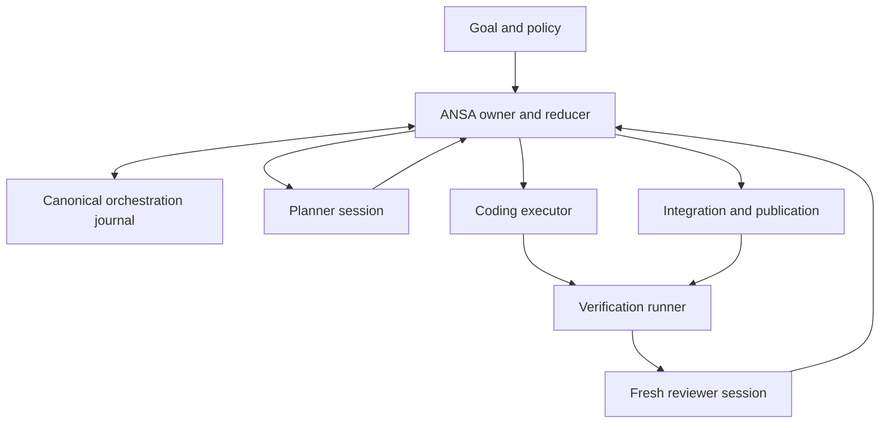

# ANSA — self-hosted orchestration без зависимости от ChatGPT Pro

Дата исследования: **13 ноября 2026, Europe/Moscow**. Статус архитектуры: **PROPOSED / для независимого review**. Это исследование и контракты, не реализация и не разрешение на live inference или Rust cutover.

## Решение

**Выбрать hybrid: собственный deterministic control plane ansa, собственные read-only SIWC sessions для planning/review и официальный Codex app-server по stdio как основной coding executor.** Платный OpenAI API — явно выбираемый дополнительный inference route. Native ansa coding executor — последующая альтернатива за тем же узким контрактом, если evals подтвердят достаточное качество. Обычный basic/plan loop ansa сохраняет независимость от Codex.

MVP: один coordinator, один builder, свежий reviewer context и обычный VerificationRunner. Одновременных builders — **один**, вложенных Codex agents — **ноль**. Integrator, scheduler, recovery и acceptance — код, а не отдельные LLM-персоны. Planner также делает bounded research и failure analysis.

Production implementation по умолчанию начинается **после подтверждённого `migration/m10-rust-production` GO**, отдельным feature milestone. Сейчас полезны ADR и contracts; после M6 возможен отдельный non-production lifecycle spike. M0–M10 не изменяются. Удаление C++ не является техническим условием orchestration; эта последовательность выбрана для сохранения уже принятого parity/cutover scope.

Почему это самый короткий надёжный путь: ansa повторно использует собственные owner/journal/auth/recovery contracts, Codex приносит готовую coding execution capability, а новая часть ограничена task lifecycle, evidence gates и Git integration. Ни перенос всего Codex runtime в ansa, ни передача Codex права принимать milestone не нужны.

### Как читать статусы

| Метка | Значение в этом отчёте |
|---|---|
| CONFIRMED | Проверено чтением actual repository code, GitHub metadata или официального контракта. Историческое сообщение о тестах обозначается отдельно. |
| TESTED | Выполнено в этой исследовательской сессии; платформа и предел проверки указаны. |
| PROPOSED | Новое архитектурное решение; ещё не реализовано и не измерено. |
| UNKNOWN | Доказательств недостаточно; указана будущая проверка. |

Все новые Rust types, CLI команды и файловые схемы ниже — **PROPOSED**. Имена моделей в архитектуру не зашиты. Текущие модели аккаунта, quota и native X13s поведение Codex не проверялись: реальные credentials не открывались, inference не запускался. Вымышленных результатов evals нет.

Пакет: этот отчёт — D1–D5, D7–D8; [четыре prompts](ORCHESTRATION_PROMPTS.md) — D6; [ADR 0002](adr/0002-self-hosted-orchestration.md) — короткий decision record.

## D1. Current State Audit

### Проверенный GitHub snapshot

Репозиторий исследован через GitHub connector. Immutable main: `ca851c99d4887a121300f0bcee8687ed9d055071`. При повторном использовании отчёта сначала обновить snapshot; наличие этого документа не доказывает, что ветки всё ещё стоят на тех же SHA.[A1][A2]

| Объект | CONFIRMED состояние на дату аудита |
|---|---|
| `main` | Merge PR #1; production C++20. Rust workspace в main отсутствует. |
| PR #1 | Merged 12 ноября 2026 в 23:44:05 МСК; архитектура Rust migration, docs-only. |
| `docs/rust-migration-review-20261112` | `91532315e6649eab06baf7628562a78d8e2bac5d`. |
| PR #2 / `migration/rust-runtime` | Open, non-draft, не merged; head `c06b1a839695e0690ead1db88c5e2a2df9a198db`; 3 commits, 22 изменённых файла. |
| M0 | Implementation есть в PR #2; **NO-GO**, native X13s acceptance pending. M1 не начат. |
| GitHub evidence PR #1/#2 | Formal review submissions/comments не найдены. На head PR #2 — ноль check runs и пустые statuses. Это не опровержение локальных тестов, но и не CI/APPROVED evidence. |
| C++ code last known good | `28eb41f0af449e943811cfbf9a4053f2dd7983ee`; более поздний docs merge не является новой runtime acceptance. |

Прочитаны `AGENTS.md`, `PROJECT_STATE.md`, `architecture.md`, `RUST_MIGRATION_PLAN.md`, `TODO.md`, `README.md`, implementation report, contracts/runtime/session/journal/process/provider/auth code и соответствующие tests. `docs/migration/M0.md` и Rust scaffold прочитаны **на PR #2 head**, а не приписаны main.[A3][A4][A5][A6][A7][A8][A9][A10][A11][A12]

Rust scaffold содержит два local packages и ноль external crates. `ansa-rs` намеренно завершается exit 1 с сообщением об отсутствующем runtime; `ansa-linux` — placeholder. Реальных Rust owner, provider, journal и ProcessRunner ещё нет.[A11]

M0 report сообщает x86_64 Debug/Release CTest **86/87**, failure `process-detached`, preflight **10 PASS / 1 UNSUPPORTED**, незакрытый sanitizer/native/performance gate. Исторический C++ отчёт сообщает native **87/87** Debug/Release и **85/85** ASan/UBSan. Это разные checkpoints и среды; старые числа не закрывают M0.[A4][A10]

**TESTED в этом исследовании:** неизменённые пять Python regression tests M0 harness, полученные с PR #2 head, прошли **5/5** на Linux/x86_64, Python 3.12.14; Git blob hashes трёх файлов сверены. Это проверяет anti-false-green assertions harness, не Rust runtime и не native M0. Также выполнены только offline `codex --version`/help и генерация app-server JSON Schema установленным `0.167.0-alpha.4`; ни auth, ни inference не запускались.[A12]

### Что уже можно переиспользовать

| Подсистема ansa | Существующий контракт | Что добавить для Orchestrate |
|---|---|---|
| Runtime owner | Один mutator, owned work identity, bounded inbox/outbox, reserved Cancel, snapshot/resync. | Task/attempt lifecycle и repository ownership; не второй mutator SessionState. |
| Commands/events v1 | Session/Turn/Request/Operation IDs, incarnation, cursor, Submit/Cancel/Resume. | Отдельные orchestration commands/events с feature/version negotiation. |
| Responses admission | Успешный terminal, EOF/transport admission, native replay, whole-batch validation до tools. | Validation `PlanProposal` и `ReviewReport`; они не меняют task state сами. |
| Session journal | Append-only framing/hash chain, flock, fsync barriers, exact epochs, corruption fail-closed. | Отдельный versioned orchestration aggregate с тем же storage machinery. |
| Process supervision | Fresh supervisor/subreaper, consumed marker, durable evidence, stop/reconcile. | Streaming adapter и OS lifecycle для долгого внешнего coding worker. |
| Own SIWC | Своя registration, refresh/leases, account binding, официальный model catalog. | Capability-aware routing, безопасная передача своего access token app-server. |
| basic/plan | Многошаговый loop; plan получает read-only tools без shell. | Planner/reviewer могут использовать отдельные native sessions. |
| M0 harness | Hashes, argv, raw logs, actual test inventory, запрет пустого/skip PASS. | Версионированные acceptance manifests и runner receipts на конкретный SHA. |

Основания: actual contracts и implementation, не предполагаемая функциональность.[A5][A6][A7][A8][A9][A12]

**Настоящая граница:** нынешний `AgentRuntime` обслуживает одну session и один active turn. Он уже решает «model → tools → continuation», но не «goal → task graph → independent acceptance → integration». `Done` — окончание agent turn. Это не принятый milestone.

Особенно важно: C++ `ProcessRunner` может вернуть `Execution::succeeded + Effects::known_result` при nonzero exit, timeout или cancellation, если исход процесса и cleanup известны. Эти признаки находятся внутри output. Код orchestrator не должен превращать такое значение в инженерный success.[A8]

Текущий `run_command` ограничен десятью минутами и 16 KiB сохранённого вывода; он не является двунаправленным потоковым Codex protocol host. Переиспользуются supervision/evidence principles и будущие Rust низкоуровневые primitives, а не вызов `run_command("codex ...")` внутри prompt loop.[A8]

Отсутствуют TaskId/AttemptId, task dependencies, budgets across sessions, Git worktree ownership, integration queue, independent reviewer gate, acceptance evidence на code SHA, automated selection следующего milestone и общий reconciliation workflow. Текстовое «следующий спринт — orchestrate» в старом PROJECT_STATE/README не отменяет merged migration gates.[A3][A4][A6]

## D2. Integration Decision

### Разделить orchestration backend, executor и способ оплаты

| Слой | Основной выбор | Альтернатива / условие |
|---|---|---|
| Task control | Rust owner ansa, reducer, journal, policy | Другого control plane в MVP нет. |
| Planner/reviewer inference | Собственный SIWC Responses adapter после Rust parity | Paid OpenAI API при explicit configuration и budget. |
| Coding execution | `codex app-server --listen stdio://`, pinned binary/schema | NativeAnsaExecutor после eval; `codex exec --json` как более простой ограниченный adapter. |
| Authentication | Собственный SIWC grant ansa, поддерживаемый app-server provider config | Отдельный официальный Codex sign-in или API credential, выбранные пользователем; не чтение чужих token files. |
| Storage | Локальные journals/artifacts и Git | Ни Redis, ни PostgreSQL, ни distributed queue. |

Codex владеет внутренним coding loop **одной попытки**. ANSA владеет выбором задачи, worktree, лимитами, отменой, retry, проверкой, review, integration и следующим milestone. Такой subloop не делает Codex обязательной частью native loop ansa.

### Что SIWC действительно разрешает

**CONFIRMED:** официальная документация описывает ChatGPT plan usage для open-source и locally hosted apps, собственный OAuth grant и inference через public `https://api.openai.com/v1/responses`. Это не доступ к старым ChatGPT conversations. Permission `chatgpt.tokens.use.direct`, eligibility и workspace policy проверяются отдельно.[O1][O4]

Для HTTP SIWC нужны `store:false`, `stream:true` и явный input history. `previous_response_id`, background/conversation и ряд обычных API options не поддержаны. В частности, нельзя рассчитывать на `max_output_tokens`, `max_tool_calls`, `multi_agent`, hosted MCP, file search, Code Interpreter или Responses `tool_search`. Локальные function/custom tools и Codex local tools — другая граница; они допускаются предусмотренным профилем. Web search зависит от модели/account policy.[O2][O3]

**Вывод PROPOSED:** вся минимальная meta-orchestration может использовать SIWC для inference: план, coding и review не требуют запрещённых hosted primitives. Task persistence, scheduling, tools и budgets выполняет ansa. Однако нынешний C++ adapter не реализует orchestration и не expose-ит, например, reasoning effort или generic API backend; их наличие в официальном API не означает наличие в ansa.[A9]

**UNKNOWN:** entitlement конкретного пользователя сегодня, точные модели/efforts и совместимость выбранной Codex configuration с этим route. Проверка без обращения к credentials невозможна; она намеренно не проводилась. Это deployment gate, а не основание тайно использовать другой endpoint или платёжный путь.

### Реальная model discovery, без статического списка

При первом разрешённом live deployment ansa должна:

1. Проверить собственный grant/account/workspace binding, без чтения credentials другого приложения.
2. Взять catalog через официальный `GET /v1/models` **тем же route и account**, которые будут использоваться для inference. Для SIWC это `models[]`, `slug`, `display_name`, `visibility`; API-key catalog имеет собственный API contract.
3. Записать безопасные capability metadata, route, timestamp и requested model; не token. `model/list` Codex может быть bundled/cache catalog и не подтверждает account access.
4. Разрешённый smoke request считать успешным только после `response.completed` / `turn.status=completed`. Сохранить requested/returned model и actual supported settings. Нельзя подменять модель в старой context epoch.
5. Не определять поддержку features методом бесконечных проб. Unsupported capability — bounded configuration failure; выбрать заранее разрешённый профиль или остановиться. Обновлять catalog при account/auth epoch change и policy TTL, а также после соответствующего отказа.

Model listing и successful inference проверяют разные вещи. Собственная model-list проверка уже есть в ansa; её нужно сохранить, а не заменить static model enum.[A9][O2][O5]

### Billing и usage

Различать **ChatGPT subscription**, **SIWC plan usage**, **Codex sign-in usage** и **API-key billing/quota**. Совпадающий URL Responses не объединяет их бюджеты. Ошибка SIWC не разрешает автоматический переход на API billing. Для `subscription_sharing_usage_limit_exceeded` нужно остановить новые запросы; код сам по себе не доказывает исчерпание всей подписки или конкретное время reset. `503` допускает bounded backoff; invalid grant/unsupported body не требуют циклического login.[O4]

Современные docs также описывают отдельно активируемые API-credit benefits для некоторых подписок. Это отдельная привязка API organization, eligibility и ограничения; нельзя считать такие credits автоматически доступными или строить на Pro обязательный runtime. На дату исследования benefit прямо не покрывает Codex usage через API keys и не повышает signed-in Codex limits. Архитектура рассчитана на самостоятельную оплату API, если этот route выбран.[O6]

Платный API оправдан, когда нужны предсказуемая отдельная capacity, поддержанные конкретной моделью output limits, background/retrieval, API observability или модель/feature вне доступного SIWC профиля. API background mode допускает polling/cancel и continuation stream; он не делает локальные filesystem effects транзакционными. В MVP background mode не нужен.[O7]

### Современные primitives — почему не добавлять framework

Responses function calls/streaming дают model-tool boundary; structured outputs помогают синтаксической форме, но не доказывают правильность плана. Где route-specific schema support не подтверждён, использовать bounded text/JSON и строгий local validation с одной разрешённой corrective attempt.[O8]

Agents SDK предоставляет agent loop, handoffs, agents-as-tools, local run state и guardrails в Python/TypeScript. Для Rust ansa это дополнительные language/runtime и дублирование уже существующего loop. Manager-style calls полезны как концепция, но библиотека не решает Git ownership и durable external effects за ansa.[O9]

Текущий Responses Multi-agent — beta; docs описывают model-directed дерево без фиксированного ограничения depth/total created agents. В SIWC `multi_agent` не поддержан. Для минимального deterministic control plane эта возможность не нужна; позже допустима только внутри ограниченного read-only analysis job с измеряемой ценностью.[O3][O10]

### Codex execution interfaces

| Interface | CONFIRMED возможности и зрелость | Решение для ansa |
|---|---|---|
| `codex exec` | Документированный noninteractive execution; JSONL, cwd/model/config, output schema, resume конкретной session. `--full-auto` удалён. Stable command. | Хороший offline protocol spike и simple optional backend. Нужно отдельно нормализовать interruption и process cleanup. |
| app-server stdio | Bidirectional JSONL RPC, thread/turn IDs, streamed items, approvals, history, resume и interrupt. Официально описан SIWC provider setup. CLI reference всё ещё маркирует app-server experimental/may change. | Основной adapter при pinned binary/schema и conformance suite. Использовать только stable API subset; experimental fields выключены. |
| app-server WebSocket | Docs явно называют transport experimental/unsupported. | Не нужен: локальный stdio, без сетевого listener/reconnect service в MVP. |
| TypeScript Codex SDK | Local thread API поверх subprocess `codex exec`, Node runtime. | Не добавлять Node только ради adapter. |
| Python Codex SDK | Текущие docs описывают stable `openai-codex`, app-server JSON-RPC и pinned CLI dependency. | Полезен для отдельного tooling, но production Rust может говорить с тем же протоколом напрямую. |
| Codex cloud tasks | Документированный cloud/CLI workflow, environment и account requirements; отдельный удалённый execution lifecycle. | Не требуется для self-hosted MVP; не предполагать универсальный SIWC REST tasks API. |
| Agents API + self-hosted sandbox | Managed harness остаётся у OpenAI, даже если sandbox собственный. | Не основной путь при требовании собственного управляющего runtime. |

Основания: официальные CLI/SDK/app-server docs и pinned source.[O5][O11][O12][O13][O14][O15][O16][C1][C2][C3][C4]

На момент проверки latest stable release — **Codex `0.168.0`**, source commit `9480ec100c3edee9fc69172e8e80a4730444094d`, опубликован 13 ноября 2026. Есть Linux aarch64 musl assets. Локально стоял другой binary — `0.167.0-alpha.4`; его offline schema test не подтверждает поведение stable release или NixOS/X13s. Для production pinned Nix derivation/closure, exact binary hash и native acceptance обязательны. Совместимость NixOS не следует только из наличия Linux binary.[C1]

## D3. Minimal Target Architecture

### Владение и роли



Стрелки обозначают jobs/results. Ни builder, ни reviewer не пишет task state напрямую. Owner выполняет validation и durable transition перед дальнейшим dispatch.

| Роль | MVP | Ограничение |
|---|---|---|
| Planner/Architect | Native read-only session; plan + research + failure analysis | Не запускает shell, не принимает задачи, не выдаёт себе permissions. |
| Implementer | Один Codex attempt, один выделенный worktree | Только утверждённый scope; внутренние subagents выключены. |
| Reviewer | Новая native read-only session | Original requirements + actual diff/source + runner evidence; не наследует builder conversation. |
| Verification | Deterministic runner | Реальные exit/status, test inventory, artifacts, exact SHA. |
| Integrator | Deterministic code | Serialized queue, Git operations, повтор gates на интегрированном SHA. |
| Recovery analyst | Вызов planner только после deterministic reconciliation | LLM объясняет найденные факты, не определяет, жив ли процесс или был ли side effect. |

Один owner на repository orchestration namespace. Repository lock исключает конкурирующие root runs, даже если их RunId различны. Внутри процесса один reducer владеет tasks/attempts; блокирующие journal/fs/Git operations выполняют уже предусмотренные migration bounded workers. Live completion применим только к совпадающим `run/task/attempt/owner_epoch` и expected revision. После restart reconciliation сверяет старый receipt с **сохранённым owner_epoch его AttemptRecord**, а текущий owner импортирует его отдельным transition со своей новой epoch. Валидный known outcome не отбрасывается только из-за смены owner; старый completion не получает права продолжить dispatch напрямую. Lease expiry само по себе не выдаёт второму worker право писать.

MVP хранит bounded список последовательных tasks и explicit dependencies. Runtime проверяет отсутствие cycle, неизвестных parents, дублированных IDs и превышения лимитов. Не нужен общий workflow engine. Parent-child relationship — связь work units, а не разрешение дочерней модели создавать descendants. Для одной цели верхний уровень может быть одним Task с build/verify/review phases.

### Минимальные typed contracts

Ниже semantic sketch, не compile-ready implementation. `Validated*` и durable receipts имеют private constructors; identifiers задаёт runtime. Строки LLM не превращаются напрямую в пути или команды.

```rust
struct RunId([u8; 16]);
struct TaskId([u8; 16]);
struct AttemptId([u8; 16]);
struct OwnerEpoch(u64);
struct ArtifactDigest([u8; 32]);
struct GitOid { algorithm: GitHashAlgorithm, hex: String }

struct TaskSpec {
    run: RunId,
    id: TaskId,
    parent: Option<TaskId>,
    depends_on: Vec<TaskId>,       // bounded; validated before acceptance
    source: SourceBinding,         // repo identity + immutable base SHA
    requirements: ArtifactDigest,
    acceptance: ArtifactDigest,    // immutable manifest for this revision
    write_scope: WriteScope,
    policy: PolicyRevision,
    budget: BudgetReservation,
}

struct AttemptSpec {
    id: AttemptId,
    task: TaskId,
    owner: OwnerEpoch,
    expected_task_revision: u64,
    base: GitOid,
    worktree: OwnedWorktreeId,
    executor: ExecutorProfile,
    prompt: ArtifactDigest,
    deadline: Deadline,
}

enum TaskState {
    Queued, Planning, Ready,
    Executing(AttemptId), Reconciling(AttemptId),
    Verifying(GitOid), Reviewing(GitOid), Integrating(GitOid),
    Publishing(GitOid),
    Paused(PauseReason), Blocked(BlockReason),
    Accepted(AcceptanceReceipt), Cancelled(CancellationReceipt),
}

enum ProtocolTerminal { Completed, Interrupted, Failed, Missing }
enum EffectKnowledge { NotStarted, Reconciled, Unknown }
enum CleanupState { ConfirmedStopped, Uncertain }

struct ExecutionEvidence {
    attempt: AttemptId,
    protocol: ProtocolTerminal,
    process: ProcessTermination,
    effects: EffectKnowledge,
    cleanup: CleanupState,
    thread_turn: Option<ExternalTurnId>,
    raw_events: ArtifactDigest,
    file_inventory: Option<ArtifactDigest>,
    candidate: Option<GitOid>,
}

trait CodingExecutor {
    // Return job ownership immediately; never run a model on the owner thread.
    fn start(&mut self, permit: DurableLaunchPermit,
             spec: ValidatedAttempt) -> Result<OwnedJob, StartFailure>;
    fn cancel(&mut self, job: &OwnedJob, reason: CancelReason);
    fn reconcile(&mut self, saved: &AttemptRecord) -> OwnedReconcileJob;
}

struct VerificationReceipt {
    candidate: GitOid,
    manifest: ArtifactDigest,
    toolchain: ArtifactDigest,
    outcomes: Vec<CommandOutcome>, // exact IDs/counts; bounded
    logs: ArtifactDigest,
    source_unchanged: bool,
}

struct ReviewReport {
    base: GitOid,
    candidate: GitOid,
    requirements: ArtifactDigest,
    evidence: Vec<ArtifactDigest>,
    verdict: ReviewVerdict,
    findings: Vec<Finding>,
    unverified: Vec<RequirementId>,
}
```

`OwnedJob` содержит join/result ownership, bounded event receiver и nonblocking cancellation latch. Drop не объявляет worker остановленным. Для recovery используется сохранённый AttemptRecord, не прежний PID без birth/boot identity. Второй backend нужен только когда появится реальная NativeAnsaExecutor implementation; не создавать множество пустых traits/crates заранее. Разумное размещение после миграции — `ansa::orchestrate/{state,owner,executor,git,verify}`, узкие process wrappers в `ansa-linux`.

### State transitions и принятие результата

| Переход | Обязательное доказательство / действие |
|---|---|
| Queued → Planning | Durable goal/source/policy/budget; repository lock. |
| Planning → Ready | Validated plan; requirements и acceptance manifest заморожены; scope разрешён. |
| Ready → Executing | Worktree lease + durable attempt intent + launch permit + auth admission. |
| Executing → Reconciling | Worker terminal, crash, timeout или потеря канала; terminal text не принимается как кодовый результат. |
| Reconciling → Verifying | Worker quiescent, эффект классифицирован, полный inventory проверен, immutable candidate создан. |
| Verifying → Reviewing | Все required mechanical gates прошли; no empty/skipped required suite; SHA совпадает. |
| Reviewing → Integrating | Нет blocking findings/gaps; behavioral requirements покрыты; trusted reducer принял report. |
| Integrating → Publishing | На итоговом branch SHA повторены required tests/review gates; integration conflicts закрыты. |
| Publishing → Accepted | PR/patch receipt и final-SHA evidence durable. Accepted означает accepted deliverable, не merged main. |
| Любой active → Paused/Blocked | Quota, permissions, unknown effect, missing platform, corruption или exhausted repair budget. |
| Active → Reconciling с cancel_requested | Новые dispatch запрещены; cleanup ещё не подтверждён. |
| Reconciling → Cancelled | Локальные writers подтверждённо остановлены; receipt перечисляет known effects и оставшиеся external unknowns. |

Repair не отдельный бесконечный state: rejection сохраняет finding IDs и возвращает задачу в Ready с новым AttemptId/manifest revision только в пределах budget. Failed protocol может оставить полезный patch; сначала reconciliation, затем отдельно записанное решение о проверке partial candidate. Его нельзя молча представить как успешный worker run.

MVP defaults **PROPOSED**, не оптимум: одна initial build attempt + максимум две repair attempts; максимум одна replan; один automatic model escalation из разрешённого списка; bounded transient provider retry schedule; один write-capable worker. После двух одинаковых неустранённых findings/неизменного failure signature без доказанного прогресса — stop. Эти пределы действуют на run, не сбрасываются новой session или restart. Владелец может явно выдать новый budget; модель не может.

Внутренние лимиты native agent rounds сохраняются. Они не заменяют общий root budget, поскольку несколько новых turns иначе обошли бы turn cap. Codex outer turns можно считать точно; число его внутренних HTTP retries/tool rounds считать точным только при наличии соответствующей telemetry.

### Persistence: отдельный task aggregate, один источник истины

**Решение:** отдельный canonical orchestration journal, с reuse Rust append/fsync/framing primitives. Не добавлять task records в legacy `OMHJ1` session v1. Его reducer принимает закрытый список event kinds и отвергает неизвестные; прозрачная совместимость была бы ложным обещанием.[A7]

Предлагаемый каталог вне worktree: `~/.ansa/orchestrations/<repo-id>/<run-id>/`. Нужны explicit magic/schema version для нового domain, repository/run locks, events, immutable artifacts и derived snapshots. Реализация format/header выбирается O1; строка `OMHO1` допустима как новое имя, но не как фиктивное существующее API. Per-repo root lock хранится выше per-run directories.

| Данные | Единственный authority |
|---|---|
| Task status, attempt allocation, budgets, approvals, acceptance, publication intent | Orchestration reducer + его journal |
| Native session input/output, exact epochs, admitted tool outcomes | Existing session reducer + session journal |
| Codex conversation | Codex-owned rollout/history; ansa не редактирует private DB/files |
| Фактический код | Git objects и сверенный worktree inventory |
| Supervisor/test evidence | Immutable artifacts, импортированные по digest; не самостоятельный task state |
| PROJECT_STATE, dashboard, task index | Восстанавливаемые проекции/engineering handoff |

Нативная session не пишет `TaskAccepted`; root не переписывает session history. Между journals нет мнимой распределённой транзакции: child receipt становится usable только после durable append root `EvidenceImported` с digest/session/attempt identity. Crash между publication artifact и append оставляет orphan evidence для reconciliation; missing artifact при уже записанной ссылке блокирует переход. Index можно удалить и построить заново.

Перед append reducer строит ValidatedTransition; storage worker sync-ит frame, затем owner публикует durable event. Временный known outcome при disk failure остаётся явно nondurable, новые effects не стартуют. Не хранить full logs в каждом journal record; references bounded, logs имеют quota/retention.

**Миграционный контракт:** этот namespace появляется отдельным post-migration feature. Legacy session v1 bytes и semantics не меняются; C++ fallback не обязан понимать новый task domain и никогда не продолжает его автоматически. Rollback отключает Orchestrate, останавливает/reconciles workers и сохраняет свежие evidence. Нельзя восстановить старый journal backup после effects или старые rotating credentials. Это не введение второго canonical session store в M4.[A3][A7]

### Launch protocol: два независимых окна неопределённости

Один durable process intent недостаточен: внешний процесс может стартовать, а app-server ещё не принять coding turn. Нужны два receipts.

1. Root sync-ит `AttemptPrepared`: task/source/spec/policy/budget/worktree/executable/schema hashes. Supervisor получает launch permit, создаёт consume-once marker до запуска Codex. Повтор consumed attempt не запускает process заново.
2. App-server проходит initialize и thread/start. Thread ID и effective configuration фиксируются. Crash создания пустого thread без `turn/start` не даёт права считать coding запущенным.
3. До отправки `turn/start` сохраняется `TurnDispatchIntent`: точный request ID/body digest/thread ID. Request ID JSON-RPC — correlation, **не обещание server-side idempotency**. Supervisor protocol pump сохраняет доступные responses/events в bounded spool; receipt хранит actual turn ID.
4. Потерянный ответ после send означает uncertain dispatch. Нельзя снова отправить `turn/start` «на всякий случай». Сначала stop/quiesce, read/history correlation по exact IDs, artifacts и filesystem. Если факт не доказан — `Unknown` и Blocked.
5. Terminal event, process exit, cleanup и Git snapshot фиксируются отдельно. Только после reconcile owner может создать Verification job.

Это гарантирует отсутствие **слепого автоматического повторения** известных/неизвестных attempts; не обещает exactly-once произвольного shell/remote API. Внешние effects должны быть запрещены policy либо проходить через отдельные idempotent/reconcilable operations.

### Связь ansa ↔ Codex: минимальный adapter

Adapter запускает executable через argv, без shell interpolation. Один app-server process на write attempt, контролируемый Codex state directory отдельной thread lineage, exact cwd выделенного worktree. ANSA создаёт worktree сама; не поручает его allocation второму runtime. Для `thread/resume` сохраняется и повторно подключается тот же controlled state directory соответствующей lineage, с одним live owner. Новый пустой directory не восстановит прежний thread ID: это local history, не серверное conversation storage. Новая независимая session получает отдельную lineage; перед resume новой попытки проверяются cwd/base/policy, иначе создаётся новый thread с handoff. Используются отдельные stdout protocol и stderr diagnostic pipes; stdin не TTY.

Для собственного SIWC применяется официальный provider recipe: public API base URL, Responses wire, access token из собственной auth subsystem в child environment, `requires_openai_auth=false`, HTTP/SSE configuration. Token не попадает в argv, prompt или journal; refresh token app-server не нужен. Refresh остаётся у ansa, по официальному контракту после обновления access token app-server перезапускается и thread может быть resumed.[O5]

Это **не** вызов Codex внутри native `run_command`, удерживающий native ToolLease до конца внешней сессии. Auth manager сериализует refresh короткой lease своего профиля; executor хранит только account/auth generation и ограниченный credential handoff. Перед стартом проверяется срок access token. Если runtime достигает renewal boundary, он прекращает новую работу, делает bounded interrupt/cleanup/reconcile, обновляет свой token и лишь затем продолжает разрешённой новой попыткой. Refresh между native planner и Codex не должен брать взаимно ожидающие locks. Terminal refresh failure → AuthRequired; автоматического browser login нет.[A8][A9][O17]

Свой isolated Codex profile не должен подхватить пользовательские MCP servers/plugins/hooks/permissions из другого проекта. ANSA сохраняет разрешённые engineering instructions, но фиксирует effective config, tool permissions, executable и schema. Не выключать существующие user security rules ради удобства. Неподдержанный override или невозможно доказать effective policy → Blocked. Linux sandbox capability проверяется на target; отсутствие sandbox не превращается автоматически в full access.[O18]

Минимальный RPC subset:

| Стадия | Interface | Обязанность ansa |
|---|---|---|
| Handshake | `initialize`, затем `initialized` | Стабильная app identity, explicit version, `experimentalApi=false`. |
| Setup | `thread/start` | Cwd/model/provider, explicit sandbox/approval policy, task instructions; записать returned thread ID. |
| Dispatch | `turn/start` | Text/handoff, поддержанный `effort`; output schema только после capability check; durable request intent. |
| Observation | `item/*`, token usage, `turn/completed` | Correlation, bounded parser, terminal status и evidence; text/diff notifications — вспомогательные. |
| Server → client requests | Pinned approval/permission/user-input RPC schemas | Deterministic policy response, bounded control lane; не разрешение от модели. |
| Cancellation | `turn/interrupt` | Вне очереди noisy output; затем отдельное process-tree stop/reap. |
| Recovery | `thread/read`, pinned history methods, `thread/resume` | Сначала reconciliation; только exact saved thread/turn, без `--last`. |

Unattended profile заранее задаёт поддержанный `approvalPolicy=never` в пределах approved sandbox: выход за permissions отклоняется, а не автоматически повышается. Для server-initiated approval/user-input requests adapter обязан отправить schema-valid denial либо перейти в Paused(ApprovalRequired/NeedsUserInput) с bounded deadline и cleanup при завершении ожидания. Неизвестный request method получает поддержанную protocol error и fail-closed обработку; его нельзя молча оставить без ответа. Ни модель, ни общий auto-accept handler не выдают grant. O2 fixtures включают interactive requests, unknown methods, overload и timeout этой control lane.

RPC details и поля сверяются с generated schema pinned release. Не требуется весь app-server API: config editor, remote listeners, account GUI, cloud queue, experimental terminal RPC и internal DB manipulation не входят в adapter.[O11][C2]

Для `exec` альтернативный shape — `codex exec --json -C <worktree> -m <resolved-model> ... -`, где prompt поступает через stdin, policy/effort задаются документированными configuration overrides, при необходимости используется `--output-schema`. Resume — только сохранённый ID. Не использовать `--ephemeral` при обещанном resume и не копировать старые примеры с `--full-auto`. Развивать сразу app-server и exec adapters в MVP не нужно.[O12]

### Terminal status не является acceptance

| Наблюдение | Что известно | Чего оно не доказывает |
|---|---|---|
| `turn.status=completed` | Codex turn завершён | Tests passed, требования выполнены, background processes остановлены. |
| `failed` | Protocol terminal failure | Что файловые/remote effects отсутствуют. |
| `interrupted` | Turn прерван | Rollback файлов или всех descendants. |
| EOF/timeout/no terminal | Потеря связи/дедлайн | Ни completion, ни safe retry. До reconciliation — Unknown. |
| Process exit 0 | Завершился process | Наличие валидного terminal и инженерный результат. |
| History показывает interrupted | Состояние/нормализация conversation | Фактический cleanup shell. |

На stable source `exec --json` не публикует симметричный отдельный interrupted terminal в соответствующей ветке. В app-server восстановленная inactive history может переводить stale in-progress turns в interrupted. Эти детали — причины явно сохранять transport/protocol/process/effect dimensions.[C3][C5]

**Что происходит с Codex subagents при остановке parent.** Source разделяет interrupt текущей session, cleanup background terminals и shutdown agent tree. Graceful app-server shutdown пытается закрыть threads, но имеет bounded wait, включая failure/timeout. `SIGKILL` вообще не выполняет этот cleanup. Внутренние in-memory agents погибшего процесса прекращают работу этого runtime; уже запущенные shell processes и внешние действия могут пережить его. Публичного rollback/exactly-once контракта для shell/filesystem нет.[C4][C6][C7]

Поэтому **MVP устанавливает `agents.enabled=false`**. На следующем этапе нельзя путать max concurrent threads с лимитом общего числа/глубины agents. Если pinned version не позволяет enforce total/depth, внутренние agents остаются выключенными. При сознательном full access prompt/setting всё равно не препятствует shell запускать другой agent executable; это предел security policy, не повод заявлять абсолютную гарантию.[O19]

### Cancellation, terminal disconnect и machine restart

Если local cleanup не подтверждён, состояние остаётся Reconciling/BlockedCleanup, а worktree и repository write access quarantined. Это durable факт исходного run journal; новый root обязан проверить незакрытые runs и не обходит запрет новым RunId. Derived index можно перестроить, но его отсутствие не разрешает dispatch. Release lock/terminal Cancelled не являются доказательством quiescence.

Cancellation состоит из трёх разных фактов: request принят owner; новые dispatch запрещены; старые локальные writers действительно остановлены. UI должен показывать все три, не мгновенно «отменено» после первого ACK.

Порядок: immediate in-memory dispatch latch при admission Cancel, затем asynchronous durable cancellation intent/ACK, `turn/interrupt`, bounded grace, stop attempt process group/cgroup, reap, receipt о cleanup, inventory/diff, durable final outcome. Если журнал завис, latch всё равно останавливает новый dispatch, но durable cancellation ACK не выдумывается. Прерывание не возвращает потраченный quota и не отзывает уже созданный PR.

Существующий ansa supervisor по EOF control pipe останавливает child. Этот контракт сохраняется как baseline **stop-and-reconcile**, а не необоснованное «worker продолжает жить после crash owner». Lease recovery не является восстановлением старых FDs.[A8]

Для unattended Linux deployment предлагается небольшой systemd user service profile для owner и отдельная контролируемая cgroup/transient unit попытки. Lifecycle attempt привязывается к owner unit; stop должен завершать всю cgroup, не один PID. PID/start-time/boot-id и unit/cgroup identity сохраняются. Проверка `populated=0` полезна для доказательства отсутствия локальных writers внутри известного cgroup subtree; cgroups также ограничивают memory/process/CPU resources. Она не доказывает отсутствие remote effects или невозможность побега привилегированного процесса.[L1][L2]

Это новая post-migration deployment capability, **не требование добавить cgroups в M6 parity**. Конкретный unit launch/FD protocol требует native tests. Пока containment недоступен, interactive/synthetic запуск возможен по existing supervisor contract, но supervisor death/неподтверждённый cleanup блокирует автоматическое продолжение. Для unattended write acceptance O4 рекомендуется требовать проверенный cgroup profile; не повышать привилегии автоматически.

CLI может подключаться к owner service и отсоединяться, не завершая workflow. При foreground запуске terminal loss может остановить execution; это тоже recoverable путь. После boot owner service загружает journal, но не делает dispatch, пока не проверены old attempts, policy и budget. Стандартный systemd механизм достаточен; собственный daemon cluster не нужен. Все предлагаемые `orchestrate` CLI flags пока отсутствуют в ansa.

### Backpressure и resource limits

Stdout и stderr должны дренироваться независимо от UI, reviewer и journal latency. Bounded queues хранят typed control events; текстовые deltas coalesce-ятся, durable receipts не теряются. Raw stream spool имеет byte/disk caps. Frame слишком велик, JSON malformed или required event потерян — это protocol/evidence failure; нельзя обрезать JSON и продолжить как с полным протоколом.

Control/cancel lane имеет отдельную capacity. Медленный fsync не блокирует возможность stop; невозможность durably записать новый intent запрещает effects. При заполнении обязательного evidence spool adapter прекращает работу контролируемым способом и фиксирует неполноту. Неограниченные stderr arrays и вывод в терминал не подходят.

Параметры policy: wall deadline, idle/progress timeout, grace/kill timeout, max log bytes, max JSON frame, max artifact bytes, memory/pids/CPU, max root tasks/attempts, лимит суммарных reserves. Начальные значения выбираются после измерения на X13s; generic десятиминутный tool cap не нужно молча повышать для всех shell commands. Compilers и test runner имеют отдельные бюджеты; два builder на X13s могут замедлять друг друга.

### Git, ownership и integration

Каждая write-capable попытка получает worktree от immutable base commit. Branch naming, например `ansa/<run-id>/<task-id>/a<attempt>`; name генерирует runtime и проверяет Git ref rules. Integration branch — `ansa/<run-id>/integration`. Default branch не checkout/merge target worker. Обычный Git worktree разделяет часть repository metadata; это удобная изоляция рабочих деревьев, **не sandbox**.[G1]

Правила MVP:

1. Идентифицировать repository/common-dir, default branch и exact base SHA. Нельзя считать текущий dirty user checkout целевой base. Сохранять его изменения; без stash/reset/clean. Для default committed baseline достаточно отдельного worktree. Если задача должна включать WIP пользователя, нужен отдельно разрешённый snapshot; не угадывать.
2. Один write owner на worktree. Новая попытка начинает с явно выбранного reconciled commit; старый worktree сохраняется до retention/cleanup policy. Worker не делает push/merge и не изменяет global Git/security config.
3. После quiescence снять **весь** tracked/untracked inventory, включая deletions/renames. Неожиданные изменения, submodule state и выход за write scope блокируют candidate; их нельзя скрыть, закоммитив только удобные paths. Generated outputs классифицируются заранее; secrets не включаются в artifacts.
4. Host создаёт immutable candidate commit/tree. Host Git commands используют explicit config и controlled hooks/filters; не исполняют неожиданную пользовательскую automations цепочку. Проверяется common-dir/ref identity. Нельзя считать shared worktree locks защитой от hostile same-UID shell.
5. Verification запускается в отдельном чистом worktree exact candidate. Build directories изолированы; shared caches разрешены только по явному безопасному policy. Source inventory до/после tests должен совпасть: тест, изменивший проверяемые sources, не даёт PASS.
6. Integration выполняется последовательно. Для MVP предпочтителен один host-created candidate commit на task и fast-forward/простое cherry-pick в собственную integration branch. Не rebase пользовательских/опубликованных branches и не force-push. Conflict превращается в отдельную bounded integration-repair attempt, с новым base и повторным review/tests.
7. Изменившийся target base делает integration evidence устаревшим. Для нового integration SHA повторяются обязательные gates; старый PASS нельзя переносить на другой SHA. Не гоняться за постоянно движущимся main бесконечно: после bounded rebase/reintegration — StaleBase/Blocked.
8. Публикация касается только разрешённой branch/PR. Merge в main/release — отдельная policy/action. Перед push/create PR journal хранит intent с repo/head/base/run marker. Lost ACK → query exact remote ref и existing PR, проверить SHA, импортировать receipt; не создавать дубликат вслепую.
9. Cleanup удаляет только verified ansa-owned worktree без живых процессов, незасохранённого diff и удерживаемых evidence. Не вызывать `rm -rf` по модельному пути; сохранённые uncertain worktrees не удалять по TTL без разбирательства. Background Git GC не должен удалять нужные candidate objects: удерживать refs/retention pins.

Для двух builders позднее нужны sibling worktrees, declared write scopes и conservative conflict scheduling: lockfiles, workspace manifests, public contracts и cross-cutting files сериализуются. Разные файлы могут конфликтовать семантически — общий contract revision и integration tests всё равно обязательны. Общую архитектурную декомпозицию утверждает owner через валидированный plan.

Non-Git каталог остаётся supported для **basic/plan**, как сегодня. MVP Orchestrate возвращает понятный `GitWorkspaceRequired`; не делает `git init` и не копирует произвольные пользовательские файлы автоматически. Поздняя альтернатива — отдельно согласованный snapshot/patch workflow без обещания PR.

### Независимое review и acceptance

Acceptance требует трёх уровней доказательства:

| Уровень | Кто доказывает | Что сохраняется |
|---|---|---|
| Mechanical | Host VerificationRunner | Actual argv/cwd, toolchain, source SHA, exit/signal/timeout, exact suites/counts/skips и log digests. |
| Behavioral | Requirements assertions + fresh reviewer | Coverage каждого requirement, negative cases, invariants, missing regressions и reproducible findings. |
| Integration | Host integrator + verification/review на итоговом SHA | Точное сочетание base/tasks, resolution diff, fresh receipts и PR head SHA. |

До builder замораживаются original requirements и acceptance manifest: команды, required test IDs/suites, expected environment и scope. Builder может добавлять tests; не может сам отменить required suites, заменить assertions более слабыми, занизить test count или править эталон ради зелёного результата. Исправление ошибочного oracle требует независимого safety argument и отдельного policy decision. M0 harness уже содержит полезные anti-false-green conventions; его `check` не означает весь M0 GO.[A12]

Reviewer получает scoped immutable evidence packet: исходную цель, constraints, base/candidate SHA, полный actual diff, readable source snapshot, acceptance manifest, raw/parsed verification results, предыдущие finding IDs и known limitations. Native plan tools не могут запускать shell и читать protected session roots; owner сам экспортирует разрешённые evidence или даёт узкий `ReadEvidence(ArtifactId)` tool. Не расширять reviewer до full access ради `git diff`.

Первый review pass выполняется без builder self-summary, чтобы уменьшить anchoring; summary можно дать вторым материалом. Reviewer обязан указать file/line или requirement/evidence ID, impact, воспроизведение и необходимую regression. Host проверяет schema/IDs/SHA, но не считает формально валидный JSON доказательством correctness. Missing required evidence = gap, не PASS.

Отдельная сильная модель может уменьшить корреляцию ошибок и полезна для process/replay/auth/storage изменений. Для MVP достаточно отдельного запуска той же сильной модели с чистым контекстом и иным набором инструментов. Это **независимость процесса и evidence**, не статистическая независимость моделей. Она не заменяет native fault tests, а использование другого model name само по себе ничего не доказывает.

Repair loop ограничен: finding → regression/обоснованный fix → новое frozen candidate → проверки → fresh review. После повторяющегося failure без прогресса, истечения quota или максимума attempts — Blocked с artifact links. Нельзя бесконечно менять одновременно код, критерии и тесты, пока они не станут зелёными.

### Memory и continuation без старого чата

| Слой | Где хранится | Кто обновляет и когда |
|---|---|---|
| Engineering instructions | Versioned `AGENTS.md`, ADR, security policy | Человек/отдельно reviewed docs change; worker не меняет свой authority. |
| Project state | Git + `PROJECT_STATE.md`, roadmap | Integrator после принятого checkpoint; записывает verified/WIP/blocked отдельно. |
| Task state | Canonical orchestration journal | Только owner после validated durable transitions. |
| Agent context | Native session journal или Codex thread | Соответствующий backend; root держит ID/digest, не редактирует чужой rollout. |
| Handoff | Immutable TaskSpec/evidence packet | Owner перед каждой session/attempt; версия связана с source/policy. |
| Execution artifacts | Bounded event/test/process logs, patch/inventory | Supervisor/runner; root импортирует receipts. |
| Historical logs | Immutable archives с retention | Runtime policy; summary/index всегда derived. |

Новая session читает repository snapshot, instructions, original goal, current plan revision, unresolved findings, budgets, последние durable receipts и pending approvals. Полный старый ChatGPT/Codex conversation ей не нужен. Critical constraints не должны существовать только в model summary.

Compaction текущего ansa уменьшает active context и сохраняет exact epoch и последние turns; весь journal остаётся. Это JSON-byte budget, не доказанный token-aware optimum. Новая orchestration session обычно проще и дешевле бесконечного восстановления одного разговора.[A5]

**PROPOSED policy:** короткие per-role/per-task contexts; pinned requirements/invariants/evidence references никогда не удаляются summary. Compaction запускается по измерению active input size, observed usage, context rejection/latency и eval сохранения constraints, с reserve для следующего tool batch/output. Нет произвольного «40%». Любой compact — отдельный accounted request; epoch durable до следующего inference. Ошибка/невалидная summary не меняет canonical task facts. Native API compaction доступен как отдельный primitive, но его поддержка конкретным SIWC профилем и строгим reducer требует собственной проверки; MVP на него не опирается.[O20]

### Security и approvals

Разрешение задаётся один раз для run profile и конкретной цели, а не на каждый `cargo test`. Signed/persisted policy revision определяет allowed paths, commands/resources, network destinations, budget и publication scope. LLM может **запросить** изменение policy, но не создать себе grant. Instructions из repository/logs/URLs — данные и engineering guidance, не новая authority.

| Действие | Default policy для Orchestrate |
|---|---|
| Читать source/docs; планировать и ревьюить | Autonomous, в scoped inputs. |
| Изменять код в owned worktree | Autonomous в approved scope. |
| Запускать build/lint/tests | Autonomous по approved verification/tool profile, с timeout/resource caps. Tests являются кодом и исполняются с теми же filesystem/network ограничениями. |
| Создать candidate commit/integration branch | Autonomous в namespace ansa, вне main/release. |
| Push feature branch / draft PR | Autonomous только когда goal/policy явно разрешает именно этот repo/remote/action; иначе patch готовится локально, публикация ждёт approval. |
| Изменить main/release, merge PR | Explicit action-bound approval или заранее конкретно утверждённая protected-branch policy; MVP auto-merge выключен. |
| Force-push/history rewrite | Запрещено MVP; отдельное разовое разрешение не подразумевается обычной coding задачей. |
| Удалить пользовательские данные | Explicit approval; routine cleanup только собственных доказанно ненужных artifacts по заранее принятой retention policy. |
| Live login/logout, новые credential grants/account switch | Explicit approval; normal refresh существующего grant — runtime lifecycle в пределах исходного разрешения, не новая полномочность. |
| Security/credential configuration | Отдельный reviewed change; проектный AGENTS не снимает user restrictions. |
| Новые платные external services или смена billing route | Explicit opt-in и budget; quota failure не разрешает платный fallback. |
| Несовместимая persistent storage migration | Отдельный migration plan, backups/rollback limits и approval. |
| Deploy, публикация данных, irreversible remote effects | Отдельная operation policy и reconcilable receipt; default deny. |

Для ansa full access остаётся осознанным пользовательским режимом. Для Codex builder предлагается заранее настроенный `workspace-write`/ограниченный execution profile; превышающие его actions должны завершаться отказом или policy gate. Это не вводит Ask для каждой команды и не меняет нынешний basic default.

**Предел enforcement:** произвольный full-access shell под тем же UID может обращаться к другим файлам, shared Git metadata, credentials, сети и запускать ещё процессы. File ownership table, no_new_privs, prompts, hashes и `agents.enabled=false` не превращают его в sandbox. Независимые host tests защищают от self-reporting, но evidence не становится криптографически доверенным против hostile same-UID writer. Для строгого запрета нужны реально проверенный sandbox/отдельная OS authority, закрытые credentials/network и mediated Git publication. Cgroup помогает ресурсам/cleanup, не аутентичности evidence. Не обещать запрет опасных действий, оставив технически неограниченный shell.[A3][A8][G1][L1]

Access token app-server может утечь через inherited shell environment или `/proc` при широкой same-UID видимости. O2/O4 должны проверить child environment policy и token redaction, не передавать refresh token/GitHub token/SSH agent/прочие secrets worker. Refresh/auth requests не проходят через модель. Если выбранный profile не обеспечивает требуемую credential boundary, live unattended gate остаётся закрытым. Нельзя устранять это чтением credential files другого приложения.[O17][O18]

## D4. End-to-End Workflow

### Один пользовательский запрос

Предлагаемый будущий UX: `ansa orchestrate 'Реализуй следующий milestone согласно PROJECT_STATE'`. CLI syntax требует отдельной реализации; сегодня такой команды нет.

1. Owner получает goal и выбранный policy profile. Читает фактические Git refs/dirty state, AGENTS, PROJECT_STATE, roadmap и evidence gates. Создаёт durable RunId. Нельзя считать milestone ready по одной свободной фразе Markdown.
2. Planner в read-only session выдаёт bounded plan, requirements mapping, scope и предложения tests. Deterministic code проверяет зависимости/лимиты/permissions. Неподтверждённая native gate превращается в blocker.
3. Owner фиксирует base SHA, requirements и test manifest, выделяет worktree и budget. Один builder получает задачу через app-server; ручного переноса сообщений нет.
4. Builder редактирует код и может запускать разрешённые проверки для собственной обратной связи. Его сообщение «готово» только завершает attempt. Root выполняет cleanup/reconcile и снимает actual candidate.
5. VerificationRunner выполняет обязательные команды на exact candidate; source mutation, отсутствующий test suite или timeout дают failure. Результаты пишет runner.
6. Fresh reviewer читает actual diff/source/requirements/evidence. Blocking finding становится новым bounded attempt; acceptance criteria не ослабляются.
7. Host интегрирует approved candidate в свою branch, создаёт окончательные docs/handoff и повторяет gates на final SHA. Если после проверки изменились документы/код, появляется новый SHA и evidence пересматривается; PROJECT_STATE не должен содержать выдуманную ссылку на собственный будущий commit.
8. При разрешённой публикации host делает обычный push feature branch и создаёт draft PR. Durable receipt хранит URL/number/head SHA, тесты, findings, usage и limitations. `Accepted` означает готовый проверенный PR/patch; merge main ещё не выполнен.
9. Owner либо завершает согласованный milestone, либо выбирает следующий **только в границах заранее разрешённого run scope, dependencies и оставшегося бюджета**. «Продолжай проект» не даёт бесконечного право на все будущие milestones.

### Что правильный orchestrator сделал бы с ansa сегодня

На зафиксированном snapshot он обнаружил бы открытый PR #2 и незакрытый native M0 gate. Без доступного разрешённого X13s runner он должен вернуть **Blocked: native M0 acceptance pending**, exact PR/head и список недостающих native tests. Не начинать M1 и не объявлять M0 закрытым по x86_64 scaffold results. Такой отказ — корректная автономная работа, а не сбой usefulness.[A10]

### Первая будущая полезная coding-задача

После готовности Orchestrate выбрать маленький реальный кусок уже обозначенной границы unknown-effect reconciliation: **read-only report незавершённых process intents**, без разрешения повторять их. Предлагаемый UX — `ansa session inspect --unresolved --json`; имя команды ещё не принято.

Acceptance: отчёт показывает session/turn/operation identity, известный dispatch/cleanup/evidence status, причину блокировки и необходимые действия; не читает secrets; не изменяет journal; не запускает process. Cases: missing evidence, conflicting spec hash, known late outcome, corrupt/torn evidence, cancelled-before-dispatch и повторный inspect. Добавить integration regression, что получение отчёта не увеличивает счётчик исполненных synthetic effects. Это реальная работа с recovery contracts и отрицательными сценариями, а не косметический README benchmark.[A5][A8]

Пример symbolic trace: `base B → candidate C1 → verification V1 → reviewer F1(missing conflicting-hash case) → repair C2 → V2 PASS → review R2 → integration I → final V3/R3 → PR(P, head=I)`. В живом trace B/C/I заменяются actual Git OIDs; каждый receipt содержит digest. Если к моменту O4 функция уже реализована, выбрать сопоставимую незакрытую задачу из actual TODO, сохранив критерии эксперимента.

### Обязательные failure scenarios

| Событие | Немедленная реакция | Разрешённое продолжение |
|---|---|---|
| Worker умер после записи файлов | Freeze task, stop/reap остатки, inventory/diff, сохранить evidence. | Known local state можно превратить в checkpoint и новый attempt; uncertain remote/cleanup — Blocked. |
| Reviewer отклонил | Записать finding IDs и requirement gaps. | Максимум оставшихся repairs; новый SHA и повтор gates. |
| Tests повторно fail | Сверить signature и прогресс; не менять expected PASS. | Один bounded diagnosis/escalation, затем Blocked; счётчики не обнуляются. |
| Integration conflict | Оставить working branches, запретить publish. | Отдельная repair attempt на actual integration base; новый review/tests. |
| Provider недоступен | Приостановить new dispatch, сохранить состояние. | Bounded backoff только для transient/read-only request; не слепой повтор неизвестного coding turn. |
| Parent перезапустился | Repository lock/new epoch, dispatch закрыт, old-attempt reconciliation. | Pure reads/verification повторяемы в budget; write attempt только после доказанной остановки и выбора checkpoint. |
| Budget exhausted | Stop new model/worker dispatch; orderly cancellation активного по policy. | Сохранить partial patch/evidence; explicit budget extension, не скрытая смена model/account/API. |
| Cancel после external side effect | Записать уже совершённое действие и unknown часть. | Отдельное reconciliation/compensating action при разрешении; cancellation не rollback. |
| Terminal completed получен, journal append упал | Сохранить volatile result, прекратить effects. | Сопоставить spool/history/Git после восстановления; не запускать builder заново автоматически. |
| Lost push/PR response | Publication остаётся pending/uncertain. | Query exact remote head/PR marker; импортировать существующий результат либо Blocked при неоднозначности. |
| Machine reboot | Не полагаться на прежние PID; boot ID изменился. | Reopen newest journal/evidence, проверить файловую целостность; power-loss assumptions не заменять обычным SIGKILL test. |

## Model routing и экономическая модель

**PROPOSED:** routing выбирает capability profile, а не hardcoded GPT name. Его версия входит в AttemptSpec; смена model/provider/account не продолжается незаметно в прежней exact epoch. Каталог и фактический доступ разрешаются по процедуре D2.

| Profile | Требуемое качество | Когда использовать |
|---|---|---|
| High-reasoning planning | Длинные зависимости, разделение доказанного/неизвестного, понимание ownership и failure semantics | Новый milestone, архитектурные изменения, diagnosis после повторной ошибки. |
| Everyday coding | Работа с repo/tools, небольшой diff, исправление тестов без ослабления критериев | Default builder; выбор по accepted-task eval. |
| Cheap bounded | Надёжная короткая extraction/classification по schema | Summary evidence metadata, grouping logs, документационные подзадачи; не security approval. |
| Independent review | Поиск контрпримеров, чтение actual diff и invariants | По риску не слабее необходимого уровня builder; отдельный контекст. |
| Escalation | Лучше baseline на конкретном failure family | Один разрешённый переход при доказанном непрогрессе; не бесконечная лестница моделей. |

Несколько имён моделей не обязательны. Начать с одной доступной сильной coding/reasoning модели, разных contexts и поддержанных effort settings. Вторую модель для review вводить только если paired eval снижает пропуски дефектов или затраты. Для high-risk kernel/process/journal changes полезнее сначала улучшить независимые fault tests, чем оплатить третий почти одинаковый отзыв.

| Конфигурация | Когда оправдана | Когда overhead преобладает |
|---|---|---|
| Один обычный Codex | Маленькая ясная задача с готовыми критериями | Не автоматизирует project-level acceptance/recovery/handoff сама по себе. |
| Planner + один worker | Milestone нужно превратить в проверяемый scope | План заранее полностью определён; planner только пересказывает текст. |
| Planner + два workers | Независимые scope и отдельные tests, достаточные CPU/RAM/quota | Общие contracts/lockfiles, последовательная зависимость или X13s contention. |
| Coordinator + worker + reviewer | Ошибка acceptance дороже review; важны regressions/recovery | Тривиальные изменения; можно применять risk-based review policy после eval. |
| Несколько уровней + Codex children | Read-only exploration разных областей с ограниченной глубиной | Общий write cwd, трудно учесть расход и ownership; MVP исключает. |

Главная экономическая метрика: **суммарный расход всех попыток, planning, review, repair и verification на одну принятую задачу**. Не средняя цена токена успешного последнего ответа. Снижение human interventions и regression rate может оправдать дополнительные model calls; «больше агентов» не является результатом.

Для API учитывать actual usage по provider/model, cached/reasoning breakdown где доступен, ratecard revision, tool charges и quota errors. Для SIWC сохранять observed input/output/total tokens, number of submitted outer turns, wall time, throttle/errors, доступные rate-limit observations и settings usage interval. Поле отсутствует → `unknown`, не ноль. Не переводить SIWC tokens в доллары API и не объединять разные reset windows/accounts в одно число. Если shared ChatGPT usage нельзя отделить от других приложений, отметить confounding и измерять local telemetry.[O4][O17]

Локально жёстко ограничиваются attempts, deadline, queue size, requests ansa и resource usage. Полный расход уже выполняющегося Codex turn может выясниться только после terminal. На SIWC нет нужного API output cap, поэтому **hard dollar/token ceiling в полёте не обещается**. Планировщик резервирует консервативный бюджет, не запускает новую работу без reserve, отменяет по deadline/observed limit и отдельно записывает overrun. Перезапуск не обнуляет ledger. API route может улучшить per-request caps, но root всё равно считает повторные запросы и tools.

## D5. Executable Roadmap

### Где добавить Orchestrate относительно Rust migration

| Вариант | Оценка для ansa |
|---|---|
| A — после полного Rust cutover/M10 | **Основной путь.** Не переносим новый layer второй раз; не смешиваем product expansion с parity/cutover. Минус — coding autonomy появляется позже. |
| B — Rust runtime готов, C++ ещё сохранён | Технический фундамент есть после M8, live prerequisite — M9. Допустимо отдельной feature branch/release, если M10 задержан только организационно. Требует explicit decision о приоритете; это не текущий default и не изменение scope M0–M10. |
| C — независимый narrow spike | Сейчас docs/contracts/offline protocol inspection; после M6 можно отдельно проверить streaming executor lifecycle. Никаких production hooks/defaults/new journal schema в migration milestone. |

Actual зависимости плана: M2 protocol/admission, M3 auth, M4 journal/session, M5 owner, M6 process/tools, M7 frontend, M8 полный offline E2E, M9 live/cutover, M10 Rust production. M5 прямо запрещает Orchestrate, M6 исключает cgroups из parity scope, M10 запрещает расширять продукт одновременно с cutover.[A3]

**Точная выбранная точка:** implementation O1 стартует от verified code tree milestone `migration/m10-rust-production` после закрытия required gates и отдельного завершения cutover, а не по одному имени tag. O1 не дописывается в M10 PR. Само нынешнее docs-only предложение эту зависимость не закрывает.

### Минимальные этапы

| Этап | Scope и dependency | Acceptance и meaningful tests | Stop / rollback |
|---|---|---|---|
| O0 — decision record | Сейчас: ADR, audit, typed contracts, prompts, eval plan. | Все claims имеют source/status; no production changes; независимый design review. | Unknown claims остаются открытыми; docs не разрешают live/cutover. |
| O1 — durable sequential workflow | После M10 GO: task reducer/journal, repository owner lock, bounded budget, fake CodingExecutor. | One goal → fake build → scripted fake VerificationReceipt/ReviewReport → accepted/blocked; completion executor сам по себе не даёт acceptance; crash на durable boundaries, duplicate command/attempt, stale epoch, filled queues, restart сохраняет exhausted budget. | Любой double dispatch/unknown replay — NO-GO. Удалить feature selection, сохранить evidence; basic/plan проходят unchanged suites. |
| O2 — один Codex worker | После O1: pinned stdio adapter, worktree allocator, narrow auth handoff, cancellation/cleanup, scoped environment. Fake protocol сначала; native no-inference process fixtures. | Schema conformance; lost turn/start ACK; valid completed+failed exit; missing terminal; stdout/stderr flood; parent/supervisor death; escaped descendants; renewal no deadlock; zero credential leakage на synthetic sentinel tokens, без реальных credentials. | Unknown cleanup, unsupported schema/target или credential leak блокирует live. Disable adapter, не переписывать журналы. |
| O3 — verified PR workflow | После O2: trusted VerificationRunner, immutable evidence reader, native planner/reviewer, sequential integration и publication ledger. | Frozen manifest; ноль/skip required tests fail; out-of-scope diff rejected; reviewer не видит builder context; conflict repair bound; stale-SHA receipt rejected; crash after push/PR reconciles single publication. Offline fake models/Git remote. | Любой false acceptance/publish replay — NO-GO. Retain patch, disable publication. |
| O4 — ограниченный live pilot | После O3 и отдельно разрешённого profile/model/quota/publish plan на X13s. | Actual route discovery; один useful task end-to-end; 3 evidence levels; native cancellation/restart; no manual message copying; documented usage/latency/RSS; independent review. | Native capability/quota/permission failure — Blocked, не обход. Сохранить результаты/временные ветки и вернуться к обычному basic/plan. |

В O1 выполняются fake reducer/executor tests; в O2 — synthetic native process/protocol tests, без inference; обновление app-server протокола не требует account login. O4 разрешает конкретные model calls, а не автоматическую бесконечную эксплуатацию. Уже данная пользователем рабочая policy впоследствии может покрывать новые задачи; не просить её повторно без изменения scope.

Recovery tests — часть O1–O3, а не «production hardening потом». Для MVP не нужны scheduler fairness, arbitrary DAG optimizer, plugin marketplace, distributed locks или embeddings memory.

### После доказанной ценности

O5: максимум два builders, write-scope admission и integration queue; сначала отдельный eval на действительно независимых задачах. O6: NativeAnsaExecutor, только если уменьшает dependencies/cost или даёт лучший task quality. API route, richer review routing, native compaction, Codex internal subagents и remote/cloud workers — независимые возможности, не условия MVP.

Условие остановки роста: если single-agent baseline даёт тот же accepted rate и меньше cost/human intervention, оставить простой coordinator либо выполнять такие задачи напрямую. Архитектура должна позволять этот вывод.

## Evals: воспроизводимо проверить пользу

**PROPOSED эксперимент; ни одного live eval run здесь не проводилось.** Сначала pilot из четырёх задач и четырёх serial конфигураций — 16 runs по одному повтору. Это screening, не статистическое доказательство. При полезном сигнале расширить до восьми задач × четыре конфигурации × два повторения = 64 runs; parallel subset отдельно. До начала задать общий quota/time cap и разрешённый route.

### Конфигурации

| ID | Что сравнивается |
|---|---|
| B0 | Обычный Codex agent, один bounded task prompt, собственные checks. |
| B1 | Один native ansa agent с теми же permissions/model quality tier. |
| H1 | ANSA planner + Codex executor, host verification, без отдельного reviewer. |
| H2 | ANSA coordinator + executor + fresh independent reviewer + host verification. |
| P2 | Только для подходящих tasks: два sibling builders, тот же H2 acceptance. |

Final evaluation для **всех** arms выполняет один независимый external harness/adjudicator, иначе H2 несправедливо оценивается по более строгой шкале. B0/B1 тоже могут применять свои инструменты и лимитированные self-repairs в том же budget; не ухудшать baseline искусственно. Separate measures: benefit planning H1−B0, benefit review H2−H1, benefit parallel P2−H2.

### Задачи из реального ansa

Candidate corpus ниже привязан к actual source/открытым ограничениям. На старте эксперимента curator фиксирует точные base SHAs, Rust path mapping после migration, acceptance manifests и hidden regressions; если задача уже решена, она заменяется до рандомизации, не после просмотра результатов.[A4][A5][A8][A12]

| Case | Реальная область | Сложность и ожидаемая проверка |
|---|---|---|
| E1 | Read-only unresolved process intents report | Missing/conflicting evidence, zero dispatch, corruption; первый useful end-to-end candidate. |
| E2 | Long-session/compaction evaluation corpus из TODO | Constraint retention, exact tail/epoch, restart, no fake token claims; достаточно сложнее простой правки текста. |
| E3 | Journal/replay negative case из существующих session tests | Seeded regression или historical fix replay; заранее обозначить, что это controlled fault task, а не найденный сегодня production bug. |
| E4 | Targeted Cancel при blocked output/storage | Concurrency, late outcome, bounded responsiveness; strong independent negative assertion. |
| E5 | Process evidence identity/consumed marker | Duplicate launch mutation; no double effect after restart. |
| E6 | M0 harness anti-false-green extension | Missing/duplicate/skipped inventory, semantic assertion несмотря на exit 0. Не подменять M0 GO. |
| E7 | Terminal transcript pagination/restart boundary | Source-backed frontend regression и actual rendered/event behavior. |
| E8 | Две независимые additions к fixture/evidence tooling | Parallel subset только при разных write scopes, без общего manifest/contract editing. |

E3–E5 могут быть reproducible fault injection в реальный код ansa; результат отдельно от open feature tasks. Это позволяет одинаково проверять recovery и не выдумывать нерешённый дефект. Не делать весь корпус из seeded trivial mutations.

Контроль: одинаковые base SHA/goal/requirements/tool permissions, выбранный route/model/effort, warmed dependency caches по одной политике, pinned compiler/Nix closure, одинаковые бюджет и machine resources. Порядок runs рандомизировать; fresh worktrees/sessions, не передавать решения между arms. Записать включённость Codex subagents; в базовом сравнении выключить во всех arms. Human final judge не знает arm, если это practically possible.

### Метрики и решение

| Метрика | Операционное определение |
|---|---|
| Accepted task rate | Задачи с final-SHA mechanical/behavioral/integration PASS / все назначенные coding tasks. Correct blocked reports считаются отдельно. |
| Cost/quota per accepted | Все planning/build/review/repair расходы arm / accepted tasks. При нуле accepted — неопределённо/бесконечно, не 0. |
| Wall-clock | Goal admission → durable accepted deliverable; provider wait, active model, build и human waiting отдельно. |
| Retries | Dispatch attempts, repairs, replan, transport retries; не объединять их в один красивый счётчик. |
| Review findings | Confirmed actionable findings, false positives, escaped defects; dedup по root cause. |
| Conflicts | Текстовые и semantic integration conflicts / integrated tasks. |
| Human interventions | Ручная передача сообщений, diagnosis, scope clarifications, approvals; отдельно initial policy setup и required approvals. |
| Regression rate | Defects в final evaluation/последующем интеграционном corpus, а не оценка самого builder. |
| Recovery success | После заранее заданного crash workflow продолжился без duplicate effect/false acceptance или корректно blocked; эти исходы раздельны. |
| Overhead | Startup, parent/child peak RSS, CPU, FDs, disk/artifacts, shutdown latency, aarch64 build contention. |

Добавить deterministic fault suite без paid calls: kill на launch/dispatch/terminal/publish boundaries, full stdout/stderr, corrupted evidence, stale lease, cancelled worker, exhausted budget. «Поймал Unknown и остановился» — safety success, но не automatic-recovery success. Для wall-time и ресурсов сравнивать median/p95/raw distribution; при маленьком n не объявлять statistical significance.

До runs задать практический threshold: например, H2 должен снизить human interventions или escaped defects без неприемлемого роста cost/time, а hard safety violations должны оставаться нулём. Численный допустимый рост выбирается владельцем по baseline, не постфактум. Если H2 не лучше, не включать его повсеместно; если P2 не даёт выигрыша на X13s, оставить concurrency=1.

## D6. Codex prompts

Полные четыре готовых шаблона находятся в [ORCHESTRATION_PROMPTS.md](ORCHESTRATION_PROMPTS.md): первый O1 implementation, independent review, continuation в новой session и автоматически формируемое задание worker. Это текст будущих задач. Они не запускались и не заменяют typed policy/state machine.

## D7. Project Documentation

Предлагаемые изменения в отдельной docs-only ветке:

- `AGENTS.md`: отдельная будущая Orchestrate граница, один task authority, unknown-effect discipline, fresh review и versioned executor contract; явно не разрешать implementation в текущем C++/M0.
- `PROJECT_STATE.md`: верхний current decision block с точными main/PR2 SHA, M0 NO-GO и следующим native validation шагом. Сохранить historical results и last known good, не выдавать workspace из PR #2 за merged.
- `TODO.md`: связать Orchestrate с ADR/O1–O4 и post-M10 dependency; parallel builders не входят в MVP.
- `README.md`: убрать устаревшее обещание «следующий спринт» и дать ссылку на proposed roadmap; не рекламировать отсутствующую команду.
- Новый ADR 0002, этот research report и prompts. `RUST_MIGRATION_PLAN.md`, PR #2 и production source не меняются.

Сборка C++/Rust для таких prose-only changes не доказывала бы новую runtime функциональность. Нужны diff scope, whitespace/link consistency и independent architecture review. Branch/PR сохраняет статус draft; принятие архитектуры пользователем и implementation authorization не выводятся из факта публикации.

## D8. Risks, Non-Goals и оставшиеся неизвестные

| Риск | Мера и предел |
|---|---|
| App-server evolution | Pin binary+schema, narrow adapter, offline conformance/fault fixtures; API experimental label не скрывается. |
| SIWC preview / eligibility drift | Account-specific discovery и allowlisted capability profile; no silent paid fallback. |
| Same-model blind spots | Fresh context, actual source/evidence, independent negative tests; diversity модели только по eval. |
| Full-access effects/credential exposure | Explicit trust policy; sandbox/OS boundary для строгих гарантий; no claim, что prompt предотвращает shell bypass. |
| Crash между process и turn dispatch | Два durable intents, correlation, no blind replay. |
| Lost side effect receipt | Reconciliation по external identity; неизвестное действие блокирует retry. |
| Test gaming или stale PASS | Frozen manifest, test inventory, actual runner status, final SHA, out-of-scope rejection. |
| Resource pressure X13s | Concurrency=1, bounded logs/memory/processes; реальные measurements до P2. |
| Ненадёжная summary | Canonical facts вне model memory, short role contexts, compaction eval и exact epoch. |
| Scope creep в migration | Orchestrate отдельной feature после M10; M0–M10 без изменений. |

**Explicit non-goals:** большие swarms; unbounded recursive delegation; self-modifying skills; framework ради framework; microservices; Redis/PostgreSQL; неофициальные ChatGPT endpoints; browser automation Pro; зависимость от этого разговора; автоматическое расширение permissions; автоматический main merge/force-push; exactly-once произвольного shell; uninterrupted/adopted live stdio worker после parent crash; remote/cloud executor в MVP; automatic destructive cleanup; non-Git write orchestration в MVP.

UNKNOWN до будущего допуска: актуальные модели и efforts пользователя; actual SIWC app-server task на X13s; native sandbox/cgroup behavior; quota overhead; token leakage tests; recovery с killed supervisor; disk power-loss durability; эффективность H2 против B0/B1; качество long-context summary. Ни один из этих пунктов не маскируется словом TESTED.

### Независимый review проекта архитектуры

В этом исследовании отдельный reviewer run проверил design против реальных contracts ansa. В текст включены существенные уточнения: двойная launch boundary; отсутствие long-lived native auth lease вокруг Codex; repository-level lock; честные full-access пределы; frozen verification manifest; полный diff inventory; scoped evidence для read-only reviewer; publication reconciliation. Финальный pass также уточнил recovery старой owner epoch, repository quarantine до cleanup, сохранение Codex thread lineage и ответы на server-initiated requests. Это review архитектуры, не proof реализованного runtime и не полностью независимая статистическая оценка model family.

## Однозначные ответы на десять вопросов

| Вопрос | Ответ |
|---|---|
| 1. Codex CLI или native sessions? | Собственный ansa control plane + native read-only planner/reviewer; основной builder через app-server stdio. Не shell tool с правом самому принять milestone. Native coding backend позже по eval. |
| 2. Всё inference через SIWC? | Да для минимального workflow по официальному поддержанному профилю; при фактической eligibility. Persistence/tools/scheduler локальные. Не все Responses/SDK features доступны; actual account access здесь UNKNOWN. |
| 3. Когда платный API? | При нужной capability/capacity/модели вне SIWC или желании отдельного бюджета/observability. Только explicit route и cost policy. |
| 4. Разные модели обязательны? | Нет. Одной сильной модели в отдельных contexts достаточно для стартового eval. Routing и effort выбираются по capabilities/accepted-task results. |
| 5. Review без Pro? | Fresh native session, actual diff/source/runner evidence, independent assertions; более сильная/другая доступная модель опциональна. |
| 6. Durable child без double effects? | Durable launch и turn intents, consume-once process start, owner fencing, stop/quiesce/reconcile. Unknown не повторяется; общей exactly-once гарантии нет. |
| 7. Parallel conflicts? | В MVP concurrency=1. Затем два worktrees, frozen bases/contracts, scope admission и serialized integration с final-SHA tests. |
| 8. Продолжение между sessions? | Versioned goal/requirements/policy, task journal, Git checkpoint, process/test evidence, budgets и handoff packet; чат не canonical state. |
| 9. Когда Rust Orchestrate? | Production отдельным feature после M10 GO. Narrow non-production spike возможен после M6; B после M8/M9 только отдельным обоснованным решением. |
| 10. Первая доказательная задача? | Сейчас — корректный blocker по native M0. В live pilot O4 — read-only unresolved-effects diagnostic с negative tests, fresh review и verified PR; сравнить с single-agent baseline. |

## Источники

### ANSA: immutable repository evidence

- **A1** GitHub branches, main commit и metadata: [source](https://github.com/junknewera/ansa/commit/ca851c99d4887a121300f0bcee8687ed9d055071) . Ветки считаны через `/repos/junknewera/ansa/branches?per_page=100`.
- **A2** PR #1 [source](https://github.com/junknewera/ansa/pull/1) ; PR #2 [source](https://github.com/junknewera/ansa/pull/2) . Reviews/checks прочитаны отдельно; snapshots могут измениться после даты аудита.
- **A3** AGENTS и Rust migration plan на inspected main: [source](https://github.com/junknewera/ansa/blob/ca851c99d4887a121300f0bcee8687ed9d055071/AGENTS.md) ; [source](https://github.com/junknewera/ansa/blob/ca851c99d4887a121300f0bcee8687ed9d055071/docs/RUST_MIGRATION_PLAN.md) .
- **A4** PROJECT_STATE и implementation report: [source](https://github.com/junknewera/ansa/blob/ca851c99d4887a121300f0bcee8687ed9d055071/docs/PROJECT_STATE.md) ; [source](https://github.com/junknewera/ansa/blob/ca851c99d4887a121300f0bcee8687ed9d055071/docs/implementation-report.md) .
- **A5** Architecture: [source](https://github.com/junknewera/ansa/blob/ca851c99d4887a121300f0bcee8687ed9d055071/docs/architecture.md) .
- **A6** TODO/README: [source](https://github.com/junknewera/ansa/blob/ca851c99d4887a121300f0bcee8687ed9d055071/docs/TODO.md) ; [source](https://github.com/junknewera/ansa/blob/ca851c99d4887a121300f0bcee8687ed9d055071/README.md) .
- **A7** Session/journal reducers: [source](https://github.com/junknewera/ansa/blob/ca851c99d4887a121300f0bcee8687ed9d055071/src/session.cpp) ; [source](https://github.com/junknewera/ansa/blob/ca851c99d4887a121300f0bcee8687ed9d055071/src/journal.cpp) .
- **A8** ProcessRunner и tests: [source](https://github.com/junknewera/ansa/blob/ca851c99d4887a121300f0bcee8687ed9d055071/src/process.cpp) ; [source](https://github.com/junknewera/ansa/blob/ca851c99d4887a121300f0bcee8687ed9d055071/tests/process_tests.cpp) .
- **A9** Runtime/contracts/Responses/auth: [source](https://github.com/junknewera/ansa/blob/ca851c99d4887a121300f0bcee8687ed9d055071/include/omh/contracts.hpp) ; [source](https://github.com/junknewera/ansa/blob/ca851c99d4887a121300f0bcee8687ed9d055071/src/runtime.cpp) ; [source](https://github.com/junknewera/ansa/blob/ca851c99d4887a121300f0bcee8687ed9d055071/src/responses.cpp) ; [source](https://github.com/junknewera/ansa/blob/ca851c99d4887a121300f0bcee8687ed9d055071/src/agent_authorization.hpp) ; [source](https://github.com/junknewera/ansa/blob/ca851c99d4887a121300f0bcee8687ed9d055071/src/auth.cpp) .
- **A10** M0 closeout на PR #2 head: [source](https://github.com/junknewera/ansa/blob/c06b1a839695e0690ead1db88c5e2a2df9a198db/docs/migration/M0.md) .
- **A11** Rust scaffold: [source](https://github.com/junknewera/ansa/tree/c06b1a839695e0690ead1db88c5e2a2df9a198db/rust) ; Nix: [source](https://github.com/junknewera/ansa/blob/c06b1a839695e0690ead1db88c5e2a2df9a198db/flake.nix) .
- **A12** M0 harness: [source](https://github.com/junknewera/ansa/blob/c06b1a839695e0690ead1db88c5e2a2df9a198db/tests/parity/run.py) ; [source](https://github.com/junknewera/ansa/blob/c06b1a839695e0690ead1db88c5e2a2df9a198db/tests/parity/test_run.py) ; [source](https://github.com/junknewera/ansa/blob/c06b1a839695e0690ead1db88c5e2a2df9a198db/tests/parity/fixtures/manifest.json) .

### Официальные OpenAI contracts, прочитанные 2026-11-13

- **O1** SIWC overview: [source](https://developers.openai.com/siwc/token-sharing-open-source) .
- **O2** Models and inference: [source](https://developers.openai.com/siwc/token-sharing-open-source/models-and-inference) .
- **O3** Preview limitations: [source](https://developers.openai.com/siwc/token-sharing-open-source/preview-limitations) .
- **O4** Errors and recovery: [source](https://developers.openai.com/siwc/token-sharing-open-source/errors-and-recovery) .
- **O5** SIWC Codex app-server: [source](https://developers.openai.com/siwc/token-sharing-open-source/codex-app-server) .
- **O6** API-credit benefits, отдельные eligibility/billing limitations: [source](https://developers.openai.com/api/docs/guides/chatgpt-api-credits) .
- **O7** Responses background: [source](https://developers.openai.com/api/docs/guides/background) .
- **O8** Structured outputs: [source](https://developers.openai.com/api/docs/guides/structured-outputs) .
- **O9** Agents SDK и orchestration: [source](https://developers.openai.com/api/docs/guides/agents/sdk) ; [source](https://developers.openai.com/api/docs/guides/agents/orchestration) ; [source](https://developers.openai.com/api/docs/guides/agents/results) .
- **O10** Responses Multi-agent beta: [source](https://developers.openai.com/api/docs/guides/responses-multi-agent) .
- **O11** App-server protocol: [source](https://learn.chatgpt.com/docs/app-server) .
- **O12** Noninteractive execution: [source](https://learn.chatgpt.com/docs/non-interactive-mode) .
- **O13** CLI commands/maturity: [source](https://learn.chatgpt.com/docs/developer-commands) ; [source](https://learn.chatgpt.com/docs/cli/reference) .
- **O14** Codex TypeScript/Python SDK: [source](https://learn.chatgpt.com/docs/codex-sdk) .
- **O15** Cloud: [source](https://learn.chatgpt.com/docs/cloud) .
- **O16** Agents API self-hosted execution: [source](https://developers.openai.com/api/docs/guides/agents-api/environments/self-hosted) .
- **O17** SIWC profiles, refresh, credential security, usage: [source](https://developers.openai.com/siwc/token-sharing-open-source/profiles-and-sessions) .
- **O18** Codex sandbox: [source](https://learn.chatgpt.com/docs/sandboxing) .
- **O19** Codex subagent configuration: [source](https://learn.chatgpt.com/docs/agent-configuration/subagents) .
- **O20** Responses compaction: [source](https://developers.openai.com/api/docs/guides/compaction) .

### Codex source: pinned stable release

- **C1** Release `rust-v0.168.0`: [source](https://github.com/openai/codex/releases/tag/rust-v0.168.0) ; commit [source](https://github.com/openai/codex/commit/9480ec100c3edee9fc69172e8e80a4730444094d) .
- **C2** Protocol schema: [source](https://github.com/openai/codex/blob/9480ec100c3edee9fc69172e8e80a4730444094d/codex-rs/app-server-protocol/schema/json/v2/TurnStartParams.json) .
- **C3** exec JSONL terminal mapping: [source](https://github.com/openai/codex/blob/9480ec100c3edee9fc69172e8e80a4730444094d/codex-rs/exec/src/event_processor_with_jsonl_output.rs) .
- **C4** Interrupt/session/cleanup handlers: [source](https://github.com/openai/codex/blob/9480ec100c3edee9fc69172e8e80a4730444094d/codex-rs/app-server/src/request_processors/turn_processor.rs) ; [source](https://github.com/openai/codex/blob/9480ec100c3edee9fc69172e8e80a4730444094d/codex-rs/core/src/session/mod.rs) ; [source](https://github.com/openai/codex/blob/9480ec100c3edee9fc69172e8e80a4730444094d/codex-rs/core/src/session/handlers.rs) .
- **C5** History normalization: [source](https://github.com/openai/codex/blob/9480ec100c3edee9fc69172e8e80a4730444094d/codex-rs/app-server/src/request_processors/thread_lifecycle.rs) .
- **C6** Tree shutdown: [source](https://github.com/openai/codex/blob/9480ec100c3edee9fc69172e8e80a4730444094d/codex-rs/core/src/thread_manager/shutdown.rs) ; [source](https://github.com/openai/codex/blob/9480ec100c3edee9fc69172e8e80a4730444094d/codex-rs/core/tests/suite/abort_tasks.rs) .
- **C7** App-server EOF/shutdown: [source](https://github.com/openai/codex/blob/9480ec100c3edee9fc69172e8e80a4730444094d/codex-rs/app-server/src/lib.rs) ; [source](https://github.com/openai/codex/blob/9480ec100c3edee9fc69172e8e80a4730444094d/codex-rs/app-server/src/request_processors/thread_processor.rs) .

### Git и Linux

- **G1** Git worktree: [source](https://git-scm.com/docs/git-worktree) .
- **L1** Linux cgroup v2: [source](https://cdn.kernel.org/doc/html/latest/admin-guide/cgroup-v2.html) .
- **L2** systemd kill policy: [official source](https://github.com/systemd/systemd/blob/main/man/systemd.kill.xml) (раздел KillMode прочитан через GitHub connector); [manual](https://www.freedesktop.org/software/systemd/man/latest/systemd.kill.html). Конкретный unit lifecycle ещё не реализован и требует native target acceptance.


[A1]: https://github.com/junknewera/ansa/commit/ca851c99d4887a121300f0bcee8687ed9d055071
[A2]: https://github.com/junknewera/ansa/pull/1
[A3]: https://github.com/junknewera/ansa/blob/ca851c99d4887a121300f0bcee8687ed9d055071/AGENTS.md
[A4]: https://github.com/junknewera/ansa/blob/ca851c99d4887a121300f0bcee8687ed9d055071/docs/PROJECT_STATE.md
[A5]: https://github.com/junknewera/ansa/blob/ca851c99d4887a121300f0bcee8687ed9d055071/docs/architecture.md
[A6]: https://github.com/junknewera/ansa/blob/ca851c99d4887a121300f0bcee8687ed9d055071/docs/TODO.md
[A7]: https://github.com/junknewera/ansa/blob/ca851c99d4887a121300f0bcee8687ed9d055071/src/session.cpp
[A8]: https://github.com/junknewera/ansa/blob/ca851c99d4887a121300f0bcee8687ed9d055071/src/process.cpp
[A9]: https://github.com/junknewera/ansa/blob/ca851c99d4887a121300f0bcee8687ed9d055071/include/omh/contracts.hpp
[A10]: https://github.com/junknewera/ansa/blob/c06b1a839695e0690ead1db88c5e2a2df9a198db/docs/migration/M0.md
[A11]: https://github.com/junknewera/ansa/tree/c06b1a839695e0690ead1db88c5e2a2df9a198db/rust
[A12]: https://github.com/junknewera/ansa/blob/c06b1a839695e0690ead1db88c5e2a2df9a198db/tests/parity/run.py
[O1]: https://developers.openai.com/siwc/token-sharing-open-source
[O2]: https://developers.openai.com/siwc/token-sharing-open-source/models-and-inference
[O3]: https://developers.openai.com/siwc/token-sharing-open-source/preview-limitations
[O4]: https://developers.openai.com/siwc/token-sharing-open-source/errors-and-recovery
[O5]: https://developers.openai.com/siwc/token-sharing-open-source/codex-app-server
[O6]: https://developers.openai.com/api/docs/guides/chatgpt-api-credits
[O7]: https://developers.openai.com/api/docs/guides/background
[O8]: https://developers.openai.com/api/docs/guides/structured-outputs
[O9]: https://developers.openai.com/api/docs/guides/agents/sdk
[O10]: https://developers.openai.com/api/docs/guides/responses-multi-agent
[O11]: https://learn.chatgpt.com/docs/app-server
[O12]: https://learn.chatgpt.com/docs/non-interactive-mode
[O13]: https://learn.chatgpt.com/docs/developer-commands
[O14]: https://learn.chatgpt.com/docs/codex-sdk
[O15]: https://learn.chatgpt.com/docs/cloud
[O16]: https://developers.openai.com/api/docs/guides/agents-api/environments/self-hosted
[O17]: https://developers.openai.com/siwc/token-sharing-open-source/profiles-and-sessions
[O18]: https://learn.chatgpt.com/docs/sandboxing
[O19]: https://learn.chatgpt.com/docs/agent-configuration/subagents
[O20]: https://developers.openai.com/api/docs/guides/compaction
[C1]: https://github.com/openai/codex/releases/tag/rust-v0.168.0
[C2]: https://github.com/openai/codex/blob/9480ec100c3edee9fc69172e8e80a4730444094d/codex-rs/app-server-protocol/schema/json/v2/TurnStartParams.json
[C3]: https://github.com/openai/codex/blob/9480ec100c3edee9fc69172e8e80a4730444094d/codex-rs/exec/src/event_processor_with_jsonl_output.rs
[C4]: https://github.com/openai/codex/blob/9480ec100c3edee9fc69172e8e80a4730444094d/codex-rs/app-server/src/request_processors/turn_processor.rs
[C5]: https://github.com/openai/codex/blob/9480ec100c3edee9fc69172e8e80a4730444094d/codex-rs/app-server/src/request_processors/thread_lifecycle.rs
[C6]: https://github.com/openai/codex/blob/9480ec100c3edee9fc69172e8e80a4730444094d/codex-rs/core/src/thread_manager/shutdown.rs
[C7]: https://github.com/openai/codex/blob/9480ec100c3edee9fc69172e8e80a4730444094d/codex-rs/app-server/src/lib.rs
[G1]: https://git-scm.com/docs/git-worktree
[L1]: https://cdn.kernel.org/doc/html/latest/admin-guide/cgroup-v2.html
[L2]: https://github.com/systemd/systemd/blob/main/man/systemd.kill.xml
