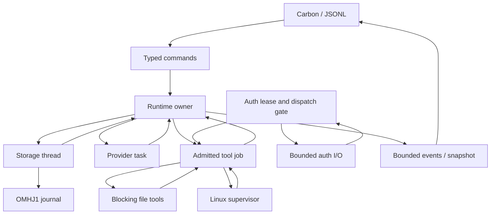

# ANSA: независимый аудит и план полной миграции на Rust

Дата ревью: **12 ноября 2026 года**. Основной результат — архитектурное решение и исполнимый план; Rust runtime в рамках этого ревью не реализован. Production baseline остаётся C++20.

## D1. Фактическое состояние репозитория

### Источник, снимок и метод проверки

GitHub connector предоставил прямое чтение `junknewera/ansa`. Проверенный HEAD `main`: **`f6c2b3f08151bfd6eeff7f6ad0f8564a2444d8a9`**, commit `docs: record visual acceptance and startup latency verification`, 2026-11-12 10:02:07 UTC (13:02:07 МСК). Tree: `34f33ac23f50f033be030a78f4e43106958a5eda`. На момент проверки новых commits относительно задания не было. Это [неизменяемый снимок ревью][S-head], а не предположение по содержимому PROJECT_STATE.

Через connector получены все **68 tracked files**; для каждого локального файла вычислен Git blob SHA-1, все 68 совпали с recursive Git tree. В `src/` 24 файла / 5 805 строк, в `include/omh/` 17 / 784, в `tests/` 16 / 3 839, включая fixtures/scripts. Это размер исходного снимка, не оценка сложности и не прогноз объёма Rust. Прочитаны AGENTS, PROJECT_STATE, architecture, implementation-report, TODO, README, CMakeLists, flake и фактические source/test bodies. Проведены отдельные source reviews protocol/auth, runtime/storage и process/frontend; выводы сведены и перепроверены. Старые чаты и сторонние отчёты не служили доказательством реализации.

Используются четыре разных статуса доказательств:

| Статус | Что он означает |
|---|---|
| **CODE** | Контракт найден в исходниках указанного SHA; наличие кода само по себе не доказывает все исполнения. |
| **TEST** | Найдено содержательное assertion/fault scenario в существующем тесте. Результат нового запуска указывается отдельно. |
| **DOC** | Заявление документации: исторические native gates, live acceptance или явно объявленное ограничение. |
| **PROPOSAL** | Решение этого плана; не выдаётся за уже реализованную возможность. |

### Что удалось исполнить при этом ревью

Среда: Linux `6.18.57`, **x86_64**, UID 1000, GCC 14.2.0, libcurl 8.14.1, OpenSSL 3.5.7. Nix, CMake, Ninja, Cargo и rustc отсутствуют. Для диагностической сборки взяты unmodified source files ANSA и upstream yyjson **0.12.0**, версия из pinned Nix recipe. Указанный в recipe дополнительный patch изменяет только pkg-config paths, не `yyjson.c/h`.[S-build][R-yyjson]

Выполнена ручная сборка GCC: `-std=c++20 -O0 -g0 -pthread`, исходные warning flags, 17 core translation units, executable и десять test executables. Затем непосредственно запущены **85 существующих CMake-зарегистрированных non-mutation scenarios**: **84 PASS, 1 FAIL**. `--self-check` и `--offline-demo` входят в эти 85 и прошли. Дополнительный `tests/cli_backpressure.py` прошёл. Это **не CTest, не Nix build, не sanitizer run и не native X13s acceptance**. Два CMake mutation-build tests здесь не исполнялись. Rust-код и зависимости здесь не собирались.

Единственный отказ: `process-detached` → `detached descendant cleanup failed`. Отдельный повтор дал тот же результат. Узкий helper, связанный с неизменённым `omh_core`, подтвердил: в среде отсутствует `/proc/self/task/<pid>/children`; `direct_children()` превращает ошибку чтения в пустой список. Отделившийся через `setsid()` child не обнаруживается, cleanup через примерно 1,56 s заканчивается `cleanup_complete:false`, `Execution::failed`, `Effects::unknown`. Diagnostic helper явно завершил и reap-нул собственного потомка. Это объяснённый **portability/cleanup gate**, а не доказанная регрессия на X13s; консервативная классификация unknown сохранилась, cleanup — нет. Rust preflight должен обнаруживать отсутствующий механизм до запуска команды.[S-process]

В документации для кода `28eb41f` заявлены native NixOS/aarch64 Debug и Release **87/87**, ASan/UBSan **85/85**, повторные UI/auth checks и live acceptance. Это отдельные **DOC** сведения. Они не превращают наш результат 84/85 в 85/85 и не закрывают здесь power-loss/TSan/native gates.[S-state][S-report]

### История архитектурных milestones

Проверены recent commits и GitHub compare каждого baseline с HEAD. Последний код менялся в `28eb41f`; `f6c2b3f` меняет только PROJECT_STATE и implementation-report.

| Baseline | До HEAD | Changed files | Что нужно учитывать в миграции |
|---|---:|---:|---|
| `ede828d71eb6176575c9baa5ddeb4f645c038b16` — protocol hardening | 16 commits | 59 | Уже существовали strict admission/native replay; далее появились runtime, persistence, auth, local agent и Carbon. |
| `10a11dd80602b127e659d2f0de6f493372f46f0d` — offline runtime | 14 | 57 | От этого baseline нельзя выводить современную storage/auth/process семантику. |
| `c0295bd57631dcfda4f5e0f7b8d67e60fbf42d94` — persistent sessions | 12 | 51 | Позже добавлены own SIWC, live prompt summary, process evidence, modes и transcript. |
| `e2f8e1ce2cf19395fd61288f5103dc916faf0adc` — SIWC | 10 | 44 | Современные multiround local tools и Carbon отсутствовали в исходной SIWC границе. |
| `66250f78498f484e904c7261e9c173c0852f4fc7` — local agent | 6 | 31 | Добавлены durable modes, preview, transcript pages, terminal renderer и lazy network guard. |
| `93393ab9e4316faabad931e23676b8a61c41f67a` — Carbon CLI | 3 | 11 | `28eb41f` добавляет `agent_authorization.hpp`, меняет renderer/auth startup и соответствующие tests. |
| `28eb41f0af449e943811cfbf9a4053f2dd7983ee` — UI/startup polish | 1 | 2 | HEAD — documentation-only evidence update; production source bytes те же. |

Проверяемые сравнения: [protocol→HEAD](https://github.com/junknewera/ansa/compare/ede828d71eb6176575c9baa5ddeb4f645c038b16...f6c2b3f08151bfd6eeff7f6ad0f8564a2444d8a9), [sessions→HEAD](https://github.com/junknewera/ansa/compare/c0295bd57631dcfda4f5e0f7b8d67e60fbf42d94...f6c2b3f08151bfd6eeff7f6ad0f8564a2444d8a9), [local agent→HEAD](https://github.com/junknewera/ansa/compare/66250f78498f484e904c7261e9c173c0852f4fc7...f6c2b3f08151bfd6eeff7f6ad0f8564a2444d8a9), [Carbon→HEAD](https://github.com/junknewera/ansa/compare/93393ab9e4316faabad931e23676b8a61c41f67a...f6c2b3f08151bfd6eeff7f6ad0f8564a2444d8a9), [последний code commit→HEAD](https://github.com/junknewera/ansa/compare/28eb41f0af449e943811cfbf9a4053f2dd7983ee...f6c2b3f08151bfd6eeff7f6ad0f8564a2444d8a9).

### Проверка заявленных возможностей по коду

| Возможность | CODE / TEST | Ограничение или уточнение |
|---|---|---|
| Независимый multistep agent loop | `Runtime::Impl::advance`, `complete`, `run_worker`; agent-loop roundtrip/known-failure/limit/between-rounds/crash tests.[S-runtime][S-loop-test] | Не Codex SDK/app-server. Local CLI defaults 32 rounds/64 calls на Resume segment; hard cap 64/256 на turn. Legacy JSONL по умолчанию сохраняет прежнюю меньшую границу. |
| Responses API / SIWC | `request_body`, `ResponseStream`, `SiwcProvider`; protocol/transport tests.[S-responses][S-transport] | Закрытое подмножество событий. Unknown event/item и `[DONE]` отвергаются; это не полная реализация всех Responses capabilities. |
| PKCE / OIDC / JWKS / rotating refresh | `AuthManager`, RS256 verification, strict discovery endpoints, nonce/state, durable pending markers; 16 auth suites.[S-auth][S-auth-crypto][S-auth-test] | Plaintext 0600, один профиль. Account — hash issuer/client/sub; workspace continuity опирается на issued client binding SIWC, отдельного локального workspace claim нет.[R-siwc-signin] |
| Provider-native continuation | Полный prior input → все native items → matching function outputs, с сохранением binding/epoch/snapshot.[S-responses] | Полные JSON values и number lexemes сохраняются; оригинальные пробелы/escape spelling сетевого JSON не обещаны. |
| SSE / tool-call admission | Streaming UTF-8/BOM/newlines/limits; private CompletedResponse после terminal+EOF+successful transfer; весь batch валидируется до executor.[S-sse][S-responses][S-tools] | Preview предварительный. Один принятый `output_item.done` никогда не разрешает исполнение. |
| Compiled ToolRegistry | Descriptor/schema/domain validator/executor/revision; move-only consume-once batch.[S-tools] | 5 local tools; general JSON Schema engine и plugin framework отсутствуют. |
| File/search/process tools | list/read/search/run_command/get_test_value; nofollow, link-count, bounds, protected paths, scoped instructions.[S-local-tools][S-local-test] | Самостоятельного file replacement tool нет. Запись файлов — через run_command. Shell full access не ограничен фильтрами file tools. |
| Linux ProcessRunner | Fresh reexec supervisor, subreaper, group, WNOWAIT, PDEATHSIG, control pipe, evidence и no-replay.[S-process][S-process-test] | Не cgroup sandbox. При гибели supervisor/недоступном procfs cleanup может быть unknown; remote effects не откатываются. |
| Control owner / cancellation | Owner, execution, storage, stop contexts; bounded slots, priority Cancel, work identity, late known outcome.[S-runtime][S-inbox][S-runtime-test] | Cancel не стирает уже совершённый эффект. Бесконечно зависший syscall/callback не получает deadline от языка. |
| Persistent journal / recovery | OMHJ1 parts, framed checksummed envelopes, hash chains, flock, fsync, torn tail continuation, reducer replay.[S-journal][S-session][S-session-test] | Полный replay; нет общей ротации, индекса checkpoints, format migration. fsync зависит от filesystem/hardware. |
| Context compaction / epochs | Live `omh.summary.v1` prompt summary, exact recent tail и durable epoch; legacy offline encrypted compact.[S-compaction][S-codec][S-summary-test] | Не live native compact endpoint. JSON/item budget, не tokenizer; long-summary semantic quality открыта. |
| Typed frontend / snapshot / resync | v1 IDs/cursors, Submit/Cancel/Snapshot/Transcript/Resume, bounded event ring, mode, preview generation.[S-contracts][S-cli][S-frontend-test] | Snapshot — производная проекция, не альтернативный storage source. |
| Carbon CLI / basic-plan | Normal terminal buffer, local history, stream preview, backend read-only plan snapshot, PTY tests.[S-agent-cli][S-terminal][S-cli-test] | Нет полного CommonMark/полного grapheme editor; отдельный TUI и orchestrate — TODO. |
| CMake / Nix / tests / sanitizers | 87 зарегистрированных CTest entries, sanitizer option, pinned flake на aarch64/x86_64.[S-build][S-flake] | Наш новый запуск — только описанный выше host diagnostic. Объявленный target сам по себе не доказательство тестирования. |

### Findings, которые влияют на решение

**F1. Главная граница миграции — совместимость семантики и identities, а не перевод синтаксиса.** `Json::operator==` игнорирует object-key order, но сравнивает числовые lexemes буквально. `dump()` сохраняет порядок keys при построении, и именно от него вычисляются tool revision, instruction token, plan/compact epochs, account identity и process specification hashes. Default serde map сортирует keys; сохранённый RawValue может содержать whitespace, которого уже нет в C++ canonical dump. Оба упрощения способны сломать resume без ошибки парсинга.[S-json][S-tools][S-config][S-session][S-process]

**F2. Auth rollback и session rollback имеют разные необратимые последствия.** После успешной rotation старый refresh token может быть consumed; восстановление старого credential backup запрещено. После side effect нельзя вернуться к старому journal и автоматически повторить невидимую ему операцию. Совместимый актуальный v1 state важнее возможности восстановить любой старый файл.[S-auth][S-session]

**F3. Workspace continuity опосредована issued client identity.** Код проверяет issuer/client_id/sub, registration host_id, auth session и локальный cwd/profile binding; отдельного provider workspace/org/tenant claim в нём нет. Официальный SIWC contract говорит, что issued client остаётся связан с зарегистрированным workspace. Поэтому сохранение и pinning client_id имеет значение для workspace continuity; отсутствие отдельного workspace claim само по себе не доказывает дефект. Нельзя описывать эту защиту как самостоятельную локальную проверку workspace_id или выводить workspace из email. Новый trusted field, если потребуется, вводится отдельным versioned policy change.[S-auth][S-auth-crypto][S-config][R-siwc-signin]

**F4. `--auth-status` не полностью read-only.** Он не делает network request, но выполняет pending cleanup и directory fsync. Проверка миграционной совместимости должна иметь отдельный inspect path без writeback. В этом ревью реальные credential values не открывались.[S-auth]

**F5. JSONL shutdown при навсегда заблокированном stdout не имеет доказанного верхнего предела.** Writer выполняет blocking `std::cout`, EOF вызывает `output.join()`. Existing backpressure test освобождает pipe перед wait, поэтому проверяет доступность Cancel, но не bounded shutdown с исчезнувшим reader. Carbon имеет иной nonblocking output path. Это статически подтверждённый test gap; production reproduction именно этого сценария здесь не выполнялся. В Rust нужен явный writer shutdown contract.[S-cli][S-backpressure][S-agent-cli]

**F6. Linux supervision имеет проверяемые prerequisites.** Наш воспроизведённый `process-detached` отказ показывает, что недоступный `/proc/.../children` нельзя молча считать отсутствием потомков. Ранний M1 spike должен выполняться на X13s и проверять этот интерфейс, subreaper и privilege restrictions. На неподдерживаемом host runtime должен отказать до нового process effect, если нет отдельно доказанного fallback.[S-process][S-process-test]

**F7. Существующие тесты — полезный oracle с известными пробелами.** Реально проверяются nonterminal/invalid streams, whole-batch rejection, replay builder и два meaningful mutants, fsync/crash boundaries, cancellation races, rotation/logout и PTY behavior. Не исчерпаны JWT aud-array/azp/critical-header/key-size branches, real HTTP trailer behavior, все syscall interleavings, TSan, hardware power loss и long-session cost. C++ и Rust, одинаково ошибающиеся на новом случае, не удовлетворяют gate.[S-protocol-test][S-auth-test][S-session-test][S-report]

### Документированные ограничения и TODO

Открыты hardware power loss, TSan, длительные journals/submit-map copies, long-summary quality, token budget, реальная logout/revoke acceptance. Live encrypted reasoning отдельно не наблюдался в документированных probes: соответствующая continuity проверяется synthetic fixtures. Full access не является sandbox; no_new_privs ограничивает exec elevation, не уже доступные privileged brokers. Reconciliation unknown effects и conflict-aware file replacement отсутствуют. MCP, Ask, интерактивный sudo, hooks/TRASH, orchestrate и отдельный TUI отложены.[S-state][S-report][S-todo]

## D2. Migration decision

### Вердикт: **MIGRATE TO RUST**

Рекомендую **полную нативную Rust migration через проверяемые параллельные milestones**. Production cutover разрешается только после compatibility/correctness gates. Фундаментального технического основания оставить core на C++ не найдено. При этом источник уже имеет разумную архитектуру и защищающие state machines: это не аварийное переписывание неисправного проекта.

Для ANSA выигрыш Rust конкретен: owned jobs и completions, типы distinct identities, неизменяемые shared requests, consume-once admitted batch, явные durable receipts, OwnedFd и проверяемые `Send`/`Sync` границы. Часть текущего ownership/callback/move reasoning становится проверяемой компилятором. Это сокращает пространство ошибок при будущих изменениях одного владельца проекта и Codex implementer. Protocol admission, auth lifecycle, journal ordering и process supervision всё равно остаются ответственностью ANSA.

Полная migration соответствует намерению владеть всем runtime. Долгосрочный hybrid оставляет самые сложные state/lifetime boundaries в C++ и добавляет вторую сборку и FFI либо IPC. Для отдельного UI эксперимента hybrid допустим, но он не достигает поставленной цели. На время migration две независимые программы с общей differential harness полезны; это переходный процесс, а не конечная hybrid architecture.

### A / B / C

| Критерий | A — Continue C++20 | B — Full Rust migration | C — Hybrid |
|---|---|---|---|
| Memory safety | RAII уже используется; корректность aliased state и callbacks держится на review/tests. | Safe Rust сильнее ограничивает lifetime/use-after-free/data-race ошибки; unsafe/transitive libraries требуют отдельного внимания. | C++ risks остаются; typed JSONL избегает cross-language pointers, FFI требует отдельного ownership contract. |
| Concurrency/cancellation | Текущие четыре contexts и dispatch gates известны и протестированы в пределах suites. | Ownership jobs проще; cancellation/effect state machines нужно сохранить явно. Async abort опасен для durability. | Две cancellation/lifetime модели; TUI-only почти не помогает core. |
| Ownership/maintainability | Вам язык знаком; минимальный immediate risk. | Выше начальная learning cost, затем меньше неявных владений на public boundaries. | Нужно уверенно сопровождать оба языка и boundary. |
| Agent protocol | Уже строгая собственная реализация. | Тот же reducer; serde/SDK не являются заменой admission. | Protocol всё равно C++; новая UI не упрощает replay. |
| POSIX/Linux | Существующий narrow syscall/fork design уже работает на заявленном target. | OwnedFd/safe wrappers помогают; subreaper/exec semantics те же, нужен ранний spike. | TUI через typed JSONL не переносит FDs/process callbacks; in-process FFI требует отдельного контракта. |
| OAuth/OIDC/crypto | OpenSSL/libcurl и собственные проверенные policies. | Поддерживаемые Rust HTTP/crypto/OAuth primitives; ANSA rotation state остаётся своим. | Auth остаётся в C++ core; TUI через typed protocol не должен получать secrets или auth handles. |
| Sessions/recovery | Минимальная цена сохранения v1 semantics. | Возможна полная v1 compatibility и более явная state model; serializer/hash риск существенный. | Storage всё равно C++, нужны schema/event contracts для Rust consumer. |
| CLI/TUI | Carbon уже реализован, срочной потребности в rewrite UI нет. | Нативный terminal ecosystem удобен; малый Carbon renderer достаточен. | Выгоден только при UI-only цели, которой здесь нет. |
| Binary/RSS/startup | Небольшая C++ программа с dynamic system closure; текущие данные неполны. | Бинарник может стать больше из-за monomorphization/TLS; RSS/startup выигрыши не обещаются. | Часто две runtimes/closure; итог определяется измерением. |
| Dependencies | curl+yyjson+crypto, но transitive closure шире трёх имён. | Больше Cargo packages; отключённые defaults и единый TLS/crypto backend сдерживают рост. | Объединение closures плюс bridge tooling. |
| aarch64 compilation/performance | Нативный опыт X13s уже есть в DOC. | Rust native target пригоден; clean/incremental build CPU/RSS нужно измерить на X13s. | Два build pipelines усложняют итерации. |
| Hackability владельца | Лучший краткосрочный вариант при вашем нынешнем знании C++. | Выбираем простые modules/enums/functions, мало generics и две production crates; обучение включено в gates. | Требует знать оба мира; bridge отнимает часть простоты. |
| Цена перехода | Наименьшая сейчас; ownership risks остаются в прежнем языке. | Наибольший одноразовый риск и стоимость parity; наиболее цельный конечный runtime. | Риск фиксируется надолго, если временный bridge превращается в архитектуру. |

Оценки footprint, скорости и затрат компиляции — **PROPOSAL / hypothesis до M0/M8 measurements**, а не неподтверждённые числа. Rust не гарантирует более быстрый runtime, лучшие ответы модели или меньше token usage.

### Условия пересмотра

Вернуться к **REMAIN ON C++** следует, если M1 не подтверждает native Linux supervision или legacy JSON/hash feasibility; если не удаётся обеспечить двунаправленный v1 journal/auth compatibility без скрытой потери смысла; либо измеренная стоимость build/dependency closure и необходимый уровень Rust abstractions мешают вам самостоятельно менять проект. Сначала устранить конкретный blocker, затем оценить решение снова. UI-only hybrid не должен становиться автоматической компенсацией провала core migration.

Отдельный owner gate: после M2 вы должны суметь самостоятельно добавить bounded pure tool с validator и negative test; после M5 — проследить реализованный путь Cancel и объяснить, кто владеет late outcome. Если это требует знания чрезмерного framework/type machinery, архитектуру нужно упростить, а не закреплять зависимость от Codex.


## D3. Target Rust system design

Все решения ниже — **PROPOSAL**. Приведённые interfaces иллюстрируют контракты, не являются собранной реализацией.

### Toolchain, workspace и размер архитектуры

**Edition 2024; project MSRV и pinned compiler — 1.98.1.** Edition 2024 технически доступен с Rust 1.85, но для одного Linux-приложения нет оснований обещать поддержку старого toolchain без проверки всего графа. Уже используемый ANSA nixpkgs commit `7fd4004d0511991fff3a0524856a9be09e28c5f0` задаёт `rustcVersion = "1.98.1"`, а `all-packages.nix` выбирает `rust_1_98` по умолчанию. Поэтому M0 может добавить Rust, не менять C++ package set и не вводить дополнительный toolchain overlay. `rust-toolchain.toml`, `rust-version` и Nix compiler должны согласоваться; запуск 1.98.1 в этой среде ревью не выполнялся.[R-edition][R-nix-rust][R-nix-default]

Выбор — **Cargo workspace с двумя production packages**, размещённый в `rust/` рядом с C++:

1. `ansa`: library modules и binary `ansa-rs` во время migration. Здесь protocol, state, network/auth adapters, tools, config и frontend. Собственный код `#![forbid(unsafe_code)]`.
2. `ansa-linux`: узкие Linux filesystem/process/signal wrappers, без business logic agent loop. Сначала safe APIs rustix/std; прямой unsafe допустим только при доказанном отсутствии подходящего API, с отдельным safety argument и тестом.

Временный test adapter — binary target, а не публичный runtime framework. Он не устанавливается в production package. Python stdlib подходит для существующего стиля PTY/parity harness и не становится runtime dependency. Не нужны crate на каждую папку, proc-macro для state machines, event bus framework, DI container или постоянный C++ FFI bridge. После cutover workspace можно переместить в корень отдельным mechanical commit.

```text
AGENTS.md                         # common + production/migration rules
CMakeLists.txt                    # production C++ до cutover
flake.nix / flake.lock            # cpp default; rust package/check alongside
include/omh/ / src/ / tests/      # сохранённый baseline
docs/RUST_MIGRATION_PLAN.md
docs/PROJECT_STATE.md
rust/
  Cargo.toml / Cargo.lock / rust-toolchain.toml
  crates/
    ansa/
      Cargo.toml
      src/
        lib.rs
        bin/ansa.rs               # ansa-rs; early --process-worker
        ids.rs / error.rs / limits.rs
        protocol/json.rs / legacy_json_v1.rs / sse.rs
        provider/request.rs / responses.rs / replay.rs / offline.rs
        transport/client.rs / policy.rs / tls.rs
        auth/manager.rs / claims.rs / jwks.rs / store_v1.rs
        auth/callback.rs / dispatch.rs
        session/state.rs / reducer.rs / journal_v1.rs / codec_v1.rs
        session/transcript.rs / catalog.rs
        context/epoch.rs / assembly.rs / summary.rs / legacy_compact.rs
        runtime/owner.rs / work.rs / dispatch.rs / outbox.rs / shutdown.rs
        tools/registry.rs / admission.rs / files.rs / search.rs
        tools/command.rs / evidence.rs / instructions.rs
        process/supervisor.rs      # standalone single-thread mode
        config/settings.rs / agents.rs
        frontend/args.rs / protocol_v1.rs / jsonl.rs
        frontend/controller.rs / carbon.rs / terminal.rs
      tests/                       # protocol, auth, journal, runtime, PTY
      examples/parity_adapter.rs   # test-only process protocol
    ansa-linux/
      Cargo.toml
      src/lib.rs / fs.rs / process.rs / signals.rs
  fuzz/                            # optional dev targets as introduced
tests/parity/
  run.py / manifest.json / normalizers.py
  cpp_adapter.cpp
  fixtures/                        # synthetic, no credentials/transcripts
  reports/                         # generated evidence; policy in .gitignore
```

Это карта ответственности; small adjacent modules можно объединять до появления реального объёма. Нельзя создавать десятки пустых interfaces ради соответствия дереву.

### Runtime: Tokio и threads

Выбираю **Tokio current-thread runtime** для network, timers, async coordination и owner task; отдельный постоянный **std journal thread** для append/fsync, **bounded blocking tool worker** для file/search/AGENTS/config/catalog I/O, **отдельный bounded auth I/O worker** для auth-file/lock/persistence операций и **supervisor process** для user commands. Core reducers остаются синхронными functions, не зависящими от Tokio. Ни обычная async task, ни малый размер файла не делают std::fs/flock/fsync неблокирующими. File tools не выполняются в reactor или в единственном journal writer; auth lock retry не удерживает reactor и не блокирует commit результата tool. Auth I/O worker обслуживает только bounded local operations, а не network wait; отдельная control lane/latch передаёт logout/cancel. Все blocking jobs имеют retained join/result ownership, и начавшийся syscall нельзя обещать остановить через abort.

Std threads/channels сами по себе годятся: текущая модель это доказывает. Но HTTPS streaming, callback listener, timeout и независимый control проще совместить с общим async reactor. Не нужен multi-thread Tokio pool для одного active turn; при CPU evidence в будущем можно изменить scheduler без изменения state contract. Не нужны и два конкурирующих schedulers вокруг каждого tool.

`spawn_blocking` не является механизмом прерывания: после начала blocking task его abort не останавливает. Долгоживущий fsync loop поэтому получает dedicated thread и bounded queue. `JoinHandle::abort` только планирует cancellation async task; handle нужно join/await, а уничтожение future не выполняет durable reconciliation автоматически.[R-tokio]



#### Ownership и task lifetime

Owner единолично владеет `DurableSession`, mutable turn control, counters, pending transitions и event cursor. Worker получает owned immutable request/job и возвращает owned result. `Arc` разрешён для действительно неизменяемых `Request`, `ToolSnapshot`, native items и cancellation capability; общий `Arc<Mutex<Runtime>>` не нужен.

Каждая task/thread имеет именованного владельца и retained join handle. Effects task не detaches и не уничтожается после Cancel. Session cannot be switched/dropped while it owns uncommitted observed outcomes. Completion с чужим work identity никогда не продолжает текущий turn; известный результат своего operation должен быть доставлен в соответствующий session persistence path до завершения его lifecycle.

Cancel имеет собственный ingress slot/latch и узкий `DispatchGate`: принятие адресной отмены и выдача dispatch permit сериализованы на одной короткой границе. Permit проверяет incarnation, request, turn, resume epoch, storage health и auth lease. Mutex этой границы не удерживается во время network, executor или fsync. Одна проверка AtomicBool задолго до syscall не заменяет этот ordering. Cancellation после выдачи permit останавливает дальнейший dispatch, но уже начавшееся действие остаётся обязанностью supervisor/outcome pipeline.[S-runtime]

| Канал | Начальная ёмкость / политика |
|---|---|
| Submit | 16 entries + byte limit; overflow явно отклоняет Submit. |
| Targeted Cancel | Независимый reserved slot/latch; identity validation до принятия. |
| Snapshot, transcript, Resume | Отдельные bounded requests; не за общим заблокированным Submit FIFO. |
| Execution job / final outcome | По одному active job/guaranteed completion slot; outcome не теряется как preview. |
| Storage request / ack | По одному; owner может обслуживать control во время blocked storage. |
| Blocking file/config jobs | Один execution slot и bounded completion; отдельный от journal writer, cooperative stop между syscalls. |
| Auth local I/O | Bounded worker/queue, nonblocking lock retry с deadline и отдельная control lane; не передаёт secret-bearing state frontend. |
| Preview | Latest cumulative value, один slot, лимит 64 KiB, generation identity. |
| Frontend events | 64 entries и byte budget; потеря → ResyncRequired, cursor и snapshot. |
| Terminal frame | Coalesced latest frame; полный stdout не удерживает runtime owner. |

Сохранение именно чисел defaults нужно для первого parity; оптимизация идёт отдельным изменением с измерением. Mandatory journal/outcome messages нельзя помещать в lossy preview channel.

#### Control phase отдельно от effects

```rust
// Newtypes prevent mixing identifiers. Fields/constructors are module-private.
pub struct SessionId(String);
pub struct TurnId(String);
pub struct RequestId(String);
pub struct OperationId(String);
pub struct RuntimeIncarnation(String);

pub struct WorkId {
    incarnation: RuntimeIncarnation,
    turn: TurnId,
    request: RequestId,
    resume_epoch: u64,
}

pub enum ControlPhase {
    Idle, Persisting, Generating, Executing, Paused, Cancelled, Completed,
}
pub enum Effects { NotStarted, KnownResult, Unknown }
pub enum Execution { Succeeded, Failed, Cancelled, Denied }
pub struct ToolOutcome {
    pub execution: Execution,
    pub effects: Effects,
    pub output: String,
}

// No Clone / Deserialize / public constructor: receipt is issued after fsync ack.
pub struct DurableIntent {
    invocation: ToolInvocation,
    work: WorkId,
    receipt: CommitReceipt,
}
pub struct PreparedBatch { /* validated immutable calls; consume once */ }
pub struct AuthorizedExecution { /* owned auth lease + stop bridge */ }

pub struct ActiveOperation {
    invocation: ToolInvocation, // retains call_id + runtime-assigned operation_id
    work: WorkId,               // retained through every effect phase
    phase: EffectState,
}

pub enum EffectState {
    AwaitingIntent,
    Ready(DurableIntent),
    Running,
    Observed(ToolOutcome),
    Committed(CommitReceipt),
    Unknown,
}
```

ActiveOperation — enclosing ledger: invocation/work identity сохраняется даже в Observed, Committed и Unknown. Executor возвращает ID-free ToolOutcome; runtime сопоставляет его с immutable job identity. Это не требование сериализовать enum discriminants Rust напрямую. Legacy wire codec явно отображает прежние string/numeric tags. `Cancelled + Observed(KnownResult)` — нормальная комбинация. `Cancelled → игнорировать outcome` — запрещённая архитектура.

### Error handling и shutdown

Domain errors — небольшие typed enums: `ProtocolError`, `AuthError`, `StorageError`, `ProcessError`, `CompatibilityError`. Wire `code/stage/diagnostic` имеют явный v1 mapping. Secret-bearing values не реализуют обычный Debug/Display; сообщения об ошибках используют фиксированные diagnostics. `anyhow` допустим только в outer CLI, если реально упрощает boundary; в core он не заменяет различение known/unknown/not_started.

Каждый error после dispatch классифицируется по effects, а не автоматически как safe retry. Failed storage acknowledgement не доказывает отсутствие записи на диске: reopen проверяет фактический valid prefix. Worker panic/join failure после permit даёт unknown или сохраняет уже известный outcome; `unwrap` не должен уничтожать единственную копию результата. Panic policy фиксируется в профилях осознанно; нельзя получать ложное `not_started` из unwinding.

Shutdown: закрыть новый dispatch → принять Cancel → отменить provider → закрыть supervisor control pipe → получить/recover outcome → попытаться commit → закрыть channels → join workers → восстановить terminal flags/termios. Пока storage syscall не возвращается, гарантируется responsiveness owner, не математически конечный graceful exit. Принудительное завершение — отдельный аварийный путь с последующим recovery. Drop освобождает FD/locks, но не обещает await/fsync или остановку всех remote effects.

### JSON, SSE и native replay

Выбираю `serde` + `serde_json` с `raw_value` для bounded parse/typed envelopes, **не default Value как canonical native storage**. Native item хранится целиком в validated immutable representation. Для legacy v1 потребуется маленький ordered representation и совместимый writer: objects как ordered pairs, numbers как проверенные lexical strings, decoded UTF-8 strings, arrays в точном порядке. RawValue — способ владеть и повторно отправить уже проверенный fragment, а не доказательство duplicate rejection или provenance.[R-rawvalue][R-value]

Разделить три контракта:

| Контракт | Требование |
|---|---|
| Semantic admission | RFC JSON grammar, decoded duplicate keys reject, depth/nodes/bytes, unsigned indices, exact sequence/IDs/model/item consistency. |
| Native replay | Все значения/unknown fields поддерживаемых items, exact encrypted string и number lexemes, item/call/result order, provider/account/model/context provenance. Original wire whitespace не требуется. |
| Legacy hash encoding | В точности тот `dump()` domain, от которого C++ считает existing identities, независимо от того, как serde обычно сериализует структуру. |

C++ принимает большие integer tokens без преобразования в double, но decimal/exponent проверяет через finite `from_chars<double>`; out-of-range, включая underflow, нуждается в golden tests. JSON equality игнорирует object-key order, хотя identity hash его учитывает. Миграционный comparator не должен сортировать keys перед сравнением hash-domain vectors или приводить `1`, `1.0`, `1e0`, `-0` к одному number.[S-json]

Минимальный strict parser adapter: заранее bound bytes/depth; получить lexical values через serde, рекурсивно проверять decoded keys/limits, сохранить numeric spans; canonical writer воспроизводит прежние escapes/order и никогда не реконструирует opaque item только по известным typed fields. Сложный самописный JSON parser вместо serde не нужен. Если выбранная стратегия требует расширенного visitor, его adversarial corpus и fuzz target обязательны до первого production replay.

```rust
pub struct NativeItem {
    canonical: std::sync::Arc<serde_json::value::RawValue>,
    view: NativeItemView, // derived from canonical, never an alternate truth
}
pub struct ReplayProvenance {
    provider: ProviderId,
    account: AccountBinding,
    requested_model: String,
    returned_model_policy: String,
    epoch: std::sync::Arc<ContextEpoch>,
    tools: std::sync::Arc<ToolSnapshot>,
}
pub struct AdmittedResponse {
    request: std::sync::Arc<ImmutableRequest>,
    response_id: String,
    native_items: Vec<std::sync::Arc<NativeItem>>,
    calls: Vec<ValidatedCallView>,
}
pub trait StreamAdmission: Sized {
    fn feed(&mut self, bytes: &[u8]) -> Result<(), ProtocolError>;
    fn finish(self, transfer: SuccessfulTransfer)
        -> Result<AdmittedResponse, ProtocolError>;
}
pub trait ContinuationBuilder {
    fn continuation(
        &self,
        response: AdmittedResponse,
        results: KnownBatchResults,
    ) -> Result<ImmutableRequest, ReplayError>;
}
```

Traits выше показывают interfaces для тестируемых adapters; production может использовать обычные inherent methods без дополнительной dynamic dispatch abstraction. `SuccessfulTransfer`, `AdmittedResponse`, `KnownBatchResults` имеют закрытые constructors; для saved response используется тот же final semantic validator. Можно устранить C++ round trip «saved JSON → synthetic SSE → parse», но только после equivalence tests; обычный `Deserialize<AdmittedResponse>` обходом admission быть не должен. Continuation не принимает новый provider/model/account/instructions.

SSE — небольшой собственный incremental framer: exact EOF framing, CR/LF/CRLF, fragmented BOM/UTF-8, multiline data, comments, reset name, poisoned state after sink error. Reconnecting EventSource library не нужна: авто-reconnect нарушит one-shot Responses и rotation assumptions. Не вызывать lossy `.text()` conversion до strict UTF-8 validator.[S-sse]

### HTTP/TLS: основной выбор и граница доказательства

Основной вариант — **один transport adapter на `hyper` + `hyper-util` + `http-body-util` + `hyper-rustls`/`rustls`**, общий для Responses, discovery/JWKS, token/revoke и models. Его задача — byte transport и policy, не собственный HTTP parser.

Основание для более низкого уровня: C++ считает bounded headers, отвергает repeated/wrong MIME и Content-Type trailers, допускает только определённый missing-MIME Responses profile. У `hyper-util` есть управление HTTP/1 header buffer/count, HTTP/2 header-list size и connection retry; hyper позволяет наблюдать HTTP/1 informational responses. Проверка duplicate MIME использует multimap `get_all`, не только первое значение.[S-transport][R-hyper]

`reqwest 0.13.5` — допустимая пересматриваемая альтернатива, а не технически невозможный вариант. Его `chunk()` пропускает non-data frames, но public conversion в `http::Response<reqwest::Body>` и `BodyExt::frame()` позволяют читать trailers. Поэтому аргумент «reqwest не умеет trailers» неверен. Вопрос — достаточность публичного контроля header/interim limits и фактическая сложность всей transport policy. M1 должен сравнить эти два adapters и оставить один; если reqwest доказывает согласованные bounds и уменьшает общий код, выбор можно изменить ADR.[R-reqwest]

Обязательная policy:

- HTTPS-only, проверка server name/certificate, explicit native root policy на NixOS. Одно `ring` crypto provider; defaults, притягивающие второй AWS-LC backend, отключены. Использование системного CA bundle проверяется synthetic local CA, без insecure verifier.
- Redirects и автоматические exchange retries отключены. У hyper-util установить `retry_canceled_requests(false)` и не добавлять retry middleware. Не повторять refresh/Responses из-за обрыва после передачи запроса.
- Ответ читается как frames до корректного EOF. Даже после `response.completed` ошибка транспорта, forbidden trailer или незавершённый SSE ведёт к rejection и нулю executors. Preview можно discard.
- Body/request limits остаются ANSA-owned; headers ограничены до/во время накопления средствами stack и отдельно semantic accounting. Для Responses сохранить исходные connect 6 s / transfer 75 s, если change ledger не утверждает иное.
- Никакой автоматической text transcoding, cookie jar, HTTP/3, decompression либо redirect machinery без подтверждённого baseline scenario. Ошибка malformed UTF-8 не превращается в replacement character до admission.
- M0/M1 отдельно инвентаризирует libcurl proxy/CA/DNS environment behavior на synthetic значениях; bare hyper не считается автоматически эквивалентным curl. Не читать значения пользовательских proxy credentials. Если требуемая proxy compatibility не реализована, transport gate остаётся открытым.

Baseline не переопределяет curl proxy defaults, скрывает CONNECT response headers от origin MIME parser через `CURLOPT_SUPPRESS_CONNECT_HEADERS` и не включает content decompression через ACCEPT_ENCODING. Для hyper нужен route adapter: уже существующие `hyper-util` proxy `Tunnel`/SOCKS helpers позволяют обойтись без нового непроверенного proxy crate и собственного CONNECT parser. Но curl и `Matcher::from_env` имеют разный приоритет lowercase/uppercase env; нужен явный нормализатор synthetic configuration и tests HTTPS_PROXY/https_proxy, ALL_PROXY, NO_PROXY, HTTP/HTTPS CONNECT и SOCKS DNS modes. Malformed/unsupported proxy не должен молча переключать на direct connection. CA/resolver behavior baseline зависит от libcurl backend: linkage `OpenSSL::Crypto` не доказывает конкретный TLS backend, а переменные CLI curl нельзя автоматически приписывать libcurl. Более строгие CONNECT helper limits также входят в change ledger.[S-transport][R-curl-env][R-hyper-proxy]

**Нельзя заранее объявить byte-exact равенство header limits:** libcurl callback bytes, normalized HeaderMap и HTTP/2 decoded-list accounting различаются. Local H1/H2 server должен доказать bounded resource use и rejection corpus; deliberate более строгий rejection range фиксируется отдельной compatibility decision. Это реальный blocker раннего spike, а не пункт, который можно закрыть фактом компиляции.

Проверенные на дату ревью прямые версии-кандидаты: hyper 1.12.0, hyper-util 0.1.21, http-body-util 0.1.5, hyper-rustls 0.27.10, rustls 0.23.46, ring 0.17.14. Это проверка manifest/API, **не утверждение о проверенном lock graph**. Exact releases/checksums/features и отсутствие лишних дублей фиксирует Cargo.lock на этапе добавления; performance определяется измерением.[R-hyper-manifest][R-tls]

### Auth: сохранить lifecycle, использовать поддерживаемые primitives

Выбор: **`oauth2 5.0.0`, default-features=false**, custom HTTP adapter на том же transport, `ring` для RS256 signature verification, ANSA-owned `claims.rs`/`jwks.rs`. OAuth2 library даёт URL/code/PKCE/exchange types, но **не OIDC verifier и не rotating-refresh transaction**. Входной token JSON проходит strict ANSA validation до более permissive standard deserialization. `StandardTokenResponse<SiwcExtraFields, …>` должен сохранить id_token/earliest_refresh_at и обязательность текущих access/id/refresh/scope/expiry fields.[R-oauth]

`openidconnect 4.1.0` предоставляет полезный verifier и custom HTTP. Однако даже с выключенными defaults содержит обязательные RSA/EC/Ed25519 implementations; fixed RS256 SIWC lifecycle всё равно требует прикладного adapter. Это более тяжёлая альтернатива для текущего scope. Если providers/algorithms разрастутся и ручной claims module станет труднее проверять, решение надо пересмотреть. Defaults oauth2 используют reqwest 0.12: их включение рядом с другим stack даст ненужное дублирование.[R-oidc][R-oauth-manifest]

Сохраняемые explicit policies: pinned issuer/discovery endpoints; RS256 only; reject crit/jku/x5u; bounded kid/JWKS; unique matching key; kty/alg/use/key_ops; RSA modulus/exponent limits; iss/sub/aud/azp/exp/iat/nbf/nonce; refresh nonce может отсутствовать, но присутствующий обязан совпасть. Signature проверяет библиотека `ring`, не ANSA arithmetic. Canonical base64url, CSPRNG, PKCE S256, state comparison и callback exact path/Host/duplicates/timeout остаются тестируемыми границами.[S-auth-crypto][R-ring]

Перед `ring::verify` сохранить application-level byte bounds и **фактическую** bit length modulus из C++. JWK leading-zero policy задаётся явно; normalization не обходит исходные limits. C++ prechecks допускают exponent до 8 bytes, тогда как ring ограничивает его 33 bits. Это потенциально более строгий отказ, не доказанная идентичность всех OpenSSL/ring acceptance ranges: M3 проверяет synthetic vectors и оформляет accepted deviation либо пересматривает backend при реальной необходимости. Не добавлять второй crypto stack заранее. [R-ring-policy]

Auth owner хранит registration lifecycle и текущую session identity; cross-process serialization обеспечивается прежним flock, а не только Tokio mutex. `AuthorizedExecution` владеет lease до завершения executor и отдаёт stop при logout. Bearer не хранится в frontend/model catalog cache. Network auth/model checks выполняются при dispatch; первый UI frame зависит только от локального состояния.

### Storage, filesystem и process isolation boundaries

Первый Rust writer сохраняет **journal v1**, без SQLite, event store framework или нового snapshot source. Private `ValidatedTransition` создаётся reducer до write; storage thread записывает frame и sync, затем owner применяет transition и публикует durable event. Recovery применяет только frame/chain-verified records. Volatile known outcome при fsync failure хранится отдельно от durable transcript.

`std::fs::rename` недостаточен для всех операций. Auth replace использует свой atomic-replace contract; create-once process evidence — NOREPLACE. Нужны owned directory FDs, openat/nofollow traversal там, где он уже требуется, regular/nlink/owner/mode validation, EINTR-aware write loops, fsync file и parent directory. `tempfile` можно использовать в tests; security-sensitive production write protocol остаётся явным.

ProcessRunner сохраняет **fresh single-thread reexec supervisor** в том же ELF, entry до Tokio/auth/UI initialization. Supervisor хранит worker lock, durable consumed marker, control pipe, primary waitable PID и process group; subreaper усыновляет descendants. Порядок WNOWAIT → group/descendant cleanup → reap → durable outcome сохраняется. `tokio::process::Child::kill_on_drop` один этот контракт не реализует.[S-process]

Для FD/process APIs сначала `std::os::fd::OwnedFd` и `rustix`. Safe wrappers существуют для многих prctl/capability операций. Если требуется `CommandExt::pre_exec`, его unsafe contract нужно доказать: после fork многопоточного process никаких allocation, locks, environment reads и произвольных Rust callbacks. Вынести bootstrap в узкий `ansa-linux`, документировать все syscalls, проверить parent-death race, descriptor leak, signal masks и exec failure. Single-thread supervisor снижает поверхность, но не снимает автоматически все требования `pre_exec`.[R-rustix][R-pre-exec]

No_new_privs, очищенные capabilities, запрет root/mismatched UID и direct sudo сохраняются. Они не запрещают уже разрешённые privileged brokers, сеть или remote side effects. Cgroup/container sandbox не добавляется в parity scope. Если supervisor убит или cleanup нельзя доказать, result unknown; автоматический replay всегда запрещён.

### Carbon и terminal

Выбор: небольшой собственный Carbon renderer поверх `crossterm` (только нужные terminal/event features) и `unicode-width`; `unicode-segmentation` добавляется, если выбран полноценный grapheme editing. Ratatui не требуется текущему main-buffer CLI. Full TUI/alternate screen будет отдельным продуктовым решением.

Frontend принимает только typed snapshots/events; он не читает journal/auth store напрямую и не решает разрешённость tool. Args сначала реализуются небольшим explicit parser: автоматически получить Clap exit2/help/`--` semantics означало бы поменять существующий CLI. Позже Clap допустим после golden command matrix.

Input/output отделены от owner. Не использовать неконтролируемый blocking Tokio stdin read как обещание cancellable interactive input. Terminal adapter должен иметь finite poll/async FD boundary и явный shutdown. JSONL stdout — только events; diagnostics — stderr; нормальный nonTTY текст выдаётся по committed result. Busy/pending-cancel/draft state сохраняется. Escape sanitization применяется к user/model text до терминала, без доверия Markdown.

Visual acceptance: 100×32, 80×24 и узкий terminal; корректные роли, wrap, input/footer, отсутствие остаточных строк после сокращения history, сохранение preview до durable page без дубликата, resize, NO_COLOR/TERM=dumb, Unicode и input preservation. Эталон — screen cells/state и функциональные свойства, не побайтовое равенство ANSI output и не AI-generated mockup.[S-terminal][S-cli-test]

### Dependencies и quality tooling

| Категория | Начальный выбор | Почему не больше |
|---|---|---|
| Async | Tokio `rt,net,time,sync,io-util` и signal support по реальной необходимости; current-thread builder | Без `full` и multi-thread pool по умолчанию. CancellationToken из tokio-util добавляется только при необходимости owned cancellation tree. |
| HTTP | Один выбранный hyper-family adapter; `http`/`bytes` как используемые wire types | Reqwest остаётся альтернативой M1, не вторым production stack. |
| JSON | serde derive + serde_json raw_value | Ordered legacy codec не требует общего IndexMap/JSON-framework. |
| Auth/crypto | oauth2 без defaults, ring, base64/url по фактическим calls | Не добавлять одновременно OpenSSL binding, AWS-LC и ring. PKCE oauth2 может иметь sha2/rand transitives — видеть их в cargo tree, не скрывать. |
| Linux | rustix выбранные fs/process/thread/event APIs; libc лишь если необходимо | No blanket unsafe subsystem. |
| Terminal | crossterm, unicode-width; segmentation при принятом scope | Carbon не требует full TUI framework. |
| Tests | built-in cargo tests, tempfile/proptest как dev-deps, Python stdlib PTY/parity | Fuzz/Loom/Miri/ASan инструменты не входят в runtime closure. |

`Cargo.lock` коммитится. `cargo build/test --locked` и Nix `cargoLock.lockFile` предотвращают незаметное изменение графа. Каждый добавленный crate получает конкретное usage justification, feature list и `cargo tree -e features` evidence. `cargo audit`/`cargo deny` — dev tools с фиксированной policy и временем advisory snapshot, не обещание отсутствия уязвимостей. Не делать автоматический blanket deny всех crate licences/duplicates без анализа необходимости.

Quality gates: fmt, clippy, meaningful unit/integration/property tests, oracle inventory (нулевой набор не PASS), bidirectional compatibility, fuzz JSON/SSE/journal, deterministic barrier races; Loom для маленького dispatch gate, Miri для pure unsafe-free/eligible code, а не Linux fork integration. Sanitizer nightly pin отдельно от stable production: ASan/LSan для native unsafe/process boundaries, TSan — отдельная job с оговорками instrumentation; не обещать Rust UBSan как прямой эквивалент C++ `-fsanitize=undefined`. Официальная документация перечисляет aarch64 Linux среди ASan/TSan targets, но конкретный Nix toolchain и native dependencies всё равно надо собрать и исполнить.[R-sanitizers]


## D4. Матрица совместимости C++ → Rust

Совместимость проверяется на конкретном source baseline и corpus. Она не означает сохранение случайной ошибки или побайтового вида терминала. Любое намеренное расхождение записывается в `tests/parity/manifest.json`/compatibility ledger с причиной, oracle, отрицательным тестом и independent review; undocumented mismatch не считается parity.

### CLI compatibility

| Поверхность | Сохраняемый контракт | Acceptance |
|---|---|---|
| Normal invocation | Interactive без positional prompt при TTY stdin/stdout; one-shot positional prompt; pipe path. | Capture argv/stdin/stdout/stderr/exit; separate PTY cases. |
| Session selection | Normal `--session ID`, `--continue`, `--cwd PATH`; новая invocation создаёт новую session, reopen не повторяет завершённый turn. | Новый cwd без Git; new/explicit/latest session; cwd/profile mismatch; restart. |
| Model/auth options | `--model`, `--returned-model`, `--auth-dir`, `--offline`, `--print-config`. | Exact effective config/request provenance; no implicit fallback account/model. |
| Auth commands | `--login`, `--login-consent`, `--logout`, `--auth-status`, `--refresh-auth`, `--models`. | Synthetic callback/token server; exact stdout fields, diagnostics и local state changes. |
| Diagnostics | `--help/-h`, `--self-check`, `--offline-demo`. | Exit0 + expected contract, no live inference. Self-check version strings могут отличаться по реализации. |
| Legacy frontend | `--offline-jsonl [--session PATH]`, `--live-jsonl --session PATH`, live `--compact-bytes`. | `--session` здесь **path**, не normal CLI ID. Schema v1 fixtures должны различать оба parser paths. |
| Internal worker | `--process-worker PATH` до auth/runtime/TUI initialization. | Isolated supervisor, marker admission, exit125 duplicate worker; не публичная arbitrary-job API. |
| Slash/keys | `/exit`, `/quit`, `/status`, `/cancel`, `/resume`, `/basic`, `/plan`; Tab/Shift+Tab, Ctrl+F, PgUp/PgDn. | Режим только на безопасной границе, draft сохранён, backend snapshot соответствует mode. |
| Output | NonTTY committed assistant text в stdout, status/errors в stderr; JSONL stdout только events. | Перекрытые pipes, invalid command, slow reader, EOF, никакого debug/secret output. |
| Exit codes | Обычно success0; normal contract/parse failure1; отдельные usage branches2; interrupted one-shot130; SIGTERM/SIGHUP128+signal. | Не заменять всё на Clap exit2. Idle interactive Ctrl+C может завершаться0; закрепить сценарий в oracle. |
| Parser details | Duplicate flags reject; текущий normal parser не имеет общего `--` delimiter. | Negative argv matrix, empty/oversized/NUL-compatible inputs, exact handling of extra arguments. |

Source of truth CLI — main/agent_cli/cli, а не только help text.[S-main][S-agent-cli][S-cli]

### Data / identities / replay

| Данные | Текущий формат/поведение | Rust gate / rollback |
|---|---|---|
| `~/.ansa/config.json` | Global schema1 → cwd `.ansa/config.json` → CLI model override; unknown keys reject. | Fixtures типов/defaults/limits/security keys. Никакого автоматического rewrite при inspect. |
| `~/.ansa/AGENTS.md` и project instructions | Global затем filesystem root→cwd; config overlay не ходит по всем ancestors. Scoped nested instructions имеют token handshake. | Сохранить тексты/base prompt/order/path normalization/hash; nofollow/hardlink bounds. Изменение instructions создаёт новую session как сейчас. |
| `~/.ansa/sessions/<id>/info.json` | Advisory catalog с id/cwd/profile; continue выбирает подходящую session по journal part mtime. | Journal остаётся authority. Не использовать info.json для обхода init binding. |
| Journal parts | `part-00000000000000000000.log`, OMHJ1, linked parts + record hashes. | C++ read → Rust append → C++ reopen; reverse; неизменный старый byte prefix; те же lock/permissions. |
| Session events | `init`, `accepted`, `response`, `intent`, `outcome`, `continued`, `compacted`, `done`, `cancel`, `pause`, `resume`. | Все transitions, optional legacy mode/basic и legacy limits. Unknown schema → diagnostic/read-only, zero dispatch. |
| IDs | Persisted request sequence; operation_run прежней incarnation в operation IDs после restart; новая runtime incarnation. | Не назначать новые operation IDs восстановленным operations. JSONL newtype codec сохраняет representation. |
| Epochs | `ansa_local_v1`, plan hash, exact_state, summary/legacy compact hashes. | Golden hash domains + next request equality; запрещена невидимая замена prompt/model/config/tool revision. |
| Native items | Полный supported item JSON, unknown fields, encrypted strings, number lexemes, item order. | Production builder comparison + mutation oracles; no summary text as substitute for opaque reasoning. |
| Process evidence | `operations/SHA256(operation_id)/request.json`, `started.json`, `result.json`, `worker.lock`. | Exact invocation/spec hash/enum codec, create-once semantics. Valid evidence admitted once into canonical journal. |
| Resume | Explicit Resume после restart/paused; known prefix не исполняется заново; unknown блокирует. | C++/Rust interop на accepted/intent/outcome/continued/compact/done boundaries. Нельзя лечить unsupported state очисткой. |

Источники форматов и identities: journal/session/context_codec/agent_config/process.[S-journal][S-session][S-codec][S-config][S-process]

#### OMHJ1: точный wire contract

- Part header: `OMHJ1 ` + decimal index шириной20 + space + lowercase SHA256 **всех bytes previous part** + LF. Для первого previous hash — 64 нуля.
- Frame header: hex length шириной8 + space + hex ones-complement length шириной8 + space + SHA256 **точных body bytes** + LF; 83 bytes.
- Body envelope: `schema_version:1`, `sequence`, `previous` hash и `event`. Part index и record sequence — разные identities.
- Torn header/body сохраняется; новый part ссылается на hash всего старого, включая torn tail. Full-frame checksum/sequence/semantic corruption блокирует запись.
- Reader объявляет record limit32MiB и parts4096; JSON builder имеет собственную границу16MiB. Нельзя считать32MiB обещанием вместимости любого writer path.[S-journal][S-json]

Новому writer не требуется воспроизводить bytes каждого будущего envelope C++: hash считается от реально записанных bytes. Но legacy hash-domain values, identities и reducer semantics обязаны совпадать. Отдельные golden vectors нужны для account hash, tool advertisement, instruction token, plan epoch, compact native digest, process request hash, operation directory name и part/frame chain.

### Auth compatibility и переход без повторного входа

**Переход без login технически возможен**, если существующий store валиден и Rust сохраняет его contract. Язык executable не меняет registered SIWC client identity. Нельзя гарантировать бесшовность для revoked/expired/ambiguous/unsupported state.

| Элемент | Сохраняемый контракт |
|---|---|
| Default path precedence | Существующий `$XDG_STATE_HOME/oh-my-harness` либо `~/.local/state/oh-my-harness` раньше `~/.ansa/auth`; explicit `--auth-dir` сохраняется. |
| Own identity | `registration.json` version1: host_id, issued client_id, subject, exchange_pending, revocation_uncertain, optional last_revocation_confirmed. Не перерегистрировать автоматически при наличии валидной identity. |
| Credentials schema1 | client_id, host_id, subject, nonce, session, id/access/refresh tokens, scope, expires_at, earliest_refresh_at, refresh_pending. Реальные значения не входят в fixtures/review/logs. |
| Account/workspace | SHA256 C++ canonical array `[issuer, client_id, subject]`; не email. Issued client сохраняет зарегистрированный workspace по SIWC contract; отдельный workspace claim клиент не изобретает.[R-siwc-signin] |
| Lock/lease | Тот же `lock`, cross-process flock; guard/lease удерживается на sensitive exchange и исполнении. Mutex процесса этого не заменяет. |
| Refresh | Durable pending до POST; exact permission/scope/identity validation; same auth session; atomic replace + file/dir fsync. Uncertain exchange не повторяется. |
| Logout | Durable signed-out marker запрещает новый dispatch и вызывает stop; local removal и remote revoke различаются. `remote_revocation_confirmed` не становится true без доказанного результата. |
| Private storage | Проверки owner/mode/regular/nlink/nofollow остаются; plaintext 0600 — существующий contract, secret store вне parity scope. |

До auth writer gate проверяются исключительно generated synthetic stores/key pairs. Реальные credentials нельзя копировать в repo, отчёт, fixture, stdout или shadow-comparison dataset. Для будущего controlled pilot используют действующий собственный store под тем же lock; это отдельный runtime action, не часть данного планирования.[S-auth][S-auth-crypto]

**Auth rollback:** сохранить рабочий C++ executable и открыть **актуальный** совместимый v1 store. После любой Rust rotation нельзя восстанавливать старые `credentials.json`/registration pending flags из backup и пробовать старый token повторно. При несовместимом/ambiguous current state — остановить live dispatch и выполнить отдельно разрешённую reauthorization; не «чинить» markers вручную.

### Execution / permission compatibility

| Инвариант | Gate |
|---|---|
| Whole response + batch admission | Любая ошибка second call/terminal/framing/MIME/model → zero executors. Preview не capability. |
| Durable intent before effects | Inject stop/crash/fsync failure на каждой границе; ни process exec, ни file mutation не начинаются до committed receipt. |
| Outcome before next executor | Known result sync-ится до следующей операции; late result после Cancel не теряется. |
| Unknown effects | Неуспешный cleanup/ambiguous launch/crash без trustworthy evidence → unknown и blocked Resume; no automatic replay. |
| Process tree | Group + private subreaper + WNOWAIT + inherited signals reset + PDEATHSIG race + control EOF; tests на setsid/runtime death/supervisor death. |
| Privileges | non-root/matching UID, zero capabilities, no_new_privs, direct sudo disabled; no обещания sandbox. |
| File tools | Полный nofollow walk в требуемых paths, regular/single-link, protected roots, nested AGENTS tokens и bounds. |
| Plan | Отдельный backend read_only snapshot; mixed read/write batch целиком reject. Не просто instruction «не менять файлы». |
| External/remote effects | Cancel не откатывает изменения на диске/в сети; escaped descendants без supervisor/cgroup могут пережить runtime. |
| Write conflicts | Advisory locks и inode/size checks не объявляются atomic CAS; arbitrary shell не получает preimage guarantee. |

### Frontend compatibility

Typed commands/events v1, command dedup с mode, incarnation, request ID и stream_sequence сохраняются. Snapshot с through_sequence и transcript query echo восстанавливает потерянные events. Transcript содержит accepted user и durable final assistant; preview имеет отдельные generation/state и исчезает при отказе. Basic/plan используют общую историю с точным turn mode; cancelled/failed partial text не становится canonical history.[S-contracts][S-cli][S-frontend-test]

Visual/function gates: history до первого prompt; три последних completed exchanges и pending user; Ctrl+F и paging сохраняют draft; resize не оставляет мусор; busy submit сохраняет/явно отклоняет ввод; Ctrl+C доступен при blocked output/storage; Unicode invalid bytes/control sequences безопасны; Markdown assistant ограниченный, user literal. Нет требования одинакового ANSI byte stream. JSONL permanently blocked reader получает заданный bounded shutdown policy и диагностируемую потерю frontend delivery без потери durable state.

### Общая rollback procedure

1. До writer parity Rust работает только с synthetic fixtures и независимыми копиями тестовых данных. Production C++ package и store не меняются.
2. До live pilot сохранить C++ executable/Nix closure, exact source/build manifest и snapshot данных для forensic recovery. Backup не является разрешением повторять effects.
3. После writer parity два executable используют одинаковые locks и никогда не пишут в одну session/auth directory одновременно. Shared store запускается поочерёдно; no shadow dual execution реального run_command.
4. При Rust failure сначала остановить dispatch и восстановить **наиболее свежий** valid journal/evidence. Старый C++ должен прочитать это состояние. Unsupported schema/revision → read-only/export diagnostic и blocked execution, исходные bytes сохраняются.
5. Нельзя восстанавливать более старый journal после новых side effects и автоматически продолжать: это сделает совершённую operation снова «невыполненной». Unknown остаётся unknown до отдельного reconciliation contract.
6. Auth rollback следует отдельному правилу выше: не откатывать rotating tokens. После несовместимого обновления данных cutover считается не reversible и не должен был пройти gate.

### Полная component migration map

Paths ниже относятся к [reviewed SHA][S-head]. Headers соответствующего имени входят в ту же строку; `src/` и `include/omh/` не удаляются до M10. Dependencies обозначают семейства, exact features фиксируются при milestone.

| C++ source → | Responsibility | Proposed Rust module | Dependencies | Migration strategy | Tests | Risks |
|---|---|---|---|---|---|---|
| `src/json.cpp`, `include/omh/json.hpp` | Owning bounded JSON, diagnostics, digest | `protocol/json.rs`, `legacy_json_v1.rs`, `error.rs` | serde/json raw_value, ring | Strict values + separately tested C++ dump/hash writer; no default Value as authority | dependencies suite, huge numeric/Unicode/duplicate corpus, fuzz | Number rounding, key sorting, underflow acceptance, private errors leaking data |
| `src/sse.cpp`, `sse.hpp` | UTF-8/SSE chunk framing | `protocol/sse.rs` | std | Pure incremental state machine, poisoned errors, finish boundary | Existing all splits/bytewise/newlines/BOM + property partitions | Accepting partial EOF, auto reconnect, lossy Unicode |
| `src/responses.cpp`, `responses.hpp` | Reducer/admission | `provider/responses.rs` | strict JSON, types | Explicit allowed events/items; private AdmittedResponse; previews separate | reducer adversarial + terminal/ID/model/order mutations | SDK permissiveness, tools before terminal/EOF |
| `src/responses.cpp:26–50,304–320` | Builder/native continuation | `provider/request.rs`, `replay.rs` | canonical native, ToolSnapshot | Exact prefix/native/results order and provenance | Production serialized request oracle, drop/reorder mutants, hash vectors | Dropped opaque fields, changed namespace/model/epoch |
| `src/transport.cpp`, `transport.hpp` | HTTP/TLS bytes + completion gate | `transport/client.rs`, `policy.rs`, `tls.rs` | selected hyper family/rustls/ring | One adapter, bounded head/body/trailers, no retries | Injected current tests + local H1/H2/TLS/proxy fault server | Hidden retries, MIME duplicates/trailers, header/CA/proxy drift |
| `src/auth.cpp`, `auth.hpp` | Registration/login/rotation/logout/leases | `auth/manager.rs`, `store_v1.rs`, `callback.rs` | oauth2 defaultfalse, transport, platform fs | Synthetic-first v1 roundtrip; explicit pending/marker state | All auth suites + simultaneous C++/Rust lock + crash every exchange boundary | Consumed refresh replay, new registration identity, changed path precedence |
| `src/auth_crypto.cpp` | PKCE/JWK/claims/signature | `auth/claims.rs`, `jwks.rs` | ring, base64, oauth2/url | Same policy on maintained primitives; no custom RSA | Current JWT vector + missing aud/azp/crit/key/nonce/callback cases | Generic defaults relax issuer/algorithm/time/nonce checks |
| `src/agent_authorization.hpp` | Lazy model/account/session dispatch guard | `auth/dispatch.rs` | owned auth lease | Validate after durable intent, cache only nonsecret policy per epoch | lifecycle/dispatch-logout/held-execution + lazy first-frame | Network reintroduced before UI; stale bearer/lease after login |
| `src/auth_cli.cpp` | Auth command frontend/browser launch | `frontend/args.rs`, `auth/callback.rs` | std process, auth | Preserve commands and redacted status; never wait on whole browser lifetime | Synthetic loopback callback, duplicate query/state, timeout | Browser invocation/environment differences, token in output |
| `src/session.cpp`, `session.hpp` | 11-event reducer/history/turn state | `session/state.rs`, `reducer.rs`, `transcript.rs` | types, canonical codec | Validate→write→commit; durable/volatile split; legacy defaults | session suites, all cut points, backward mode/limits | Cancel drops known outcome; incorrect next request/IDs |
| `src/journal.cpp`, `journal.hpp` | OMHJ1 durable append/recovery | `session/journal_v1.rs` | std I/O, ring, ansa-linux fs | Read-only first; exact framing/chains; then v1 writer | Every torn boundary, corruption, ENOSPC/EIO, C++↔Rust append | Rewriting torn tail, fsync ordering, pretending CAS |
| `src/context_codec.cpp`, `context_codec.hpp` | Save/load request/response | `session/codec_v1.rs`, shared final validator | strict JSON, provider types | Shared semantic admission without synthetic SSE only after equivalence | Saved responses altered across each field/unknown metadata | Deserialize creates trusted type without validation |
| `src/compaction.cpp`, `compaction.hpp` | Prompt summary, legacy native compact, epochs | `context/summary.rs`, `legacy_compact.rs`, `epoch.rs` | provider, canonical hash | Preserve omh.summary.v1/two-turn tail/byte budget | summary/session compact failure/cancel/restart | Silent switch to native endpoint/tokenizer, altered summary provenance |
| `src/runtime.cpp`, `runtime.hpp` | Serialized owner and jobs | `runtime/owner.rs`, `work.rs`, `shutdown.rs` | Tokio current-thread + std writer | Pure reducers then owned actor; explicit join/outcome lifecycle | Deterministic barrier traces + all runtime/session races | Async task abort loses durable evidence; owner blocks on disk |
| `src/runtime_inbox.hpp` | Work identity/priority selection | `runtime/dispatch.rs`, `outbox.rs` | bounded channels, narrow mutex/latch | Cancellation linearization and guaranteed completion vs lossy preview | Queue saturated + stale work/new resume + Loom small gate | Testing helper instead of actual production scheduling path |
| `src/tools.cpp`, `tools.hpp` | Registry/schema/batch/operation IDs | `tools/registry.rs`, `admission.rs` | std, protocol types | Compiled Tool trait/static registrations; full batch validate then consume | tools suite, new pure tool, invalid mixed batch0 executors | Generic plugin framework, changed descriptors/revisions |
| `src/local_storage.cpp`, `local_storage.hpp` | Private FD storage/create-once evidence | `ansa-linux/fs.rs`, `tools/evidence.rs` | rustix/std OwnedFd | Distinguish atomic replace vs NOREPLACE; same ownership checks | symlink/hardlink/FIFO/race/modes/dir-fsync | std path convenience loses traversal/link guarantees |
| `src/process.cpp`, `process.hpp` | Supervisor/process tree/evidence | `process/supervisor.rs`, `tools/command.rs`, `ansa-linux/process.rs` | rustix, narrow audited unsafe if needed | Early risk spike; full implementation after durable runtime | all process suites + procfs unavailable/PDEATHSIG/FD failures | Assuming Child drop kills descendants; evidence hash incompatibility |
| `src/local_tools.cpp`, `local_tools.hpp` | Five local tools and scoped instructions | `tools/files.rs`, `search.rs`, `command.rs`, `instructions.rs` | platform fs, config, registry | Preserve schema/bounds/revisions/output/instruction handshake | local and agent-loop suites, plan/read/write denial | Full-access mistaken for sandbox; adding write_file changes scope |
| `src/agent_config.cpp`, `agent_config.hpp` | Settings/AGENTS/context/catalog | `config/settings.rs`, `agents.rs`, `session/catalog.rs` | strict JSON, fs, ring | Exact defaults/ordered text/epoch and latest-session selection | config/catalog/instruction-links + golden effective request | Root/cwd traversal changed, prompt rewritten, config rebind |
| `src/main.cpp` | Entry dispatch | `bin/ansa.rs`, `frontend/args.rs` | std | Early worker branch; migration binary distinct name | All command/exit/stdio modes, help and self-check | Automatic CLI defaults silently break scripts |
| `src/cli.cpp` | JSONL v1 adapter | `frontend/protocol_v1.rs`, `jsonl.rs` | serde wire-only, bounded output | Explicit field codec incl absent/null; fix permanent blocked shutdown via reviewed contract | CLI scripts, schema snapshots, slow reader/cancel/EOF | Dropped ids/cursors; diagnostics mixed into stdout |
| `src/agent_cli.cpp` | Carbon controller/input/session bootstrap | `frontend/controller.rs`, `args.rs` | runtime, terminal | Preserve pending submit/cancel, history-first, backend modes | PTY, input-size, busy, auth-lazy, late preview | UI state drives execution policy; first frame waits on network |
| `src/terminal.hpp` | Renderer/TTY restoration | `frontend/carbon.rs`, `terminal.rs` | crossterm, unicode-width | Semantic screen corpus; safe user/model text; explicit terminal guard | resize/NO_COLOR/Unicode/control escape/cell snapshots | Alternate screen drift, escape injection, false grapheme guarantee |
| `include/omh/contracts.hpp` | Typed IDs/commands/events | `ids.rs`, `frontend/protocol_v1.rs` | std/serde | Newtypes internally; same v1 representation externally | contracts/frontend-resync/transcript query corpus | Rust enum layout accidentally becomes wire format |
| `src/offline.cpp`, `offline.hpp` | Deterministic provider fixture path | `provider/offline.rs` | production framer/reducer/builder | Same core path as live; injectable bytes/results | offline roundtrip and future parity adapter | Test fake bypasses production admission |
| `CMakeLists.txt`, `flake.nix`, `flake.lock`, all tests | Build, native package, quality evidence | additive Nix rust attrs, Cargo.lock, parity harness | build/test tools only | C++ default retained; Rust added beside; baseline tag/closure | full CTest, Rust native, differential, sanitizer gates | Empty-test success; mutating lock/toolchain while comparing |


## D5 — Исполнимый roadmap полной Rust migration

#### Статус и границы плана

Решение: **MIGRATE TO RUST при прохождении последовательных compatibility gates**. Сейчас production runtime остаётся C++20. Ни scaffold, ни успешный Rust unit test, ни работающий интерфейс не означают готовность заменить `ansa`. План не разрешает реализовать весь перенос одним изменением.

Проверенный исходный снимок — `f6c2b3f08151bfd6eeff7f6ad0f8564a2444d8a9`. Перед M0 Codex получает актуальный remote HEAD и проверяет изменения после этого SHA. Docs-only commits не меняют code baseline; новые C++ изменения сначала включаются в audit и corpus. Зафиксировать source SHA, а не полагаться на имя `main`.

В review-среде выполнен дополнительный ручной Linux/x86_64 diagnostic build: 84 из 85 существующих non-mutation cases прошли; `process-detached` не прошёл из-за отсутствующего procfs children interface. Это не CMake/CTest, не Nix, не sanitizer и не native X13s result. Поэтому M0 обязан заново установить baseline на ThinkPad X13s / NixOS / aarch64. Нельзя записывать review-host 84/85 как 87/87 либо незаметно исключать detached test.

Текущая задача запрещает реальные credentials и платные model calls. **M0–M8 полностью synthetic/offline.** M9 содержит отдельную точку будущего пользовательского разрешения на конкретные live actions и расходы. M10 содержит отдельное разрешение на удаление C++. Эти два разрешения не следуют из согласия изучить миграцию.

### Общая организация Git, сборки и evidence

Начать с отдельной ветки `migration/rust-runtime`. Если рабочее дерево занято, создать отдельный worktree; не stash-ить, не reset-ить и не переписывать чужие изменения. C++ executable, package default и существующие fixtures сохраняются до cutover. Сначала tag на неизменённый исходник, а отметку last known good присвоить только после actual native gates. Сохранить executable C++ и build manifest; на Nix сделать GC root для fallback closure, иначе tag не сохранит исполняемый rollback artifact.

Rust живёт в `rust/`, Cargo workspace имеет **два production packages**:

* `rust/crates/ansa`: library и binary `ansa-rs`; module boundaries для protocol/provider/auth/session/runtime/tools/frontend.
* `rust/crates/ansa-linux`: узкие Linux filesystem/process/terminal wrappers. Здесь допустим отдельно обоснованный unsafe, если safe syscall API недостаточен. В `ansa` — `forbid(unsafe_code)`.

Edition 2024; начальные MSRV/toolchain **1.98.1** из уже pinned nixpkgs `7fd4004d0511991fff3a0524856a9be09e28c5f0`. Это deliberate reproducibility choice, а не заявление, что исходники используют каждую новую возможность языка. Не добавлять второй toolchain overlay. `Cargo.lock` коммитится; Nix `buildRustPackage` использует этот lock. Обновление MSRV/dependencies — отдельный reviewed change, не побочный эффект milestone.

Добавить named Nix package `ansa-rust` и check `rust`, оставляя default C++. `nix develop --no-update-lock-file` должен давать C++ инструменты и согласованные rustc/cargo/rustfmt/clippy. При необходимости rust-toolchain.toml повторяет pin для rustup-пользователя, но Nix остаётся authoritative build environment.

### Контракт нового differential harness

Следующие файлы и команды **предлагается создать в M0; в audited HEAD их ещё нет**:

`tests/parity/run.py` на Python standard library; `tests/parity/README.md`; versioned synthetic fixtures и manifests в `tests/parity/fixtures/`; C++ adapter `tests/parity/cpp_adapter.cpp` по мере появления потребности; Rust test adapters внутри integration tests/examples package `ansa`, без третьего production crate. В M0 реализуются preflight/capture/check и базовый CLI capture; остальные subcommands первоначально возвращают явный nonzero «suite not implemented», а не PASS.

```sh
python3 tests/parity/run.py preflight --output build-migration/preflight.json
python3 tests/parity/run.py capture --cpp-build build-ansa --output build-migration/cpp-baseline
python3 tests/parity/run.py compare --suite protocol --cpp-build build-ansa --rust-target rust/target --output build-migration/M2
python3 tests/parity/run.py fault --suite sessions --cpp-build build-ansa --rust-target rust/target --output build-migration/M4-fault
python3 tests/parity/run.py check --milestone M2 --evidence build-migration/M2
```

Harness сохраняет case ID, source/binary SHA, platform/toolchain/dependency versions, fixture digest, actual command, exit status, stdout/stderr separately, normalized semantic result и expected safety property. Dynamic incarnation/PID/temp path сравниваются через explicit identity mapping; operation/call/context identities и payload не выбрасываются «ради зелёного diff». Для races сравниваются разрешённые partial orders и counters, а не случайный scheduling order.

Для fixture isolation использовать explicit synthetic home/auth/session/cwd inputs существующих adapters; не переназначать HOME текущей сессии и не запускать обычный CLI bootstrap против реального global config/AGENTS. `--offline --cwd <temp> --auth-dir <temp>` само по себе не изолирует global HOME paths. M0 измеряет безопасные CLI формы и explicit-path frontend adapter отдельно. Метрика неизменённого production first frame остаётся PENDING до контролируемого synthetic filesystem/OS environment для обеих программ; adapter timing не выдаётся за production bootstrap timing. Если для этого нужен test-only dependency-injection seam, он оформляется отдельно, production default path не меняется. Production performance gate закрывается в M7/M8 лишь на корректно изолированном C++ baseline перед Rust comparison.

C++ — behavioural oracle, но не нормативное доказательство безопасности. Каждый case имеет independently stated invariant. Если оба клиента одинаково нарушают invariant, case падает. Acceptance weakening или correction получает отдельную запись rationale и регрессию. Отсутствующий case, skipped required capability, timeout и неисполненный mutant никогда не считаются PASS. Harness запускает только принадлежащие ему synthetic subprocesses; cleanup имеет owner PID/identity и не сигналит произвольным процессам.

Все build/check команды выполняются внутри `nix develop --no-update-lock-file`. Общие Rust команды, начиная с M0:

```sh
cargo build --manifest-path rust/Cargo.toml --workspace --locked
cargo fmt --manifest-path rust/Cargo.toml --all --check
cargo clippy --manifest-path rust/Cargo.toml --workspace --all-targets --locked -- -D warnings
cargo test --manifest-path rust/Cargo.toml --workspace --locked
nix build --no-update-lock-file .#ansa-rust
git diff --check
```

Каждый milestone имеет implementation commit и затем evidence/handoff commit без дополнительных изменений runtime. В handoff записываются tested source SHA, platform, test totals, failures/skips, review, unresolved gates и next milestone. Tag `migration/mN-<name>` указывает на checkpoint с той же проверенной code tree. Не force-update существующий tag. Продолжение возможно только при GO предыдущих зависимостей; WIP checkpoint сохраняет работу, но не закрывает milestone.

### M0 — Воспроизводимая основа, C++ baseline и harness

**Scope и файлы.** Создать workspace manifests/lock, `rust/crates/ansa/src/lib.rs и src/bin/ansa.rs`, `rust/crates/ansa-linux/src/lib.rs`, scoped `rust/AGENTS.md`, named Nix Rust package/check, harness, synthetic fixture manifest и `tests/parity/perf_budget.json` с budgets, фиксируемыми после baseline до Rust comparison. Scaffold явно сообщает, что runtime ещё не реализован; он не маскируется под готовый `ansa`. Корневой production entry point и `src/` не меняются. CMake дополняется только test-only oracle target, если он уже нужен capture; без экспортного ABI и FFI.

**Crates и зависимости.** M0 не требует network/crypto/UI crates; только path dependency на `ansa-linux`. Toolchain и Cargo.lock фиксируются. Предыдущих Rust milestones нет; необходим verified C++ source snapshot.

**Acceptance.** На X13s установить реальный baseline: Debug CTest **87/87** текущих cases, включая два mutants; Nix Release **87/87**; ASan/UBSan **85/85** без recursive mutants. Если HEAD добавил tests, ожидаемый count пересчитать из фактической регистрации и сохранить old/new mapping; не подгонять число исключением failures. Production `--self-check`, `--offline-demo`, existing JSONL/PTy tests запускаются offline. Capture сохраняет fixtures, version info, командную матрицу и доступные безопасные startup/RSS/build measurements с явной маркировкой adapter versus production; production first-frame gate из раздела harness остаётся PENDING до M7/M8. Scaffold проходит Rust build/fmt/clippy/Nix build без runtime parity claim.

**Adversarial/preflight.** Проверить наличие и доступность `/proc/self/task/<own-pid>/children`, own child enumeration, subreaper, waitid WNOWAIT, no_new_privs, capabilities operations, close_range, renameat2 NOREPLACE и fsync directory на synthetic temporary directory. Capability absence — named failure, не пустой список descendants. Никаких commands за пределами test-owned дерева и реальных auth stores.

```sh
cmake -S . -B build-ansa -G Ninja -DCMAKE_BUILD_TYPE=Debug
cmake --build build-ansa -j 4
ctest --test-dir build-ansa --output-on-failure --no-tests=error
./build-ansa/ansa --self-check
./build-ansa/ansa --offline-demo
nix build --no-update-lock-file
cmake -S . -B build-ansa-sanitize -G Ninja -DCMAKE_BUILD_TYPE=Debug -DOMH_SANITIZERS=ON -DOMH_MUTATION_CHILD=ON
cmake --build build-ansa-sanitize -j 2
ASAN_OPTIONS=detect_leaks=1 UBSAN_OPTIONS=halt_on_error=1 ctest --test-dir build-ansa-sanitize --output-on-failure --no-tests=error
python3 tests/parity/run.py preflight --output build-migration/preflight.json
python3 tests/parity/run.py capture --cpp-build build-ansa --output build-migration/cpp-baseline
```

**Checkpoint / GO.** `migration/m0-toolchain-harness`; reproducible toolchain, truthful native baseline, functional capture and capability report. If detached cleanup не проходит на X13s, M0 остаётся blocked для production process migration; narrow scaffold WIP допустим. Исправление существующего C++ дефекта — отдельный минимальный commit/review, затем baseline пересчитывается.

**Rollback / не делать.** Удаляется только отдельный scaffold/worktree при необходимости; working C++ и состояния не тронуты. Не реализовывать SSE, auth, journal, async runtime, full ProcessRunner, TUI, live login. Не называть skeleton performance измерением будущего runtime.

### M1 — Ранние рискованные проверки

**Scope и файлы.** Короткие executable spikes: `protocol/{json,legacy_json_v1}.rs`, `ansa-linux/src/{process,fs}.rs`, `ansa/src/process/supervisor.rs`, `transport/frame_probe.rs`; `tests/parity/fixtures/{json,hashes,transport,process}/`. Проверить три потенциальных blockers до широкого переноса: legacy hash exactness, reexec/supervisor на aarch64, доступность complete HTTP frames/trailers в выбранном transport.

**Crates / зависимости.** M0; serde/serde_json raw_value, ring для SHA256/random, минимальные rustix features; Tokio current_thread и выбранный HTTP/TLS adapter только для local test server. `reqwest` не выбирается автоматически: если его API скрывает trailers/limits, использовать reviewed hyper adapter, а не ослаблять admission. Один TLS backend; default features проверяются через `cargo tree -e features`.

**Acceptance.** C++ и Rust одинаково сохраняют opaque numbers, decoded strings и array order; совпадают tool/instruction/plan/compact/evidence hash vectors. Rust executable умеет войти в private supervisor до Tokio/auth initialization. Synthetic subprocess + setsid grandchild корректно отменяются/reap-ятся; same operation нельзя выполнить дважды. Local HTTP/TLS server показывает status, interim headers, duplicate MIME, body frames, trailers и transfer failure после apparent terminal.

**Fault tests.** Дубликаты decoded JSON keys, `1/1.0/1e0/-0`, huge integers, exponent underflow/overflow, Unicode/NUL, deep nesting; missing procfs, inherited signals, pipe EOF, supervisor death; malicious content-type trailer, invalid certificate, redirect, EOF midway. Добавить synthetic proxy/NO_PROXY/case-precedence/CONNECT/SOCKS/CA/resolver и no-content-decompression cases; unsupported proxy не превращается в direct connection. Для unsupported process capabilities отказ происходит до primary exec; отдельно review-ится fallback, если он нужен.

```sh
cargo test --manifest-path rust/Cargo.toml -p ansa --locked --test risk_spikes
python3 tests/parity/run.py compare --suite risk --cpp-build build-ansa --rust-target rust/target --output build-migration/M1
python3 tests/parity/run.py fault --suite risk --cpp-build build-ansa --rust-target rust/target --output build-migration/M1-fault
```

**Checkpoint / GO / rollback.** `migration/m1-risk-spikes`; три blockers закрыты evidence либо конкретным accepted design correction. Необъяснённый hash drift, недоступные trailers или escaped live descendant без preflight отказа — NO-GO. Вернуться к M0 и изменить узкий adapter/codec; production state не затронут. Не строить полный auth/store/loop, cgroups или transport framework; spike должен дать ответ, а не стать скрытой полной реализацией.

### M2 — Полный protocol, Responses, replay и batch admission

**Scope.** Довести `protocol/{json,legacy_json_v1,sse}.rs`, `provider/{request,responses,native,replay}.rs`, `tools/{schema,registry,admission}.rs`, `transport/{mod,http}.rs`. Сохранить закрытые constructors `AdmittedResponse`/`PreparedBatch`, всю native item representation и provenance. Test adapters используют production builder; `PreparedBatch` consume-once, без `Clone`.

**Crates / зависимости.** M1; serde/serde_json, ring, выбранный transport, Tokio minimal; без reconnecting EventSource и universal schema framework. Compiled pure counter executors нужны только как test oracle. Протокол не получает реальные auth tokens.

**Acceptance.** Перенести **все фактические cases** protocol_tests, обе SSE fixtures и drop/reorder mutants. Все splits/BOM/UTF-8/CRLF, created/sequence/item/call/model consistency, full successful terminal **и успешный transport EOF**. На каждом rejected stream/batch счётчик executors нулевой. Replay сохраняет исходный prefix, all native items, matching outputs, separate requested/returned model, exact epoch/tools/account. Проверить production serialized request, а не внутренний mock объект.

**Fault tests.** Раздробленный UTF-8, trailing partial event после completed, duplicate/out-of-order sequence, final-only overflow, invalid second call, metadata spoofing, unknown event/item, huge number lexeme, MIME trailer, transfer truncation после terminal. Изменение acceptance допускается только как отдельно объяснённая correction с independent safety assertion.

```sh
ctest --test-dir build-ansa --output-on-failure --no-tests=error -R '^(sse|reducer|replay|tools|transport|contracts|mutation-)'
cargo test --manifest-path rust/Cargo.toml -p ansa --locked --test protocol_parity
python3 tests/parity/run.py compare --suite protocol --cpp-build build-ansa --rust-target rust/target --output build-migration/M2
python3 tests/parity/run.py fault --suite protocol --cpp-build build-ansa --rust-target rust/target --output build-migration/M2-fault
```

**Checkpoint / GO / rollback.** `migration/m2-protocol-replay`; accepted/rejected corpus и negative safety oracle совпадают, mutants действительно ловятся указанной assertion. Нет подхода «normalize numbers/order until equal». NO-GO на любом executor при invalid response. Rollback к M1; C++ остаётся default. Не подключать real model, durable executors, journal, automatic retries либо новую Responses capability.

### M3 — Auth/OIDC и совместимый synthetic store v1

**Scope.** `auth/{claims,registration,pkce,callback,manager,dispatch,store_v1}.rs`, platform atomic-replace/lock wrappers, synthetic key/JWKS/token/callback fixtures. Сохранить own dynamic client registration, identity binding, signed-out/refresh_pending/exchange_pending state machines и auth lease lifecycle.

**Crates / зависимости.** M2; oauth2 5 с `default-features=false` как узкий helper PKCE/forms, выбранный transport, ring RS256/SHA256/RNG, нужные base64/url primitives. Claims validation остаётся explicit policy; crypto crate не заменяет issuer/aud/azp/nonce/time checks. Не добавлять parallel HTTP client через defaults oauth2.

**Acceptance.** Same synthetic `registration.json`/`credentials.json` paths, versions, client_id/host_id/sub/session, account hash, nonce/scope/timestamps и marker/lock semantics. C++ reads Rust writes и наоборот; refresh сохраняет session, pending фиксируется до fake POST. Concurrent fake refresh выполняет один exchange; ambiguous refresh не повторяется. Logout отменяет active lease и ждёт release. Первый UI-ready bootstrap не требует network.

**Fault tests.** Все текущие auth suites плюс aud array/azp/duplicate aud, crit/jku/x5u, kid ambiguity, слабый/oversized RSA, actual modulus 2040/2041/2047/2048 bits, exponent 33/34/64 bits, leading-zero n/e и отдельно reviewed stricter rejection, refresh missing nonce versus mismatch, callback duplicate query/Host/path/state, malformed base64url. Crash на каждом pending/replace/fsync/logout boundary; symlink/hardlink/mode/owner failures. Нет вывода synthetic token strings в обычные diagnostics, чтобы этот контракт переносился на real use.

```sh
ctest --test-dir build-ansa --output-on-failure --no-tests=error -R '^auth-'
cargo test --manifest-path rust/Cargo.toml -p ansa --locked --test auth_compat
python3 tests/parity/run.py compare --suite auth --cpp-build build-ansa --rust-target rust/target --output build-migration/M3
python3 tests/parity/run.py fault --suite auth --cpp-build build-ansa --rust-target rust/target --output build-migration/M3-fault
```

**Checkpoint / GO / rollback.** `migration/m3-auth-v1`; подтверждена техническая возможность binary switch без login для valid compatible state, но не обещание для revoked/pending credentials. Workspace continuity сохраняется через issued client_id по SIWC contract; отдельный workspace claim не выдумывается. Локальный cwd binding — иной контракт. Rollback только synthetic fixture root. Не читать реальный store, не вызывать production `--auth-status` ради планирования, не делать live login/refresh/logout, keychain migration или multi-profile.

### M4 — Journal/session v1, exact epochs и recovery

**Scope.** `session/{journal_v1,codec_v1,reducer,state,transcript,catalog}.rs`, `context/{epoch,legacy_compact}.rs`, storage worker primitives. Реализовать OMHJ1 exact framing и все 11 event kinds. Saved response проходит shared final admission; private type нельзя создать прямым Deserialize. Начать reader, затем writer.

**Crates / зависимости.** M2 и M3 для synthetic identity compatibility; std I/O, ring, strict JSON, rustix locks/atomic operations. Никакой SQLite, второго canonical store, schema rewrite, general persistence framework.

**Acceptance.** Golden C++ journals: completed, paused, cancelled, old missing mode, plan, outstanding intent, known batch prefix, summary/native legacy compact, linked torn tails. C++→Rust append→C++ reopen и reverse на fixture копиях; старые bytes не изменяются. IDs, exact epochs/hash domains, request provenance и transcript совпадают. Unsupported state — read-only diagnostic. Общий flock исключает simultaneous writers обеих реализаций.

**Fault tests.** Обрезка каждого header/body boundary; wrong length/complement/checksum/previous/sequence/part name; ENOSPC/EIO/EINTR, file/directory fsync failure, replacement/size conflict, constructor recovered-outcome append failure. Crash после durable intent без outcome не запускает tool; newest valid evidence допускается один раз. `done` fsync failure не публикует assistant в transcript.

```sh
ctest --test-dir build-ansa --output-on-failure --no-tests=error -R '^(session-|summary-codec)'
cargo test --manifest-path rust/Cargo.toml -p ansa --locked --test session_compat
python3 tests/parity/run.py compare --suite sessions --cpp-build build-ansa --rust-target rust/target --output build-migration/M4
python3 tests/parity/run.py fault --suite sessions --cpp-build build-ansa --rust-target rust/target --output build-migration/M4-fault
```

**Checkpoint / GO / rollback.** `migration/m4-session-v1`; writer enabled лишь после bidirectional reader/writer gate. NO-GO на automatic replay, regenerated operation IDs, repaired-by-overwrite hashes либо silent config rebind. Rollback к C++ на последнем совместимом состоянии, не к старому snapshot после новых effects. Не читать пользовательские sessions, не менять формат, не оптимизировать fsync batching и не добавлять reconciliation UI.

### M5 — Owned runtime, cancellation и summary loop

**Scope.** `runtime/{owner,work,dispatch,outbox,shutdown}.rs`, `context/summary.rs`, `frontend/protocol_v1.rs`. Один Tokio current_thread owner владеет state; immutable Request/ToolSnapshot разделяются через Arc. Persistent journal thread имеет очередь capacity=1; отдельные bounded blocking tool и auth I/O workers сохраняют responsiveness при file/search/AGENTS/lock/fsync waits. Эти операции не исполняются в Tokio reactor. Bounded submit/control/completion mailboxes, latest-only preview, resync ring. Пока только synthetic provider/tools.

**Crates / зависимости.** M2–M4; Tokio с нужными rt/net/time/sync/io features, без multi-thread pool по умолчанию; cancellation primitive с narrow owner-checked dispatch gate. Не создавать detached effect task. Blocking journal и external process не «отменяются» drop future.

**Acceptance.** Full batch admission → durable intent → authorization recheck → executor → known/unknown outcome → durable outcome → next dispatch. Cancel независим от заполненной submit queue и blocked output/disk; late known result сохраняется. Work identity incarnation/turn/request/resume_epoch/generation исключает stale continuation. Summary сохраняет exact two-turn tail и активирует epoch только durable commit. Restart pauses до explicit Resume.

**Fault tests.** Cancel при queued success, до/после intent fsync, при auth revoke, в executor, после outcome до continuation; late preview/summary; overflow и snapshot; storage failure с known volatile outcome; injected blocked file/AGENTS read и blocked auth persistence/lock, пока targeted Cancel и Snapshot остаются responsive. Deterministic barriers и bounded state-machine exploration дополняются stress; timeout не может скрыть lost completion. Shutdown сохраняет ownership handles до join/reap.

```sh
ctest --test-dir build-ansa --output-on-failure --no-tests=error -R '^(runtime-|summary-|frontend-)'
cargo test --manifest-path rust/Cargo.toml -p ansa --locked --test runtime_parity
python3 tests/parity/run.py compare --suite runtime --cpp-build build-ansa --rust-target rust/target --output build-migration/M5
python3 tests/parity/run.py fault --suite runtime --cpp-build build-ansa --rust-target rust/target --output build-migration/M5-fault
```

**Checkpoint / GO / rollback.** `migration/m5-runtime-owner`; ноль dispatch после принятой отмены и ноль потерянных known outcomes. Actor responsiveness измерена отдельно от cleanup/durable acknowledgement. Не обещать bounded fsync при неисправном диске. Rollback к M4, сохранённые fixtures читаются старым клиентом. Не добавлять orchestrate, parallel tools, remote plugin tasks или UI redesign.

### M6 — Config/AGENTS, file tools и полный ProcessRunner

**Scope.** `config/{settings,agents}.rs`, `tools/{files,search,command,evidence}.rs`; довести `ansa::process::supervisor` и low-level `ansa-linux::{process,fs}`. Сохранить текущие defaults, exact prompt/settings, instruction_token handshake, session catalog selection, pure/read-only classifications и semantic implementation revisions при доказанном parity.

**Crates / зависимости.** M1 supervisor spike, M4 durable store, M5 runtime; std+rustix/ring/strict JSON. Reexec helper запускается до Tokio, остаётся single-threaded; unsafe boundary только для необходимого fork/pre_exec syscall sequence с отдельным safety proof. Не вызывать allocator/locks между fork и exec multithreaded parent.

**Acceptance.** Все local/process/agent-loop suites на native X13s. Read/search limits и protected paths/links; plan не рекламирует/не допускает command writer. Durable process spec/consumed/result evidence связывает invocation/options и markers по legacy hash. Normal nonzero exit возвращается модели как known result. Сохраняются process group/subreaper, capability/no_new_privs, timeout/output bounds, exact exit/signal, cancellation и recovery. `process-detached` — отдельный обязательный gate.

**Fault tests.** Setsid/fork descendants, missing procfs, primary/supervisor/runtime death, repeated worker/conflicting arguments, exec/cwd failure, stdout/stderr flood/invalid UTF-8, inherited SIGCHLD/mask, parent-death race, FD leaks, PID reuse discipline, partial evidence publication. Оставшийся descendant в test environment явно cleaned harness owner-ом, но исходный case остаётся failed. Unsupported capability отказ до launch.

```sh
ctest --test-dir build-ansa --output-on-failure --no-tests=error -R '^(local-|process-|agent-loop-)'
cargo test --manifest-path rust/Cargo.toml -p ansa --locked --test tools_process_parity
python3 tests/parity/run.py compare --suite tools --cpp-build build-ansa --rust-target rust/target --output build-migration/M6
python3 tests/parity/run.py fault --suite tools --cpp-build build-ansa --rust-target rust/target --output build-migration/M6-fault
```

**Checkpoint / GO / rollback.** `migration/m6-local-tools`; dual-client evidence recovery и all native cleanup tests. Full access не sandbox, remote effects не rollback, supervisor kill может дать unknown. Не менять эти обещания молча. Rollback binary на последнем v1 state; unknown не исполнять повторно. Не добавлять cgroups, privileged broker, sudo, replacement-tool CAS, MCP или Ask в parity scope.

### M7 — Carbon, typed JSONL и CLI compatibility

**Scope.** `frontend/{args,jsonl,controller,input,carbon,terminal}.rs`, binary dispatcher `bin/ansa.rs`, terminal wrappers. Восстановить commands/flags/exit codes/stdout/stderr, one-shot/pipe/interactive paths, history/basic/plan/preview/resync. Manual args parser допустим; framework auto-help не должен поменять legacy exit behaviour.

**Crates / зависимости.** M5–M6; unicode-width и при доказанной необходимости unicode-segmentation; crossterm либо существующие narrow termios wrappers после сравнения closure/behaviour. Не добавлять full TUI framework ради имени Carbon. Standard screen main buffer сохраняется.

**Acceptance.** Fixture command matrix, prompt/history ready ordering, first history page до input, Tab/Shift+Tab/slash modes, Ctrl+F/PgUp/PgDn, input сохранён при busy/resync. Preview не попадает в journal, cancelled/invalid preview discarded. Сценарии 80×24 и 100×32 и resize small→large сравниваются по screen cells/roles/prompt/stale rows; ANSI bytes могут отличаться.

**Fault tests.** Permanently blocked stdout, unread stderr, early Ctrl+C при accepted fsync, EOF/signal/shutdown, writer EPIPE, escaped CSI/OSC, invalid UTF-8/combining/emoji/ZWJ, long multiline input, stale page query, full outbox. Проверить terminal restoration и bounded writer shutdown отдельно: текущий blocked-output test сам по себе не доказывает bounded completion без читающего consumer.

```sh
ctest --test-dir build-ansa --output-on-failure --no-tests=error -R '^(agent-cli-|frontend-|cli-)'
cargo test --manifest-path rust/Cargo.toml -p ansa --locked --test frontend_parity
python3 tests/parity/run.py compare --suite frontend --cpp-build build-ansa --rust-target rust/target --output build-migration/M7
python3 tests/parity/run.py fault --suite frontend --cpp-build build-ansa --rust-target rust/target --output build-migration/M7-fault
```

**Checkpoint / GO / rollback.** `migration/m7-carbon-cli`; функциональные и визуальные acceptance отдельно приложены. Проверить факт local-only first frame, а не просто отсутствие сетевого кода в renderer. Rollback запускает C++ бинарник, session data v1 сохранены. Не требовать pixel-identical typography; не добавлять отдельный alternate-screen TUI, full CommonMark или темы marketplace.

### M8 — Полный offline E2E, ресурсы и independent review

**Scope.** Все modules вместе, release Nix package, `tests/parity/run.py` и проверка уже замороженного в M0 `perf_budget.json`, offline scenario corpus, quality configuration. Это первый gate полного runtime parity, а не только отдельных unit tests. Существующий C++ reference продолжает собираться.

**Crates / зависимости.** M0–M7; production dependency list заморожен и review-ится. Proptest для property corpus и cargo-fuzz как dev tooling добавляются лишь для конкретных parser/reducer targets. Miri проверяет pure logic, не является Linux process proof. C++ ASan/UBSan сохраняются отдельно; Rust ASan/LSan и TSan выполняются в отдельном pinned nightly quality shell с поддержкой target, Miri — для допустимого pure subset. Rust UBSan эквивалент C++ не обещается; неподдерживаемая проверка — explicit open gate.

**Acceptance и fault tests.** End-to-end multi-round basic/plan, known command failure, restart/resume, compact, same-store binary switch, saturated I/O/cancel, crashes на всех durable boundaries. Full CTest включая mutants плюс Rust workspace и differential corpus. Repeated race suites на native aarch64. Independent reviewer пытается нарушить replay, authorization, durable intent, cleanup и shutdown. Увеличение тест-count не заменяет coverage review.

```sh
ctest --test-dir build-ansa --output-on-failure --no-tests=error
cargo test --manifest-path rust/Cargo.toml --workspace --locked
cargo build --manifest-path rust/Cargo.toml --workspace --release --locked
nix flake check --no-update-lock-file
python3 tests/parity/run.py compare --suite e2e --cpp-build build-ansa --rust-target rust/target --output build-migration/M8
python3 tests/parity/run.py perf --cpp build-ansa-release/ansa --rust rust/target/release/ansa-rs --output build-migration/M8-perf
```

Перед perf отдельно собрать C++ `build-ansa-release` с `-DCMAKE_BUILD_TYPE=Release`; не сравнивать Rust release с C++ Debug. Документированные 17–20 ms относятся к нескольким first-frame PTY observations без generation, не SLA и не проверенному cold-cache benchmark.

**Resource budget.** M0 сохраняет raw C++ distribution и numeric budget file; M8 применяет его без молчаливого повышения. Измерять exec→first frame, history ready, Submit→preview, terminal→durable Done, cancel-control ack и process cleanup отдельно; median/p95/max, RSS, binary/stripped size, Nix closure bytes, clean/incremental build time+RSS, SSE MB/s и allocations, fsync latency, user input responsiveness. Отдельные datasets: fresh, 100 и 4096 submits. Warm-cache и controlled cold observations разделены; не использовать privileged drop_caches как обычную проверку. Зафиксировать battery/AC, governor/thermal state, kernel/filesystem/storage, toolchain и бинарный SHA.

Для deterministic fixtures количество provider requests, tool calls и summary calls должно совпасть; model/token usage offline не выдаётся за измеренную live стоимость. Hard correctness/limit budgets неизменны. Допустимые численные regression thresholds фиксируются после baseline с обоснованием, до сравнения Rust; неопределённый threshold не считается пройденным gate.

**Checkpoint / GO / rollback.** `migration/m8-offline-parity`; всё required evidence есть, нет открытых correctness blockers, perf budgets выполнены либо explicit reviewed exception без correctness trade-off. При excessive aarch64 compile RSS сначала features/jobs/codegen measurement, затем архитектурное решение, а не добавление CI машины вместо проверки X13s. Rollback — C++ default. Не запускать live «для полноты», не удалять C++, не заменять пользовательский executable.

### M9 — Отдельно разрешённая live acceptance и обратимый cutover

**Scope.** После M8 подготовить конкретный план: выбранный аккаунт/profile/client identity, модель, ограничение числа generation/summary requests и расходов, synthetic рабочий каталог, harmless tool scenario, перечень login/refresh/logout действий и rollback. Пользователь отдельно разрешает этот план. До разрешения milestone остаётся `NOT AUTHORIZED`, даже при готовом коде.

**Files / crates / dependencies.** M8; `docs/PROJECT_STATE.md`, live acceptance checklist и build/package selection; новых crates не требуется. Актуальный v1 auth store использует сама программа как часть разрешённого live сценария; Codex не печатает и не открывает значения secrets в отчёт. Исходные client_id/host_id/account/session binding сохраняются.

**Acceptance.** Запуск совместимого Rust на текущем valid store без login, если состояние это допускает; explicit login только когда необходим и разрешён. Ограниченный multi-round request, native replay, restart/continue, known safe command, targeted Cancel и отдельно разрешённая refresh проверка. Encrypted reasoning, если provider не прислал его, записывается как not observed; synthetic proof не подменяет live observation. Проверку logout согласовать отдельно, поскольку она меняет реальную авторизацию.

**Fault tests и команды.** Live fault injection не повторяет side effects и не обрывает rotating refresh ради эксперимента; crash coverage уже synthetic в M3–M8. Сначала повторить offline `compare --suite e2e` на exact cutover SHA. Точные live commands составляются по approved flags/client/model и только после разрешения; план намеренно не содержит автоматически исполняемой последовательности платных calls.

**Checkpoint / GO / rollback.** `migration/m9-cutover`; first release candidate оставляет `ansa-cpp` artifact/GC root и быстрый выбор предыдущего package. Default меняется лишь после agreed live results. При отказе Rust открыть состояние original bytes не правятся. После rotating refresh **не восстанавливать старый credentials backup**: C++ должен читать наиболее свежий совместимый store; иначе explicit reauthorization. После новых effects не откатывать journal к старой копии. Не выполнять destructive permission cleanup и не удалять C++ sources.

### M10 — Завершение миграции и удаление C++

**Scope / files.** Только после отдельного пользовательского разрешения: удалить C++ production `src/`, `include/omh/`, CMake-specific packaging и лишние dependencies; назначить Rust binary/package `ansa`; обновить точечные архитектурные ссылки/AGENTS/README. Golden fixtures и independently expressed protocol/storage/process safety cases остаются. Versioned legacy v1 readers/writers не удаляются вместе с C++.

**Dependencies/crates.** M9 плюс фактическое пользовательское использование согласованных сценариев без unresolved blockers. Новых crates нет; closure после удаления C++ dependencies измеряется заново. C++ baseline tag, исходник и executable artifact остаются доступными через Git/Nix rollback, не в production build graph.

**Acceptance/fault tests.** Fresh checkout собирает Rust-only package по lock/Nix с разрешённой загрузкой зависимостей; повтор offline проверяется только при предварительно заполненных и зафиксированных source/dependency/Nix caches; весь Rust/property/parity corpus больше не зависит от установленного C++ oracle, но сохранённые golden expectations доступны. Отдельно cold startup, old-state reopen, unknown-effect block, supervisor cleanup, no credential leaks, CLI exit/stdout/stderr. Independent review подтверждает отсутствие hidden runtime dependency на C++ helper.

```sh
cargo test --manifest-path rust/Cargo.toml --workspace --locked
cargo clippy --manifest-path rust/Cargo.toml --workspace --all-targets --locked -- -D warnings
nix flake check --no-update-lock-file
nix build --no-update-lock-file
./result/bin/ansa --self-check
./result/bin/ansa --offline-demo
git diff --check
```

**Checkpoint / GO / rollback / exclusions.** `migration/m10-rust-production`; корневой AGENTS впервые честно сообщает, что production runtime Rust. До этого такого утверждения быть не должно. При проблемах восстановить C++ package из сохранённого baseline и текущего совместимого state, не cherry-pick-ать старые secrets/journal bytes. Не удалять legacy fixture contracts, не расширять продукт orchestrate/MCP одновременно с cutover и не считать старый бинарник вечным средством чтения новой несовместимой schema.


## D6. Repository changes и handoff

Документационная ветка этого ревью содержит только:

- `AGENTS.md`: точечные migration-aware правила с отдельными production C++ и migration Rust областями.
- `docs/RUST_MIGRATION_PLAN.md`: полный D1–D7 audit/design/compatibility/roadmap/prompts, включая реальные ограничения verification.
- `docs/adr/0001-rust-runtime-migration.md`: короткое решение с условиями GO/NO-GO и rollback.

`main`, C++ source, tests, CMake и flake в этом documentation change не меняются. Rust migration branch/scaffold появятся только при выполнении M0. `docs/PROJECT_STATE.md` сохраняет фактическое production состояние; его будущие handoffs должны иметь отдельные поля C++ last known good и Rust last verified milestone. Этот PR не закрывает runtime milestone.

Корневой AGENTS сохраняет независимый loop, strict admission, provider-native continuity, durable intent, no automatic replay unknown effects, typed frontend, minimal dependencies, independent review и реальные build/test evidence. Добавляются owned async jobs/cancellation, narrow unsafe policy, locked Cargo/Nix, differential tests и ограничения удаления C++. Он прямо говорит, что production пока C++20.

Отдельный `rust/AGENTS.md` полезен начиная с M0 для локальных paths/команд, но не должен дублировать общие инварианты или объявлять их исключения. Его нет необходимости добавлять в текущий docs-only PR до создания `rust/`.

Минимальная запись handoff после каждого implementation checkpoint:

```yaml
migration:
  source_baseline: <immutable C++ SHA>
  implementation_commit: <tested Rust code SHA>
  milestone: M<N>
  status: GO | NO_GO | WIP | NOT_AUTHORIZED
  production_language: C++20 # до фактического cutover
  cpp_last_known_good: <native verified source SHA>
  rust_last_verified: <source SHA or none>
  platform: <kernel / arch / Nix pin / rustc / profile>
  evidence:
    commands: <artifact paths and exact exit statuses>
    test_counts: <passed / failed / skipped by suite>
    compatibility: <fixture manifest SHA and direction>
    resources: <raw measurements + frozen budgets>
  independent_review: <scope / findings / resolution>
  unresolved_gates: []
  next_action: <one concrete command or implementation task>
  rollback: <binary/closure path and current-state compatibility>
```

Не сохранять в handoff secrets, live transcript или environment dump. В source SHA нельзя ссылаться на ещё не существующий commit: сначала code checkpoint, затем отдельный documentation evidence commit с его SHA. Последующий docs-only commit не меняет tested code tree.


## D7 — Готовые задания для Codex CLI

### Prompt: только M0

```text
Ты работаешь над ansa на NixOS/Linux aarch64, ThinkPad X13s.
Выполни только M0 плана Rust migration: воспроизводимый toolchain,
нефункциональный workspace scaffold, проверенный C++ baseline и harness.
Не начинай M1 автоматически.

Сначала прочитай корневой AGENTS.md, docs/PROJECT_STATE.md,
docs/RUST_MIGRATION_PLAN.md и rust/AGENTS.md, если он существует.
Проверь git status --short --branch, последние commits и актуальный origin/main.
Audited code baseline: f6c2b3f08151bfd6eeff7f6ad0f8564a2444d8a9.
Если после него изменился production C++ code, сначала зафиксируй delta
и обнови baseline/corpus. Не присваивай новой code tree старые test results.

Работай в отдельной ветке migration/rust-runtime. При занятом working tree
создай отдельный worktree; сохрани пользовательские изменения.
Не меняй main напрямую. Не удаляй C++ и не меняй его production поведение.

Создай rust/ Cargo workspace: два production packages
crates/ansa (library + binary ansa-rs) и crates/ansa-linux (узкие platform wrappers).
Edition2024, rust-version/toolchain1.98.1 из уже pinned nixpkgs
7fd4004d0511991fff3a0524856a9be09e28c5f0. Commit Cargo.lock.
Не добавляй toolchain overlay, Tokio, HTTP, crypto либо UI crates в M0.
Scaffold должен честно говорить, что runtime ещё отсутствует; не заявляй parity.
В ansa запрети unsafe; в ansa-linux M0 также не нужен unsafe.

Добавь named Nix package ansa-rust и Rust check/dev tools,
оставив default package и executable ansa на C++.
Создай migration-aware rust/AGENTS.md; корневые общие инварианты сохрани.

Создай tests/parity/run.py на Python stdlib, README и versioned fixture manifest.
Реализуй preflight/capture/check; future compare/fault/perf suites обязаны
возвращать явный nonzero, если они ещё не реализованы. Нет пустого PASS.
Capture пишет только synthetic artifacts, source/binary SHA, команды,
platform/toolchain/dependency versions, case IDs, exits/stdout/stderr separately.
Тестовые adapters используют explicit synthetic paths и существующие injection
points. Не переназначай пользовательский HOME и не читай его credential stores.

На X13s собери C++ Debug и запусти весь CTest с --output-on-failure
--no-tests=error: в audited baseline87 tests включая два mutants.
Собери Nix Release package с полными tests. Собери ASan/UBSan с
OMH_SANITIZERS=ON, OMH_MUTATION_CHILD=ON: baseline85 tests.
Запусти production --self-check и --offline-demo.
Не исключай process-detached: review-host не поддерживал procfs children
и получил84/85, это не native X13s PASS.

Preflight проверяет own procfs children enumeration, subreaper/waitid,
no_new_privs/capability operations, close_range, renameat2 NOREPLACE
и fsync directory в temporary owned fixtures. Отсутствующая capability
получает отдельный failure/diagnostic, не маскируется пустым результатом.

Зафиксируй baseline startup/first-frame methodology, RSS, binary/closure size,
build time/RSS и список будущих numeric perf budgets. Разделяй warm-cache,
cold observations, fresh/history-ready и first-model-response. Не обещай17ms.
Если baseline в этой машине не проходит, сохрани WIP evidence и blocker;
не называй его last known good и не ослабляй test ради закрытия этапа.

Проверь cargo build/test --workspace --locked, fmt --check,
clippy --workspace --all-targets --locked -- -D warnings,
nix build .#ansa-rust с --no-update-lock-file, git diff --check.
Передай diff независимому reviewer с M0 acceptance criteria, исправь findings.
Создай отдельный implementation commit, затем evidence/handoff commit,
запиши tested SHA и действительные counts/results/open gates в docs/PROJECT_STATE.md.
Tag migration/m0-toolchain-harness создавай только при GO; не force-update tags.
Сохрани исходный C++ executable/build manifest и Nix fallback GC root.

Запрещено: читать реальные OAuth values, .env и stores других агентов;
запускать login/status/refresh/logout на реальном store; платные или live model
queries; полная миграция; удаление C++; автоматическое начало M1;
новые features MCP/orchestrate/Ask/sudo/TUI; fake test evidence.

В конце сообщи: что создано, source/checkpoint SHA, точные команды/результаты,
native platform, GO или NO-GO M0, unresolved blockers и следующий конкретный шаг.
Не пересказывай неподтверждённые исторические результаты как свои проверки.
```

### Compact prompt для следующих milestones

```text
Продолжи ansa Rust migration: выполни ТОЛЬКО milestone <M_N> из
docs/RUST_MIGRATION_PLAN.md. Рабочая ветка: migration/rust-runtime.

Прочитай AGENTS.md, rust/AGENTS.md, docs/PROJECT_STATE.md и секцию <M_N>.
Проверь git status/log и last verified checkpoint <SHA>; восстанови контекст
из Git/evidence, не из предположений о предыдущей сессии.
Если dependencies milestones не имеют GO, сначала установи blocker,
не перепрыгивай через gate. Сохрани текущий C++ baseline и чужие изменения.

Реализуй указанные module files и минимальные crates/features.
Сначала capture known behaviour, затем Rust equivalent, differential tests,
independent adversarial invariants, validation и только потом replacement.
Missing/skipped required tests не PASS. Не смягчай oracle без отдельной
описанной correction и regression; не теряй native items/IDs/context epochs.
Side effects требуют durable intent; Cancel не уничтожает known outcome;
unknown effects никогда автоматически не повторяются.

Выполни exact acceptance/fault/build commands этого milestone на X13s,
обнови evidence с tested SHA/platform/counts и запроси независимый code review.
После исправлений повтори затронутые gates. Сделай implementation checkpoint
и отдельный truthful PROJECT_STATE handoff: GO/NO-GO, open gates, next action.
Если отсутствует capability, сохрани reviewable WIP и объясни блокировку.

Не запускай real credentials/live/paid scenarios, если отдельное явное
разрешение на конкретный M9 план отсутствует. Не удаляй C++ без отдельного
M10 разрешения. Не начинай следующий milestone в этом задании.
```

Handoff минимально содержит source SHA, tested code SHA, milestone status, actual environment, command/result/count table, newly frozen fixtures/contracts, accepted deviations, risks/rollback instructions и одну следующую воспроизводимую команду. «Все тесты прошли» без этого набора не завершает этап.

## Источники и границы воспроизводимости

Все S-ссылки ниже закреплены на audited commit. R-ссылки — первичная документация/исходники зависимостей, проверенные 2026-11-12; их API требуется перепроверить при изменении Cargo.lock. Наличие ссылки на test не подменяет результат execution; фактические результаты этого ревью перечислены в D1. Code snippets D3 и будущие harness commands D5 не выдаются за выполненную Rust implementation.

[S-head]: https://github.com/junknewera/ansa/tree/f6c2b3f08151bfd6eeff7f6ad0f8564a2444d8a9
[S-build]: https://github.com/junknewera/ansa/blob/f6c2b3f08151bfd6eeff7f6ad0f8564a2444d8a9/CMakeLists.txt
[S-flake]: https://github.com/junknewera/ansa/blob/f6c2b3f08151bfd6eeff7f6ad0f8564a2444d8a9/flake.nix
[S-state]: https://github.com/junknewera/ansa/blob/f6c2b3f08151bfd6eeff7f6ad0f8564a2444d8a9/docs/PROJECT_STATE.md
[S-report]: https://github.com/junknewera/ansa/blob/f6c2b3f08151bfd6eeff7f6ad0f8564a2444d8a9/docs/implementation-report.md
[S-todo]: https://github.com/junknewera/ansa/blob/f6c2b3f08151bfd6eeff7f6ad0f8564a2444d8a9/docs/TODO.md
[S-json]: https://github.com/junknewera/ansa/blob/f6c2b3f08151bfd6eeff7f6ad0f8564a2444d8a9/src/json.cpp#L16-L164
[S-sse]: https://github.com/junknewera/ansa/blob/f6c2b3f08151bfd6eeff7f6ad0f8564a2444d8a9/src/sse.cpp
[S-responses]: https://github.com/junknewera/ansa/blob/f6c2b3f08151bfd6eeff7f6ad0f8564a2444d8a9/src/responses.cpp#L26-L320
[S-transport]: https://github.com/junknewera/ansa/blob/f6c2b3f08151bfd6eeff7f6ad0f8564a2444d8a9/src/transport.cpp#L96-L331
[S-auth]: https://github.com/junknewera/ansa/blob/f6c2b3f08151bfd6eeff7f6ad0f8564a2444d8a9/src/auth.cpp
[S-auth-crypto]: https://github.com/junknewera/ansa/blob/f6c2b3f08151bfd6eeff7f6ad0f8564a2444d8a9/src/auth_crypto.cpp#L74-L147
[S-tools]: https://github.com/junknewera/ansa/blob/f6c2b3f08151bfd6eeff7f6ad0f8564a2444d8a9/src/tools.cpp
[S-local-tools]: https://github.com/junknewera/ansa/blob/f6c2b3f08151bfd6eeff7f6ad0f8564a2444d8a9/src/local_tools.cpp
[S-config]: https://github.com/junknewera/ansa/blob/f6c2b3f08151bfd6eeff7f6ad0f8564a2444d8a9/src/agent_config.cpp
[S-process]: https://github.com/junknewera/ansa/blob/f6c2b3f08151bfd6eeff7f6ad0f8564a2444d8a9/src/process.cpp#L80-L318
[S-runtime]: https://github.com/junknewera/ansa/blob/f6c2b3f08151bfd6eeff7f6ad0f8564a2444d8a9/src/runtime.cpp
[S-inbox]: https://github.com/junknewera/ansa/blob/f6c2b3f08151bfd6eeff7f6ad0f8564a2444d8a9/src/runtime_inbox.hpp
[S-session]: https://github.com/junknewera/ansa/blob/f6c2b3f08151bfd6eeff7f6ad0f8564a2444d8a9/src/session.cpp
[S-journal]: https://github.com/junknewera/ansa/blob/f6c2b3f08151bfd6eeff7f6ad0f8564a2444d8a9/src/journal.cpp
[S-codec]: https://github.com/junknewera/ansa/blob/f6c2b3f08151bfd6eeff7f6ad0f8564a2444d8a9/src/context_codec.cpp
[S-compaction]: https://github.com/junknewera/ansa/blob/f6c2b3f08151bfd6eeff7f6ad0f8564a2444d8a9/src/compaction.cpp
[S-contracts]: https://github.com/junknewera/ansa/blob/f6c2b3f08151bfd6eeff7f6ad0f8564a2444d8a9/include/omh/contracts.hpp
[S-cli]: https://github.com/junknewera/ansa/blob/f6c2b3f08151bfd6eeff7f6ad0f8564a2444d8a9/src/cli.cpp#L28-L245
[S-main]: https://github.com/junknewera/ansa/blob/f6c2b3f08151bfd6eeff7f6ad0f8564a2444d8a9/src/main.cpp
[S-agent-cli]: https://github.com/junknewera/ansa/blob/f6c2b3f08151bfd6eeff7f6ad0f8564a2444d8a9/src/agent_cli.cpp
[S-terminal]: https://github.com/junknewera/ansa/blob/f6c2b3f08151bfd6eeff7f6ad0f8564a2444d8a9/src/terminal.hpp
[S-protocol-test]: https://github.com/junknewera/ansa/blob/f6c2b3f08151bfd6eeff7f6ad0f8564a2444d8a9/tests/protocol_tests.cpp
[S-auth-test]: https://github.com/junknewera/ansa/blob/f6c2b3f08151bfd6eeff7f6ad0f8564a2444d8a9/tests/auth_tests.cpp
[S-runtime-test]: https://github.com/junknewera/ansa/blob/f6c2b3f08151bfd6eeff7f6ad0f8564a2444d8a9/tests/runtime_tests.cpp
[S-session-test]: https://github.com/junknewera/ansa/blob/f6c2b3f08151bfd6eeff7f6ad0f8564a2444d8a9/tests/session_tests.cpp
[S-process-test]: https://github.com/junknewera/ansa/blob/f6c2b3f08151bfd6eeff7f6ad0f8564a2444d8a9/tests/process_tests.cpp
[S-local-test]: https://github.com/junknewera/ansa/blob/f6c2b3f08151bfd6eeff7f6ad0f8564a2444d8a9/tests/local_tests.cpp
[S-loop-test]: https://github.com/junknewera/ansa/blob/f6c2b3f08151bfd6eeff7f6ad0f8564a2444d8a9/tests/agent_loop_tests.cpp
[S-summary-test]: https://github.com/junknewera/ansa/blob/f6c2b3f08151bfd6eeff7f6ad0f8564a2444d8a9/tests/summary_tests.cpp
[S-cli-test]: https://github.com/junknewera/ansa/blob/f6c2b3f08151bfd6eeff7f6ad0f8564a2444d8a9/tests/agent_cli_tests.cpp
[S-frontend-test]: https://github.com/junknewera/ansa/blob/f6c2b3f08151bfd6eeff7f6ad0f8564a2444d8a9/tests/frontend_runtime_tests.cpp
[S-backpressure]: https://github.com/junknewera/ansa/blob/f6c2b3f08151bfd6eeff7f6ad0f8564a2444d8a9/tests/cli_backpressure.py
[R-yyjson]: https://github.com/NixOS/nixpkgs/blob/7fd4004d0511991fff3a0524856a9be09e28c5f0/pkgs/by-name/yy/yyjson/package.nix
[R-edition]: https://doc.rust-lang.org/stable/edition-guide/rust-2024/index.html
[R-nix-rust]: https://github.com/NixOS/nixpkgs/blob/7fd4004d0511991fff3a0524856a9be09e28c5f0/pkgs/development/compilers/rust/1_98.nix#L53
[R-nix-default]: https://github.com/NixOS/nixpkgs/blob/7fd4004d0511991fff3a0524856a9be09e28c5f0/pkgs/top-level/all-packages.nix#L3944-L3952
[R-tokio]: https://docs.rs/tokio/latest/tokio/task/fn.spawn_blocking.html
[R-rawvalue]: https://docs.rs/serde_json/latest/serde_json/value/struct.RawValue.html
[R-value]: https://docs.rs/serde_json/latest/serde_json/enum.Value.html
[R-hyper]: https://docs.rs/hyper-util/0.1.21/hyper_util/client/legacy/struct.Builder.html
[R-hyper-manifest]: https://docs.rs/crate/hyper/1.12.0/source/Cargo.toml
[R-reqwest]: https://docs.rs/reqwest/0.13.5/src/reqwest/async_impl/response.rs.html
[R-tls]: https://docs.rs/crate/hyper-rustls/0.27.10/source/Cargo.toml
[R-oauth]: https://docs.rs/oauth2/5.0.0/oauth2/
[R-oauth-manifest]: https://docs.rs/crate/oauth2/5.0.0/source/Cargo.toml
[R-oidc]: https://docs.rs/crate/openidconnect/4.1.0/source/Cargo.toml
[R-ring]: https://docs.rs/ring/0.17.14/ring/signature/struct.RsaPublicKeyComponents.html
[R-rustix]: https://docs.rs/rustix/latest/rustix/all.html
[R-pre-exec]: https://doc.rust-lang.org/std/os/unix/process/trait.CommandExt.html
[R-sanitizers]: https://doc.rust-lang.org/unstable-book/compiler-flags/sanitizer.html
[R-curl-env]: https://curl.se/libcurl/c/libcurl-env.html
[R-hyper-proxy]: https://docs.rs/hyper-util/0.1.21/hyper_util/client/legacy/connect/proxy/index.html
[R-siwc-signin]: https://developers.openai.com/siwc/token-sharing-open-source/sign-in
[R-siwc-tokens]: https://developers.openai.com/siwc/token-sharing-open-source/token-reference

[R-ring-policy]: https://docs.rs/ring/0.17.14/ring/signature/index.html
