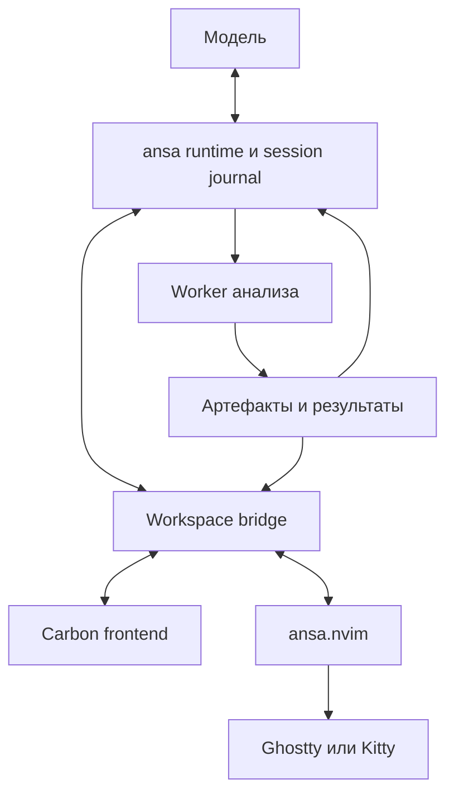

# Ghostty/Kitty, Neovim и графические результаты: system design

Статус: **PROPOSED, docs-only**. Дата: 2026-11-16.
Проверенный baseline исходников: [`main@8b6ecb7`][ansa-base].
Документ описывает предлагаемое расширение; `ansa.nvim`, workspace bridge,
новые tools и artifact API ещё не реализованы. Имена будущих операций ниже
обозначают проектный контракт, а не доступные команды или окончательную schema.

## 1. Задача и выбранная граница

Добавить рабочую среду, в которой чат ansa, настоящий редактор и результаты
анализа доступны одновременно. Пользователь открывает файл в соседнем Neovim,
передаёт агенту выделение, получает оформленный Markdown с таблицами и графиками
и уточняет анализ, сохраняя положение в документе.

Распределение ответственности:

- ansa владеет agent loop, сессиями, допуском tools, отменой и canonical journal;
- workspace bridge связывает интерфейсы с одним владельцем runtime;
- `ansa.nvim` предоставляет контекст редактора и отображает документы;
- вычислительный worker создаёт числовые результаты, таблицы и изображения;
- терминальный адаптер определяет возможности вывода и управляет панелями там,
  где для этого есть подходящий API.

Первый вертикальный срез сохраняет Carbon и добавляет соседний Neovim. Для Kitty
панель открывает native launcher; на Ghostty/Linux MVP подключается из заранее
созданного split. Общий API затем позволяет сделать самостоятельный Neovim
frontend, который управляет раскладкой внутри редактора.

Целевая среда первого этапа — Linux/aarch64, на которой проверен текущий ansa.
Поддержка протоколов Ghostty/Kitty не означает готовый macOS port: flake объявляет
Linux, а системные операции находятся в `ansa-linux`. x86_64-linux требует
своей приёмки. Источники: [README baseline][ansa-readme], [flake][ansa-flake].

### Связь с постоянными терминалами

[Proposal #17][native-pr] отдельно описывает собственные PTY, `TerminalHost`,
input leases и detach/reconnect живого shell. Его [документ][native-design]
имеет более ранний baseline и остаётся proposal. Здесь Neovim запускается
в поверхности внешнего терминала и владеет её экраном; базовый Markdown/PNG
сценарий не требует реализации собственного PTY host или VT эмулятора ansa.

Если позднее появятся постоянные Python kernels или общий output spool,
их ownership, evidence и retention согласуются с принятым контрактом host.
Два независимых canonical журнала диалога или конкурирующих artifact store
не вводятся. M10 и проверенные runtime checkpoints из [PROJECT_STATE](PROJECT_STATE.md)
сохраняют свой статус; этот документ не меняет очередь уже согласованных работ.

## 2. Фактическое состояние baseline

| Область | Что реализовано | Граница расширения |
|---|---|---|
| Carbon workspace | Чат, собственный inspector Source/Diff/Markdown Preview, сессии и локальная консоль | Inspector рисует ansa; реальный редактор в соседнюю область пока не встроен. |
| Внешний редактор | `e` выбирает `VISUAL`, затем `EDITOR`, иначе `vi` | Передаётся весь текущий TTY; все slots должны быть неактивны, pending context/results отсутствовать. |
| Markdown Preview | `markdown_preview` убирает часть маркеров заголовков, emphasis и fences, возвращает строку | Полноценной модели Markdown-блоков и изображений нет. |
| Runtime protocol | Typed commands/events, preview, snapshot, transcript, timeline, resync | Не является готовым внешним API всей рабочей среды. |
| `--live-jsonl` | Live generation, streaming preview, сохраняемая legacy session | Выбирает `pure_tools()` с `get_test_value`, тестовый epoch и default одного tool round. |
| Tools | Compiled registry, immutable snapshot/revisions, validator/executor, policies и recovery | Внешний plugin host, MCP и editor tools ещё не реализованы. |
| Графические результаты | Команда может создать файл на диске | Нет отдельного artifact contract, image events и графического renderer. |

Основание: [workspace][ansa-workspace], [workbench][ansa-workbench],
[terminal handoff][ansa-terminal], [app initialization][ansa-app],
[runtime defaults][ansa-runtime], [tool registry][ansa-registry].

`authorized()` в актуальном `app.rs` устанавливает `streaming: true`;
`live_jsonl()` наследует эти options, а controller передаёт события в JSONL
encoder. Отсутствие streaming не является блокером. Для рабочего клиента
нужно переиспользовать production settings, инструкции и tools обычного CLI.
Источники: [app][ansa-app], [controller][ansa-controller], [JSONL codec][ansa-jsonl].

В [текущем TODO](TODO.md) уже есть задачи про Markdown Preview и мигание чата
при прокрутке редактора. Причина мигания этим статическим разбором не установлена.
Обычное улучшение встроенного текстового Preview можно выполнить отдельно;
оно не требует Neovim bridge и не закрывает интеграцию изображений.

## 3. Протокол вывода и управление панелями

Графический протокол, расширенная клавиатура и remote control окон являются
разными capabilities. Их нельзя выводить из одного имени терминала или считать
взаимозаменяемыми: поддержка Kitty Graphics не предоставляет команды `kitten @`.

| Среда | Изображения | Создание соседней панели | Решение для первой версии |
|---|---|---|---|
| Kitty | Kitty Graphics Protocol | Remote control: launch, layout, focus, resize, close; с 0.50 есть `window-dock` | Автоматический launcher с конкретным window ID. Для старых версий — поддержанный split layout. |
| Ghostty 1.4 на Linux | Общий PNG/RGBA путь через Kitty Graphics | Документированы CLI `+new-window` и `+new-tab`; полный адресный split backend здесь не подтверждён | Подключение Neovim из созданного пользователем split; позже — проверенный адаптер либо раскладка Neovim. |
| Ghostty на macOS | Kitty Graphics; 1.4 — целевой графический baseline | AppleScript с 1.3 умеет создавать splits с command/cwd/env и управлять ими | Возможный будущий frontend adapter после отдельного решения о платформе ansa. |

Kitty 0.50 выпущен 2026-11-03; dock привязан к окну или вкладке и подходит
для редактора рядом с чатом. Ghostty 1.4 выпущен 2026-10-27: авторы заявляют
полное покрытие опубликованной на тот момент спецификации Kitty Graphics,
включая animation и relative placements. Новые расширения протокола проверяются
отдельно; MVP использует PNG/RGBA. Источники: [Kitty changelog][kitty-changelog],
[remote control][kitty-remote], [Ghostty 1.4][ghostty-release],
[AppleScript][ghostty-applescript], [Linux IPC][ghostty-linux].

Launcher сохраняет созданный pane ID и обращается к нему явно. Фокус терминала
не является identity сессии. Повторный запрос открытия находит существующую
панель либо возвращает её состояние. Неопределённый исход запуска сначала
проверяется, чтобы повтор не создавал второй редактор. Закрытие viewer удаляет
его presentation state; оно само по себе не отменяет работу агента.

Доступ к remote control выдаётся интеграционному процессу в необходимом объёме.
Capability detection использует ответы терминала и согласованный backend;
переменные окружения — подсказка. Query replies разбираются отдельно от ввода
пользователя. При неподдержанной графике доступны текст и ссылка на сохранённый
файл. Для SSH данные передаются явно: remote path не считается локальным путём
терминала. tmux требует отдельной проверки passthrough, clipping и cleanup.
Источники: [graphics protocol][kitty-graphics], [Snacks image][snacks-image].

Улучшение клавиатуры Carbon — отдельный slice: нынешний input parser понимает
некоторые CSI-u последовательности, а terminal setup включает bracketed paste
и SGR mouse. Полную negotiation расширенных клавиш нужно реализовать вместе
с parser, восстановлением режимов и обработкой ответов терминала, сохраняя
legacy input. Источники: [input][ansa-input], [terminal][ansa-terminal].

## 4. Два режима интерфейса

### Carbon и соседний Neovim

Работающий Carbon process предоставляет локальный workspace endpoint над своим
runtime. `ansa.nvim` подключается как viewer/editor и отображает подтверждённую
историю, выбранные документы и артефакты. Carbon остаётся владельцем основного
ввода. Передача выделения или сообщения из редактора — явная команда с identity,
проходящая обычную сериализацию и dedup runtime.

Два интерфейса не запускают два ansa на одном session directory. Каждый настоящий
terminal pane имеет свой TTY; Carbon не рисует в TTY Neovim. Existing `$EDITOR`
handoff остаётся отдельным сценарием, не смешивается с одновременной работой.

### Neovim как самостоятельный frontend

Плагин запускает production headless process через обычные pipes и открывает
окна чата, файлов и отчётов внутри Neovim. Это новая проекция той же сессии;
её layout не зависит от API панелей внешнего терминала. Job control обеспечивает
асинхронные stdin/stdout/stderr. JSONL требует собственного bounded line framing:
один callback stdout не гарантирует целую строку. `rpc=true` обозначает
MessagePack-RPC и не используется для JSONL. Источник: [Neovim jobs][nvim-jobs].

Предлагаемый headless entry point использует общий production constructor:
`AgentSettings`, `agent_epoch`, `local_tools`, session catalog/factory,
authorization, loop limits и cancel/recovery. Тестовый legacy JSONL сохраняет
совместимость. Новый entry point и schema выбираются на implementation этапе.

### Markdown и изображения

Первый набор компонентов: `ansa.nvim`, `render-markdown.nvim` и модуль
`snacks.image`. Markdown остаётся настоящим текстовым буфером. Renderer оформляет
заголовки, код, списки, ссылки и таблицы; изображения показывает отдельный backend.
Нужны совместимые зафиксированные версии и parsers `markdown`/`markdown_inline`.
Конвертеры других форматов не становятся обязательными для PNG-only MVP.
Источники: [render-markdown][render-markdown], [Snacks image][snacks-image].

Обновления применяются пачками, сохраняют cursor/scroll position и черновик.
Preview/committed/discarded показываются как состояние интерфейса; временный
preview не превращается в сохранённый отчёт. При редактировании пользователем
сгенерированного документа новая версия результата открывается отдельно либо
проходит явную проверку конфликтов, не затирая dirty buffer.

Картинки размещаются в обычном Neovim buffer или настоящем terminal pane.
Графический passthrough внутри вложенного `:terminal` не является prerequisite:
[задача Neovim #32189][nvim-terminal-images] остаётся открытой на дату исследования.
Классический Vim требует отдельного адаптера; Lua-плагины Neovim автоматически
на него не переносятся.

## 5. Workspace bridge и границы полномочий

Это логические границы, не обязательные отдельные crates или daemon. В первом
режиме bridge живёт вместе с Carbon runtime. Уход viewer не завершает turn;
потеря самого owner проходит существующие pause/recovery правила. Detached agent
lifetime и восстановление памяти процесса не обещаются наличием socket.

Один serialized owner принимает команды и ведёт canonical journal. Нынешний
`Outbox::next()` извлекает событие через `pop_front`, поэтому для нескольких
клиентов нужен явный fan-out с отдельными bounded queues. Медленный viewer
получает gap и snapshot/resync; он не блокирует Cancel, journal writer или
других подписчиков. Stream cursor привязан к incarnation и не является journal
offset. Источники: [outbox][ansa-outbox], [runtime architecture](architecture.md).

Handshake согласует версию, session/incarnation, роль клиента и capabilities.
Команды сохраняют request/command identities; reconnect не повторяет Submit,
редактирование или вычисление под новым ID при неизвестном исходе. Read-only
viewer не получает полномочия controller. Snapshot содержит доступные ему
проекции, а не произвольный native fork seed из существующего `GetContext`.

Локальный IPC использует private Unix socket с проверкой владельца и peer
identity. Доступ к socket даёт только описанные операции; credentials и opaque
reasoning не публикуются интерфейсам. Editor/artefact access сохраняет scope,
protected paths и instruction policy существующих tools. Это API boundary,
не обещание OS sandbox для процессов того же UID.

Все ожидания editor RPC, файловых данных и вычислений выполняются вне control
owner. Перед фактическим действием проверяются актуальные identity, stop и
mode policy. Плагин не получает обход full-response/full-batch admission,
tool budgets, durable intent/outcome или `effect_unknown`.

## 6. Нативные инструменты среды и плагины

| Предлагаемый tool | Содержание и контракт |
|---|---|
| `workspace_describe` | Ограниченная проекция cwd, доступных документов, datasets и результатов; без полного дампа model context. |
| `editor_get_context` | Editor incarnation, buffer identity, path/filetype, selection, revision и необходимые фрагменты несохранённого текста. |
| `editor_open_file` | Открывает проверенный файл и диапазон в конкретном редакторе; не эмулирует shell keystrokes. |
| `editor_apply_edits` | Проверяет ожидаемую версию буфера и применяет ограниченный набор правок. Save на диск — отдельная операция. |
| `dataset_inspect` | Схема, число строк, пропуски, статистики и bounded sample; большой dataset не копируется целиком в prompt. |
| `python_execute` | Контролируемый анализ с timeout/cancel, числовыми итогами и descriptors созданных файлов. |
| `artifact_show` | Запрос отображения разрешённого artifact ID/version в целевом viewer; повтор показа не повторяет вычисление. |

Для editor integration используются Lua/API и MessagePack-RPC Neovim; это
другой транспорт относительно JSONL ansa. Mutation передаёт editor incarnation,
buffer ID, expected `changedtick` и edits. Проверка tick и применение выполняются
в одном вызове на стороне редактора; отдельные RPC read/write не образуют atomic
операцию. После restart editor старый tick не переиспользуется. Dirty buffer
читается как buffer state, а filesystem save отдельно проверяет preimage и
сообщает конфликт без обещания CAS с внешними writers. Источник: [Neovim API][nvim-api].

Mutating editor tools требуют durable intent/outcome и receipt с operation ID.
Если ответ потерян после изменения, executor запрашивает исходную операцию,
а не применяет patch повторно. Пока нет надёжного receipt/recovery для выбранного
способа записи, этот путь не входит в MVP: допустимы чтение и показ proposed diff.
Plan mode получает только tools, разрешённые его immutable read-only policy.

Первый срез использует compiled registry. Внешний plugin host позже может
связывать descriptor/validator с отдельным процессом и versioned protocol.
Нужны lifecycle, лимиты, cancellation, implementation revision и проверяемое
восстановление исхода. Замена плагина не меняет tool snapshot уже принятого
request или exact replay context. Rust dynamic ABI не требуется.

MCP-клиент ansa подключает чужие tools; MCP-сервер предоставляет среду ansa
внешнему агенту. Эти направления реализуются отдельно поверх тех же политик
и tools. MCP не назначает второго владельца сессии и не заменяет renderer
терминального окна. Текущий [TODO](TODO.md) описывает будущее подключение MCP;
готового SDK или сервера документ не предполагает.

## 7. Артефакты: данные, сохранение и восстановление

Артефакт — созданный отчёт, таблица или изображение с устойчивой identity.
Предлагаемые поля descriptor:

| Поле | Назначение |
|---|---|
| `artifact_id`, `revision` | Identity и неизменяемая версия содержимого. |
| `session_id`, `producer_operation_id` | Привязка к owner и фактическому выполнению; назначаются runtime. |
| `mime`, `size_bytes`, `sha256` | Проверяемый тип, размер и целостность bytes. |
| `title` | Очищенная подпись для пользователя. |
| `storage_ref` | Ссылка внутри контролируемого store; не произвольный путь, заданный моделью. |
| `availability` | Доступен, потерян, повреждён или временный; состояние показа не подменяет outcome вычисления. |

Файлы записываются отдельно от transcript и model context. Готовый tool result
содержит небольшие метаданные и числовые итоги. Первый вариант использует обычный
durable tool outcome; специальные artifact events вводятся через versioned
capability extension, без неизвестных records в legacy journal.

Порядок публикации: создать private temporary blob, проверить содержимое и
лимиты, синхронизировать bytes, опубликовать immutable version и синхронизировать
directory; затем записать canonical outcome со ссылкой и только после этого
показать durable ready. Durable tool intent предшествует вычислению. Evidence
исполнителя связывает descriptor с operation ID и позволяет дописать известный
outcome после crash. Один найденный PNG не доказывает успешность всей операции.

| Сбой | Требуемое поведение |
|---|---|
| Crash до публикации outcome | Temporary/unreferenced данные не видны как committed; recovery проверяет evidence, автоматического повторного анализа нет. |
| Outcome сохранён, ACK или событие потеряно | Snapshot/lookup возвращает тот же artifact ID/version; viewer повторяет только показ. |
| Blob отсутствует или hash не совпадает | Явная ошибка доступности; сохранённый outcome не переписывается, вычисление не запускается автоматически. |
| Storage quota исчерпана | Новый результат отклоняется или приостанавливается по политике; ранее journal-referenced версии сохраняются. |
| Cancel после известного результата | Результат фиксируется по существующим правилам; позднее событие не меняет другой turn/viewer. |

Retention referenced blobs связан с lifetime сохраняемых сессий. Производные
thumbnail/cache можно удалить и восстановить из исходного blob. Удаление original
по cache policy не допускается; очистка непривязанных temporary файлов выполняется
после reconciliation. Цикл жизни store согласуется с [native terminal proposal][native-design].

Renderer получает проверенный artifact через resolver, учитывающий session scope,
ownership, regular-file/nofollow policy и пределы размера/декодирования. Display ID
терминала отделён от artifact ID и выделяется для текущего attachment. При resize,
scroll, смене буфера или закрытии renderer обновляет placement и удаляет старые
изображения. Модель и stdout инструментов остаются данными; управляющие terminal
sequences формирует renderer. Shell/HTML в Markdown автоматически не исполняются.

Существующий process output ограничен общими stdout/stderr 16 KiB. PNG/base64
через этот текстовый путь не передаётся. Обычный `icat` также использует TTY для
чтения и записи; его неконтролируемый запуск одновременно с Carbon не служит
API графики. Источники: [run_command baseline][ansa-readme], [icat integration][kitty-icat].

## 8. Анализ данных и степень интерактивности

Первый worker выполняет отдельный ограниченный Python job с явно выбранным
окружением, входными dataset references и каталогом результатов. Он использует
существующие supervision, timeout/cancel и evidence semantics. Зависимости
анализа не устанавливаются автоматически во время model tool call.

Сценарий: прочитать CSV, вычислить помесячные агрегаты, сохранить таблицу и PNG,
опубликовать Markdown-отчёт со ссылками, затем по уточнению создать новую версию
результата. Matplotlib `savefig` предоставляет файловый PNG output. Модель получает
статистики и происхождение результата; показ картинки пользователю не означает
передачу изображения в multimodal provider context. Источник: [savefig][matplotlib-savefig].

| Уровень | Решение |
|---|---|
| Статический график | PNG в image buffer или Markdown; входит в первый срез. |
| Обновляемый график | Новая immutable revision, стабильная логическая связь с документом. |
| Масштаб/фильтр клавишами | Отдельные UI actions и повторный render; это дополнительная реализация. |
| Plotly hover/pan/zoom и HTML widgets | Browser/webview либо специально реализованный renderer; KGP переносит pixels, не исполняет Plotly.js. |
| Состояние DataFrame между вызовами | Отдельный persistent worker/kernel с owner, cleanup, budgets и recovery. |

Интерактивность HTML Plotly и статический экспорт имеют разные контракты;
терминальное изображение не объявляется полноценным HTML widget.
Источник: [Plotly HTML export][plotly-html].

Persistent kernel не запускается скрытым фоновым потомком `run_command`.
Перед его добавлением определяются lifetime между turns, полномочия на dataset,
состояние при interrupt/crash и поведение после потери памяти процесса.
Сохранённые артефакты переживают restart по storage contract; сохранение памяти
kernel и автоматическое исполнение прежних ячеек этим не обещаются.

## 9. Этапы и критерии выхода

| Этап | Scope | Критерий выхода |
|---|---|---|
| 0. Дизайн | Review текущего кода, источников и границ; выбрать protocol/version, numeric caps и роли клиентов до реализации | Согласованы contract и acceptance; статус implementation остаётся отдельным. |
| 1. Production bridge | Общая session initialization, local IPC, typed commands/events и fan-out | Два клиента видят одну сессию; slow reader/resync/cancel/reconnect не теряют identity и outcomes. |
| 2. Neovim viewer | Соседняя панель, Markdown, selection/context и proposed diff | История и document updates сохраняют draft/scroll; dirty buffers и stale editor identities обрабатываются явно. |
| 3. Артефакты и PNG | Worker анализа, durable descriptors/store, image renderer | CSV → таблица/Markdown/PNG, уточнение и повторное открытие после reconnect без повторного вычисления. |
| 4. Расширения | Прямые editor mutations с recovery, headless Neovim frontend, дополнительные terminal adapters, plugins/MCP, persistent kernels | Каждый slice закрывает собственные policy/lifecycle/compatibility gates. |

До этапов 1–3 фиксируются пределы числа клиентов/jobs, command/event bytes,
очередей, времени editor RPC, размеров buffers/artifacts/images, disk retention
и декодирования. Превышение не блокирует control и не выдаётся за успешное усечение.
Protocol mismatch завершает attachment понятной ошибкой, не запускает fallback
runtime на той же session directory.

### Acceptance будущей реализации

| Группа | Наблюдаемые проверки |
|---|---|
| Production parity | Headless/bridge используют те же tools/settings/instructions, limits и auth dispatch; проверяются обычный CLI, one-shot, pipeline и legacy JSONL. |
| IPC и несколько клиентов | Gap/resync, медленный viewer, disconnect, дубликаты команд, stale incarnation, отказ controller-role; адресный Cancel доступен при заполненной очереди. |
| Editor state | Кириллица и multiline selection, dirty buffer, изменение во время запроса, editor restart, потеря mutation ACK; нет повторного patch и скрытого save. |
| Markdown | Заголовки, ссылки, таблицы, fences, длинные строки, неподдержанный ввод; scroll/draft сохранены, preview отличим от durable результата. |
| Graphics | Реальные Kitty и Ghostty с зафиксированными версиями: resize, scroll, смена buffer/session, закрытие pane, замена revision и очистка images. |
| Storage/recovery | Fault между blob и outcome, disk full, missing/corrupt artifact, повтор attachment; нет ложного ready или rerun анализа ради показа. |
| Analysis lifecycle | Timeout/Cancel, output flood, известный late outcome, неизвестный эффект, cleanup descendants и bounded dataset/results. |
| Fallbacks | Plain terminal, NO_COLOR, graphics unavailable; SSH и tmux только после отдельных transport/passthrough checks. |

Проверки перечислены как требования. В этом docs-only изменении runtime build,
native GUI/PTY matrix и live model calls не выполняются. Для документа проверяются
diff, ссылки, согласованность с исходниками и независимые review. Перед включением
runtime slice действуют [AGENTS.md](../AGENTS.md) и применимые gates проекта.

## 10. Альтернативы и открытые решения

| Вариант | Когда подходит |
|---|---|
| Улучшить только встроенный Preview | Быстро закрывает оформление текста; графики, реальный editor и workspace API остаются отдельной задачей. |
| Carbon + Neovim bridge | Выбран для первого среза: сохраняет текущий чат и даёт реальный соседний редактор. Цена — IPC и несколько подписчиков. |
| Neovim frontend + headless ansa | Удобен для одинаковой раскладки в разных терминалах; требует новой проекции чата. |
| Собственный VT/embedded editor | Нужен при требовании рисовать произвольный TUI внутри Carbon; добавляет PTY/VT/input ownership. Не prerequisite Markdown/PNG. |
| Browser/webview | Подходит для полноценных интерактивных HTML графиков; отдельная поверхность, если пользователь выбирает такой UX. |

`libghostty-vt` предоставляет terminal emulation state и может пригодиться для
собственного VT слоя. Она не создаёт готовый Markdown renderer или Neovim bridge.
Источник: [libghostty-vt][libghostty].

Открытые решения перед соответствующим implementation slice: exact protocol и
caps; storage location/retention; pinned Neovim/plugin versions; UX открытия
панели и её закрытия; восстановление editor mutations; автоматический Linux
Ghostty split backend, если он станет требованием. Они не мешают проверить
базовый сценарий с заранее открытым Neovim и статическим PNG.

## Источники

GitHub ссылки на ansa закреплены на baseline; ссылки на плагины — на просмотренных
версиях. Внешняя документация проверена 2026-11-16 и может изменяться. Поддержка
в документации не заменяет приёмку конкретной установленной связки.

[ansa-base]: https://github.com/junknewera/ansa/commit/8b6ecb7f4b67250dd28c9ca8f4ec46f7e3383df0
[ansa-readme]: https://github.com/junknewera/ansa/blob/8b6ecb7f4b67250dd28c9ca8f4ec46f7e3383df0/README.md
[ansa-flake]: https://github.com/junknewera/ansa/blob/8b6ecb7f4b67250dd28c9ca8f4ec46f7e3383df0/flake.nix
[ansa-workspace]: https://github.com/junknewera/ansa/blob/8b6ecb7f4b67250dd28c9ca8f4ec46f7e3383df0/rust/crates/ansa/src/frontend/workspace.rs
[ansa-workbench]: https://github.com/junknewera/ansa/blob/8b6ecb7f4b67250dd28c9ca8f4ec46f7e3383df0/rust/crates/ansa/src/frontend/controller/workbench.rs
[ansa-terminal]: https://github.com/junknewera/ansa/blob/8b6ecb7f4b67250dd28c9ca8f4ec46f7e3383df0/rust/crates/ansa/src/frontend/terminal.rs
[ansa-input]: https://github.com/junknewera/ansa/blob/8b6ecb7f4b67250dd28c9ca8f4ec46f7e3383df0/rust/crates/ansa/src/frontend/input.rs
[ansa-app]: https://github.com/junknewera/ansa/blob/8b6ecb7f4b67250dd28c9ca8f4ec46f7e3383df0/rust/crates/ansa/src/frontend/app.rs
[ansa-runtime]: https://github.com/junknewera/ansa/blob/8b6ecb7f4b67250dd28c9ca8f4ec46f7e3383df0/rust/crates/ansa/src/runtime/mod.rs
[ansa-controller]: https://github.com/junknewera/ansa/blob/8b6ecb7f4b67250dd28c9ca8f4ec46f7e3383df0/rust/crates/ansa/src/frontend/controller.rs
[ansa-jsonl]: https://github.com/junknewera/ansa/blob/8b6ecb7f4b67250dd28c9ca8f4ec46f7e3383df0/rust/crates/ansa/src/frontend/jsonl.rs
[ansa-registry]: https://github.com/junknewera/ansa/blob/8b6ecb7f4b67250dd28c9ca8f4ec46f7e3383df0/rust/crates/ansa/src/tools/registry.rs
[ansa-outbox]: https://github.com/junknewera/ansa/blob/8b6ecb7f4b67250dd28c9ca8f4ec46f7e3383df0/rust/crates/ansa/src/runtime/outbox.rs
[native-pr]: https://github.com/junknewera/ansa/pull/17
[native-design]: https://github.com/junknewera/ansa/blob/35adac6cc590cfb6a24031938703d56571a8047d/docs/NATIVE_TERMINALS_DESIGN.md
[kitty-changelog]: https://sw.kovidgoyal.net/kitty/changelog/
[kitty-remote]: https://sw.kovidgoyal.net/kitty/remote-control/
[kitty-graphics]: https://sw.kovidgoyal.net/kitty/graphics-protocol/
[kitty-icat]: https://sw.kovidgoyal.net/kitty/kittens/icat/
[ghostty-release]: https://ghostty.org/docs/install/release-notes/1-4-0
[ghostty-applescript]: https://ghostty.org/docs/features/applescript
[ghostty-linux]: https://ghostty.org/docs/linux/systemd
[nvim-jobs]: https://neovim.io/doc/user/job_control/
[nvim-api]: https://neovim.io/doc/user/api/
[nvim-terminal-images]: https://github.com/neovim/neovim/issues/32189
[render-markdown]: https://github.com/MeanderingProgrammer/render-markdown.nvim/blob/8801162e041e34c64d0d1397cd1f353a14b01950/README.md
[snacks-image]: https://github.com/folke/snacks.nvim/blob/882c996cf28183f4d63640de0b4c02ec886d01f2/docs/image.md
[matplotlib-savefig]: https://matplotlib.org/stable/api/_as_gen/matplotlib.pyplot.savefig.html
[plotly-html]: https://plotly.com/python/interactive-html-export/
[libghostty]: https://lib.ghostty.org/vt/index.html
