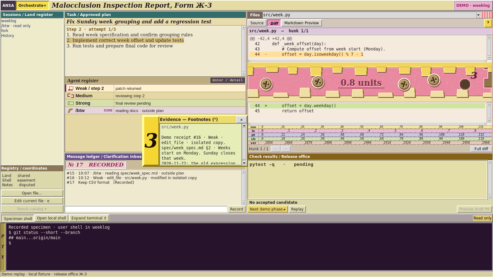

# Форма Ж-3

Графическое окно ANSA для Linux. Слева — реестр разговоров, в центре — план, ведомость агентов и входящие уточнения. Справа — инспектор с асимметричной розовой прокладкой между версиями файла. Пятое отверстие открывает квитанцию выбранной правки. Внизу — терминалы с раздельным вводом.



## Запуск

В графической сессии X11 или Wayland с XWayland из checkout ANSA:

```sh
# Интерактивный образец с заранее подготовленными событиями
nix run .#ansa-form-zh3 -- --demo

# Новый процесс Carbon в этом окне, проект задаёт рабочую папку
nix run .#ansa-form-zh3 -- --cwd /path/to/project

# Проверка встроенного Carbon локальным офлайн-провайдером
nix run .#ansa-form-zh3 -- --offline --cwd /path/to/project
```

Тот же вход из исходников — `python3 -B integrations/form-zh3/app.py`. Для самой формы нужен Tk. Для встроенных терминалов нужны xterm и python-xlib, для редактора — Neovim или Vim, для сравнения с HEAD — Git. Пакет Nix предоставляет эти зависимости и Rust-бинарь ANSA. Параметр `--ansa /absolute/path/to/ansa` выбирает уже собранный бинарь.

## Что можно делать

| Где | Действие |
|---|---|
| Реестр агентов | Щёлкнуть по роли или выбрать её стрелками и нажать Enter. Открывается полное описание состояния. Esc закрывает запись. У бокового разговора собственная метка SIDE. |
| Файлы | `Ctrl+F` открывает файл проекта. Вкладки показывают Source, Diff и Markdown Preview. Стрелки рядом с номером хунка переключают изменения. Full diff открывает весь патч. Кнопка ³, пятое отверстие и F3 в инспекторе открывают источник данных. |
| Редактор | Для файла, открытого с диска, `e` в инспекторе или Edit current file запускает Neovim/Vim в нижнем отсеке. При переключении вкладок буфер сохраняется. После выхода через `:wq` или `:q` инспектор перечитывает выбранный файл. Копии из ревью доступны для чтения. |
| Терминалы | Carbon получает клавиатуру в своей вкладке. Open local shell запускает отдельный интерактивный shell пользователя в каталоге проекта. Expand terminal увеличивает отсек. В виджетах формы `Ctrl+T` открывает список терминалов. Само открытие списка сохраняет фокус задачи и состояние процессов. Внутри xterm действуют сочетания самого приложения. |
| Реальный разговор | Ввод, Work, Plan, Orchestrate, Orchestrate+, `/btw`, `/sessions`, `/resume`, выбор моделей, подтверждение плана и приёмка доступны во встроенном Carbon. После приёмки выбранные изменения можно опубликовать через `gh` из локального shell или поручить это агенту в Carbon. |
| Замороженное ревью | Frozen review открывает нативный `approved-plan.json` из `verification-N/` или `plus-review-views/candidate-N/`. Отдельное окно содержит сохранённый план и патч. В Orchestrate+ оно также показывает записанные результаты шагов и текст уточнений. Перечисленные в плане команды помечены как предусмотренные. |
| Демосцена | Начальное состояние — Weak вернул правку, Medium проверяет шаг, Strong ожидает финального ревью. Нажмите Record, чтобы добавить уточнение. Next demo phase доставляет его, затем показывает завершение тестов и решение Strong. Лишь после этого доступен локальный предпросмотр PR. Выбор `/btw` занимает правый отсек, Esc возвращает к тому же файлу. Replay начинает сцену заново. |

### Подключение к уже открытому Carbon

```sh
# В первом терминале
endpoint=$(mktemp -d)
printf '%s\n' "$endpoint"
ansa --cwd /path/to/project --workspace-dir "$endpoint"

# Во втором подставьте каталог, напечатанный первой командой
nix run .#ansa-form-zh3 -- --cwd /path/to/project --workspace-dir /path/to/endpoint
```

Роль viewer получает фазу, последние подтверждённые сообщения, явно помеченное предварительное сообщение и каталог доступных результатов. Подготовленные редактором выдержки, патчи, Markdown и CSV открываются по разрешениям текущего подключения. Выбранный с диска файл сравнивается с конкретным Git HEAD. Текст для просмотра ограничен 256 КиБ, сравнение — 4096 строк на версию.

Workspace v1 закрепляет просмотр за исходной сессией и её incarnation. При переключении разговора внутри Carbon этот просмотр продолжает показывать исходную сессию. Текущие роли, результаты проверок и допуск к публикации смотрите в управляющем Carbon. Данные замороженного ревью и демонстрационный прогон имеют отдельные метки. После потери соединения форма отмечает сохранённую историю и даёт команду Reconnect viewer. В среде без именованных Unix-сокетов `--terminal-only --offline` запускает Carbon в форме с отключённым viewer. [Workspace protocol v1](../../docs/WORKSPACE_PROTOCOL.md)

## Проверка

```sh
cd integrations/form-zh3
python3 -B -m unittest discover -v
```

Графическим тестам нужен дисплей X11 с расширением XTEST. В headless-среде подойдёт `xvfb-run -a`. Для сквозного теста укажите абсолютный путь к собранному Rust-бинарю в переменной `ANSA_TEST_BIN`. Офлайн-тесты используют временные каталоги.
